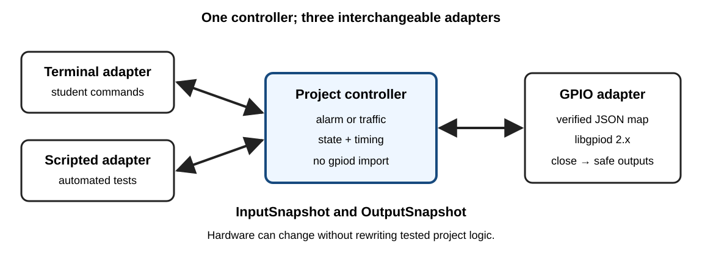
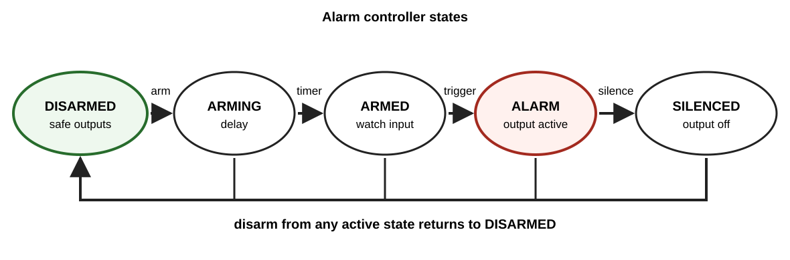
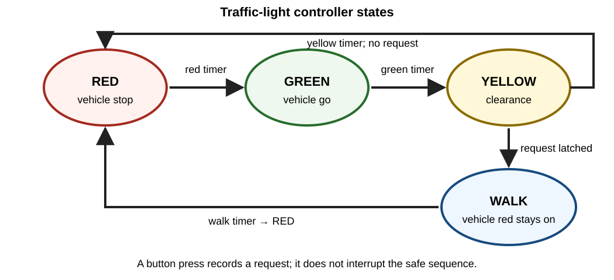

## One contract for every project

Every input/output adapter provides three operations:

```text
read_inputs() -> InputSnapshot
write_outputs(OutputSnapshot) -> None
close() -> None
```

`InputSnapshot` contains logical actions:

```text
arm, disarm, trigger, silence, pedestrian, ambient_value
```

`OutputSnapshot` contains logical commands:

```text
red, yellow, green, status, alarm, relay, pedestrian_walk
```

Unused values stay false or empty. Project code uses these exact names. It does
not import `gpiod` or duplicate electrical pin mappings.

{fig-alt="A central project controller is linked to terminal, scripted-test, and GPIO adapters using one common snapshot contract." width="100%"}

The supplied libgpiod adapter handles digital input and output only. A night
light using an analogue or I2C sensor needs a separately reviewed adapter that
converts the approved sensor reading into `ambient_value`.

## Why logical values matter

A physical button may be active-low: pressing it makes the voltage low. The GPIO
adapter interprets that electrical detail and returns `trigger=True`. The alarm
controller therefore asks only whether the trigger is active, not how it is
wired.

Likewise, `relay=True` is only a requested function. It does not authorize a
relay coil connection. The approved driver and external supply remain part of
the electrical project.

## Alarm states

| State | Main outputs | Normal transition |
|---|---|---|
| DISARMED | green/status | `arm` → ARMING |
| ARMING | blinking yellow | timer complete → ARMED |
| ARMED | red/status | `trigger` → ALARM |
| ALARM | alarm and relay active | `silence` → SILENCED |
| SILENCED | red/status | `disarm` → DISARMED |

`disarm` returns every active state to the safe DISARMED state.

{fig-alt="Five oval alarm states joined from left to right. A separate lower return path shows disarm returning active states to DISARMED." width="100%"}

## Traffic-light states

The default sequence is RED → GREEN → YELLOW → RED. A pedestrian request is
latched and inserts a protected WALK state after YELLOW. Vehicle red remains on
during WALK.

All durations come from configuration objects. Tests advance a supplied
monotonic time value; they do not wait for real seconds.

{fig-alt="Four traffic states with arrows for normal timing and an alternate pedestrian-request path from yellow through walk to red." width="100%"}

All three software figures are original course diagrams generated from the
tested Python state machines in this platform. They describe the supplied code,
not an external tutorial implementation.

## Test without hardware

```sh
python3 -m unittest discover -s tests -v
python3 simulate.py alarm
python3 simulate.py traffic
```

The terminal adapter and automated `ScriptedAdapter` implement the same contract
as GPIO. This allows a group waiting for hardware to finish meaningful state,
timing, logging, and troubleshooting work.

## Current GPIO implementation

Only `tej_platform/gpio_adapter.py` imports `gpiod`. It uses the current
libgpiod 2.x Python request API documented by the
[libgpiod project](https://libgpiod.readthedocs.io/en/v2.3/python_api.html).
Older images are a teacher compatibility decision, not something student code
silently guesses.

## Project-author interface contract

An individual project page should provide:

1. which logical inputs and outputs it uses;
2. the state/timing configuration it changes;
3. an approved electrical schematic kept separate from Python;
4. a verified JSON GPIO mapping supplied by the teacher;
5. a terminal-simulation route;
6. a `Ctrl+C`/`close()` safe-state check;
7. an honest data origin in every log.

Do not publish a header mapping until it has been verified on the exact classroom
board and image.
