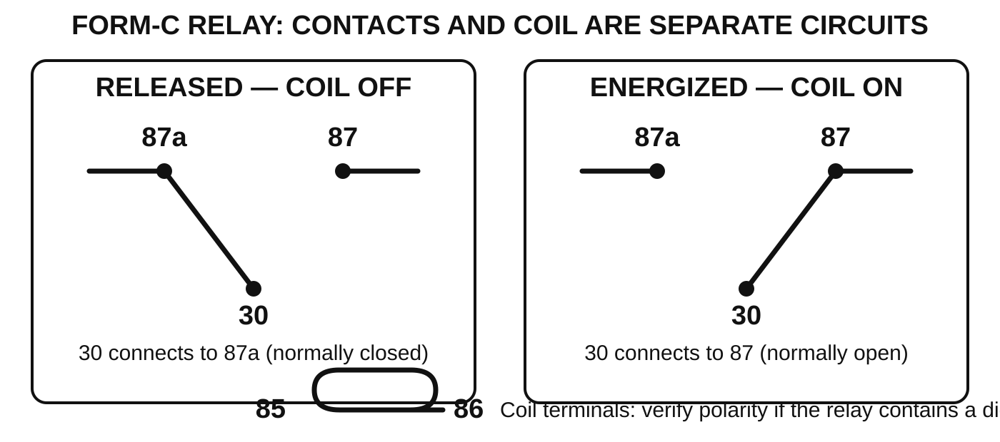
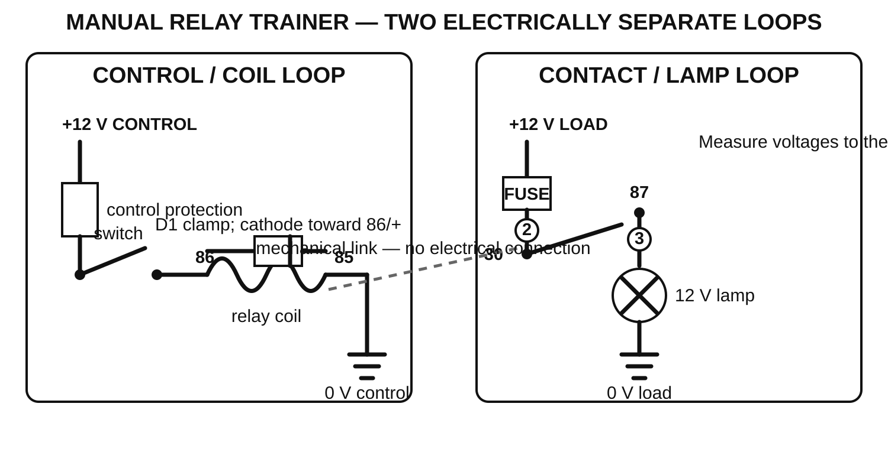
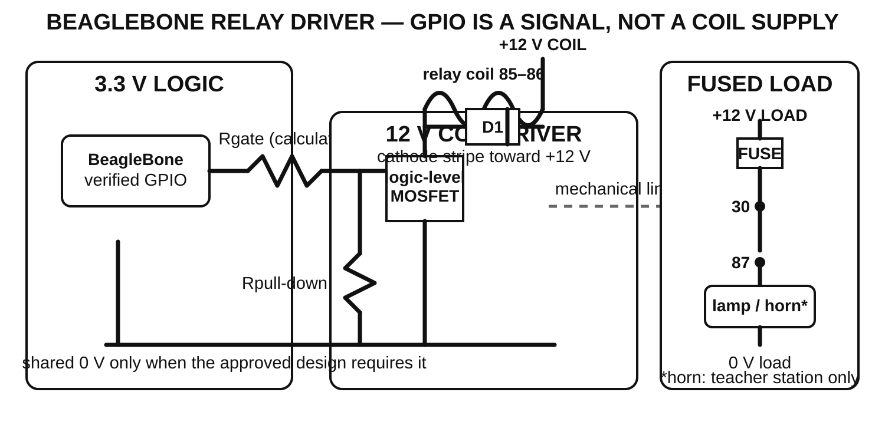

An automotive relay lets a small control current operate a separate load circuit. In this project, the normal load is a lamp. A real horn is an optional teacher-supervised extension, not a student bench load.

::: {.callout-important title="Approval before power"}

Do not energize an unidentified relay. Read the diagram printed on the actual case and confirm it with the manufacturer's datasheet. Terminal position is not guaranteed by the terminal number, case shape, colour, or a diagram for a different part.

Use a relay socket, a teacher-approved current-limited and fused 12 V DC source, correctly rated wiring, and a lamp as the first load. Never connect a relay coil, lamp, or horn directly to a BeagleBone GPIO pin.

:::

## What the terminal numbers mean

The common five-terminal changeover arrangement normally uses these functional numbers. The actual relay must still be verified.

| Terminal | Normal function | Circuit side |
|---:|---|---|
| 85 | one side of the relay coil | control |
| 86 | other side of the relay coil | control |
| 30 | moving contact, also called common | load |
| 87 | normally open contact; connects to 30 when energized | load |
| 87a | normally closed contact; connects to 30 when released | load |

A four-terminal normally open relay may not have 87a. A relay with an internal diode is polarity-sensitive at 85 and 86. A relay with an internal resistor behaves differently. The case diagram and exact datasheet decide.

### Contact states

{fig-alt="Two large side-by-side relay diagrams. Released: terminal 30 touches 87a and 87 is open. Energized: terminal 30 touches 87 and 87a is open. A separate coil is labelled 85 and 86." width="100%"}

This is an original redraw of a common form-C arrangement described in the [TE Connectivity Micro Relay A data sheet](https://www.te.com/content/dam/te-com/documents/automotive/global/ENG_DS_V23074-X0000-A001_0615.pdf). It explains function, not physical socket position. Match the case diagram and exact data sheet for the relay in your hand.

## Two circuits in one device

### Coil or control circuit

The coil circuit contains its own source, protection, control switch or transistor, coil, and return. When coil current flows, the magnetic field moves the contact.

For a manually controlled reference build, trace:

**control source → control protection → switch → coil → return**

The coil's measured resistance can support a first current estimate only after the datasheet has confirmed that a resistance measurement is suitable for that part:

$$
I_{coil}\approx\frac{V_{coil}}{R_{coil}}.
$$

### Contact or load circuit

The contact circuit is electrically separate from the coil circuit. For the normally open lamp path, trace:

**12 V load source → fuse → terminal 30 → terminal 87 → lamp → return**

With the relay released, 30 normally connects to 87a instead. Verify both states with power removed and continuity mode before connecting the 12 V supply.

### Manual two-loop reference circuit

{fig-alt="A left control loop carries a protected 12 volt supply through a switch and relay coil 86 to 85. A right load loop carries a separately fused 12 volt supply through relay contacts 30 and 87 and a lamp. A dashed mechanical link joins coil and contact without an electrical connection." width="100%"}

The dashed line is a **mechanical** link. It is not a wire. The two 0 V references may be separate; connect them only when the approved design calls for it. The lamp is the normal classroom load.

## Choose a pathway

### Minimum: identify and operate

1. Record the relay manufacturer, exact part number, coil voltage, case diagram, contact form, and contact rating.
2. Map the socket wires to 30, 85, 86, 87, and 87a with power removed.
3. Verify released-state continuity between 30 and 87a, and an open circuit between 30 and 87.
4. Build the fused lamp circuit using the normally open contact.
5. Measure the source voltage, coil voltage, and lamp voltage in both relay states.
6. Explain why the control and load currents are not the same current.

### Proficient: analyze and troubleshoot

Complete the minimum pathway, then:

- label the coil loop and the active load loop;
- identify at least two KVL checks and one KCL node;
- predict and measure four voltage test points;
- diagnose two teacher-inserted reversible faults;
- explain the difference between a released relay, an energized relay, and a failed load;
- document contact voltage drop without putting a handheld meter in current mode.

### Extension: control from a BeagleBone

Replace the manual coil switch with a teacher-approved driver stage:

**3.3 V GPIO → base/gate resistor → transistor or logic-level MOSFET → relay coil**

Place a flyback diode across a plain DC coil with its cathode toward the positive coil supply. Confirm whether the relay already contains suppression before adding anything. Use a separate fused load supply. Use a documented shared reference only when the approved driver design requires it; an opto-isolated module may use a different arrangement.

The extension must include a default-off state, a software stop method, and a hardware means to remove load power. The BeagleBone Black expansion I/O is a 3.3 V domain; it does not supply relay-coil or horn current. See the official [BeagleBone Black overview](https://docs.beagleboard.org/boards/beaglebone/black/ch04.html).

### GPIO driver reference

{fig-alt="A verified 3.3 volt GPIO drives a logic-compatible MOSFET through a calculated resistor. A pull-down holds it off. A separate 12 volt supply powers relay coil 85 to 86 and a labelled flyback diode is across the coil. Isolated relay contacts switch a separately fused lamp or teacher-supervised horn." width="100%"}

The drawing is a topology, not a parts list. Confirm the MOSFET pinout and logic-level operation, calculate the gate and pull-down resistors, and select the flyback diode from the measured coil current and switching requirements. If the relay already contains a diode or resistor, follow its exact data sheet instead of adding parts by habit.

## Parts and approval record

| Item | Requirement to record before use |
|---|---|
| Automotive relay | exact part number, coil voltage, form A/form C, internal suppression, coil current or resistance, contact rating |
| Relay socket | wire-to-terminal map, conductor size, secure insulated connections |
| 12 V DC source | current limit, maximum available current, polarity, teacher approval |
| Fuse and holder | fuse type and rating selected for the wiring and reference load |
| Lamp | rated voltage and power/current |
| Switch | DC voltage/current rating |
| Driver extension | transistor/MOSFET part number, pinout, ratings, resistor value, diode part and orientation |
| Horn extension | rated voltage, measured or documented current, fuse, sound-control plan |

## Voltage test points

Use the supply negative terminal as the 0 V reference unless the approved schematic states otherwise.

| Test point | Relay released: prediction | Relay energized: prediction | Measured | Meaning |
|---|---:|---:|---:|---|
| TP1: source positive after fuse |  |  |  | confirms protected supply |
| TP2: terminal 30 |  |  |  | confirms feed to common contact |
| TP3: terminal 87 |  |  |  | reveals NO contact state |
| TP4: lamp positive |  |  |  | confirms voltage reaches load |
| TP5: coil high side |  |  |  | confirms control feed |
| TP6: transistor/coil low side |  |  |  | helps distinguish off, on, and open return |

## KVL and KCL checks

For the energized lamp loop, an ideal first model is

$$
V_S=V_{fuse}+V_{wire}+V_{30\rightarrow87}+V_{lamp}+V_{return}.
$$

Small wiring, fuse, and closed-contact drops may be treated as approximately zero for a first calculation, but measured results should not be forced to equal the ideal model.

At a protected supply node feeding more than one branch, KCL gives

$$
I_{source}=I_{coil}+I_{lamp}+I_{other\ branches}.
$$

The source current is not automatically equal to the current in one load branch. Calculate lamp current from its documented rating for a first estimate, or use a teacher-approved current clamp or protected measurement method suitable for the expected range.

## Four reversible fault challenges

The teacher inserts only one fault at a time with power removed.

1. **Open control switch:** the load supply remains present, but the coil never energizes.
2. **Removed load fuse:** the relay clicks, but terminal 30 loses its protected feed.
3. **Lamp return disconnected:** terminal 87 becomes live when energized, but the lamp has no complete path.
4. **Load connected to 87a instead of 87:** the lamp operates in the opposite relay state.

Do not create a deliberate short circuit, bypass the fuse, reverse a polarity-sensitive coil, or exceed a component rating as a fault exercise.

## Safe current strategy

Start with voltage measurements. Calculate expected lamp current from the rated power:

$$
I\approx\frac{P}{V}.
$$

Measure current directly only with a teacher-approved protected method and a meter/range suitable for the expected value. A clamp requires one conductor, not the whole two-conductor cable, inside the jaw. A typical clamp may not resolve relay-coil current accurately. Never move a meter lead into a current jack while the probes remain across a source.

## Success criteria

- The exact relay and socket mapping are documented from reliable evidence.
- The circuit is fused and the lamp is the standard first load.
- Released and energized contact states agree with continuity and voltage tests.
- Coil and load circuits are explained separately.
- KVL and KCL statements match the actual nodes and loops.
- At least two faults are diagnosed from evidence rather than guessed parts replacement.
- The extension, if used, includes a driver and flyback protection; GPIO never drives the coil directly.

## Portfolio evidence

Include the approved schematic, actual part identification, terminal map, predicted/measured voltage table, KVL/KCL checks, one clear build photograph, one fault diagnosis, driver calculation if attempted, safety decisions, and a conclusion that names limitations.

## References

- [BeagleBone Black features and I/O voltage domains](https://docs.beagleboard.org/boards/beaglebone/black/ch04.html)
- [TE Connectivity Micro ISO relay data sheet: example of part-specific coil, contact, form, and suppression information](https://www.te.com/content/dam/te-com/documents/automotive/global/ENG_DS_V23074-X0000-A001_0615.pdf)
- [Texas Instruments: switching inductive loads and the effect of a freewheeling path](https://www.ti.com/document-viewer/lit/html/SLVAF04/GUID-6EC58385-6811-4984-B5CF-9CD8D8E7D24E)

These references show why the exact board and relay must be identified. They do not replace the datasheet for the classroom relay.

