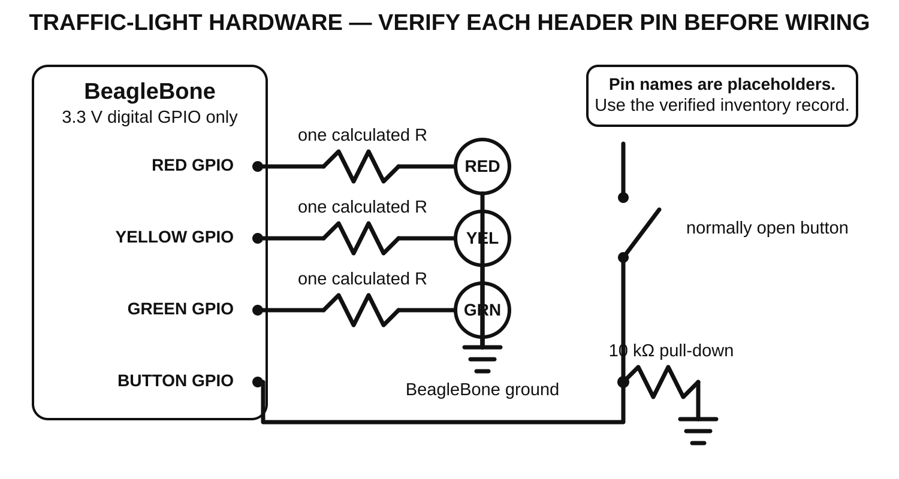
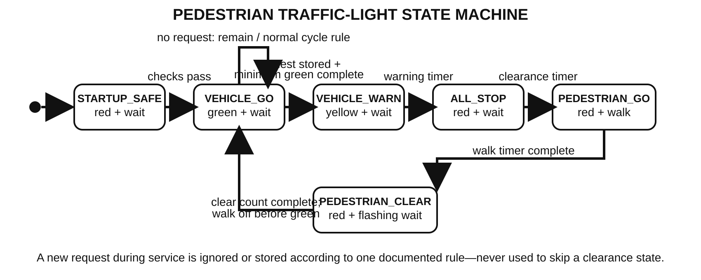

This project joins Linux, Python, digital inputs, resistor-limited LEDs, timing, and state-machine design. The first gate is one LED. A group does not receive three-light parts until the one-output circuit and test pass.

::: {.callout-important title="GPIO boundary"}

Confirm the exact BeagleBone model, Linux image, pin configuration, and header map before wiring. BeagleBone Black expansion I/O uses 3.3 V signals. Do not apply 5 V to an I/O pin, and do not assume a pin is free merely because it appears on a generic pinout. See the official [BeagleBone Black documentation](https://docs.beagleboard.org/boards/beaglebone/black/ch04.html).

:::

## System goal

Create a model intersection with red, yellow, and green vehicle indicators plus a pedestrian request input. The controller must start in a known safe state, use an understandable finite-state machine, and return to normal operation after serving a request.

This is a tabletop logic model, not a controller for a road, vehicle, or safety-critical installation.

## Choose a pathway

### Minimum: one LED gate and timed sequence

1. Calculate and install a suitable resistor for one LED using the approved GPIO voltage, measured or documented LED forward voltage, and a conservative target current.
2. Run a teacher-approved Python output test.
3. Measure the LED resistor voltage and calculate current using $I=V_R/R$.
4. Add red, yellow, and green LEDs, each with its own resistor.
5. Implement a repeating green → yellow → red sequence.
6. Stop the program and confirm that the required safe state is documented.

### Proficient: pedestrian state machine

Complete the minimum pathway, then add:

- a pedestrian request button with a defined idle state;
- software debouncing or a documented approved input strategy;
- named states and one transition rule per state;
- a request that is remembered and served safely;
- a walk indicator or accessible alternative;
- unit tests for the hardware-independent transition logic;
- a keyboard simulator that uses the same state-machine rules.

### Extension: accessible and observable controller

Add one or more:

- a quiet active buzzer with an approved driver, or a distinct visual pulse pattern;
- adjustable timings stored in a configuration file;
- timestamped event logging;
- a night mode or maintenance state;
- a second request input;
- fault detection that forces a documented safe output pattern;
- a small local status page that never exposes classroom network information.

## Parts

| Item | Minimum requirement |
|---|---|
| BeagleBone | exact model and verified Linux/GPIO environment |
| LEDs | red, yellow, green; record part or measured forward voltage used in the calculation |
| Resistors | one independently calculated and approved resistor per LED |
| Pushbutton | normally open momentary switch with a defined pull-up or pull-down strategy |
| Breadboard and jumpers | inspected, with rails and connected groups mapped before power |
| Optional audible output | low-current active buzzer with approved transistor/driver when required |
| Meter | voltage mode first; black lead in COM and red lead in V/Ω |

## Resistor calculation

For each LED, use

$$
R\geq\frac{V_{GPIO}-V_F}{I_{target}}.
$$

Choose the next suitable available resistance that keeps current conservative. Then check resistor power:

$$
P_R=I^2R.
$$

Do not copy an Arduino resistor value without doing the BeagleBone calculation and checking the actual LED.

### Hardware reference diagram

{fig-alt="A BeagleBone has three verified output pins. Each output has its own calculated resistor and red, yellow, or green LED to ground. A fourth verified pin reads a normally open button to 3.3 volts and has a 10 kilo-ohm pull-down to ground. No wires cross." width="100%"}

The exact header pins are intentionally left blank until the classroom board, Linux image, and pin mode are verified. This original redraw follows the one-LED pattern in the official [BeagleBone Cookbook external-LED tutorial](https://docs.beagleboard.org/books/beaglebone-cookbook/03displays/displays.html), then repeats the independently current-limited branch three times.

## Required states

Use descriptive names in the program. One workable model is:

| State | Vehicle red | Vehicle yellow | Vehicle green | Pedestrian indication | Transition condition |
|---|:---:|:---:|:---:|:---:|---|
| `VEHICLE_GO` | off | off | on | wait | minimum green time complete and request stored |
| `VEHICLE_WARN` | off | on | off | wait | warning timer complete |
| `ALL_STOP` | on | off | off | wait | clearance timer complete |
| `PEDESTRIAN_GO` | on | off | off | walk | walk timer complete |
| `PEDESTRIAN_CLEAR` | on | off | off | flashing wait | clearance count complete |
| `STARTUP_SAFE` | on | off | off | wait | initialization checks complete |

Your final state diagram must show every state, transition condition, initial state, and the response to a new request while one is already pending.

### State diagram

{fig-alt="The initial arrow enters Startup Safe, then Vehicle Go. A stored request after minimum green leads to Vehicle Warn, All Stop, Pedestrian Go, Pedestrian Clear, and back to Vehicle Go. A no-request loop remains at Vehicle Go." width="100%"}

Trace the arrows with the timing table and code. If your design adds a normal no-request cycle, night mode, or fault state, update all three together. Never let a new request skip VEHICLE_WARN or ALL_STOP.

## Timing plan

Use short classroom demonstration timings rather than real transportation timings. Record them in one configuration table instead of scattering unexplained numbers through the code.

| Timing name | Planned value | Test tolerance | Reason |
|---|---:|---:|---|
| minimum green |  |  |  |
| yellow warning |  |  |  |
| all-red clearance |  |  |  |
| pedestrian walk |  |  |  |
| pedestrian clearance pulse |  |  |  |
| input debounce |  |  |  |

## Software structure and tests

Separate the transition logic from GPIO access. The same state-machine function must run with:

1. a keyboard simulator on an ordinary Linux computer; and
2. the approved BeagleBone input/output adapter.

Minimum automated tests should verify:

- startup enters the safe state;
- no request produces the normal vehicle sequence;
- a request is remembered until it can be served;
- green and red vehicle outputs are never on together;
- pedestrian walk is never on with vehicle green;
- a repeated request does not corrupt the state;
- a simulated stop or exception invokes the documented cleanup behaviour.

## Voltage checks

| Check | Prediction | Measured | Unit | Pass/revise |
|---|---:|---:|---|---|
| GPIO high to ground |  |  | V |  |
| red LED resistor drop |  |  | V |  |
| yellow LED resistor drop |  |  | V |  |
| green LED resistor drop |  |  | V |  |
| button idle input |  |  | V |  |
| button active input |  |  | V |  |

Use voltage across each resistor to calculate LED current. Do not use a GPIO pin as a current source for a relay, lamp, motor, or automotive buzzer.

## Test plan

1. Run the keyboard simulator and record a complete request cycle.
2. Unit-test the transition logic without importing GPIO libraries.
3. Test one resistor-limited LED from a short approved output script.
4. Add and test each remaining LED one at a time.
5. Verify the button voltage before allowing software to read it.
6. Run the full state machine with the audible output disconnected.
7. Add the optional output only after its driver and safe state pass inspection.
8. Run at least ten request cycles, including a press during every state.

## Troubleshooting sequence

1. Stop the program and remove external circuit power before moving wires.
2. Confirm the exact header pin and current pin configuration.
3. Test the state logic in the keyboard simulator.
4. Run a one-output test for the affected LED.
5. Measure the GPIO and resistor voltages.
6. Confirm LED polarity and that its leads are in different nodes.
7. Check the input idle and active voltages.
8. Change one thing, repeat the same test, and record the result.

## Success criteria

- Every LED is independently current-limited.
- The first physical gate uses only one output.
- The controller starts in a documented safe state.
- The state diagram, timing table, and program agree.
- A request is served without unsafe output combinations.
- Hardware-independent Python tests pass.
- The keyboard fallback demonstrates the same logic.
- Measurements support the circuit calculations.
- At least one revision is based on test evidence.

## Portfolio evidence

Include the system goal, GPIO/parts table, resistor calculations, state diagram, timing table, code structure, test results, voltage table, one useful failure and revision, accessible-output decision, clear build image, and a conclusion that distinguishes a classroom model from a safety-certified traffic controller.

## References

- [BeagleBone Black features, expansion interfaces, and voltage domains](https://docs.beagleboard.org/boards/beaglebone/black/ch04.html)
- [BeagleBone Cookbook: external LED, series resistor, and conservative GPIO current](https://docs.beagleboard.org/books/beaglebone-cookbook/03displays/displays.html)
- [BeagleBone Black documentation licence: CC BY-SA 4.0](https://docs.beagleboard.org/boards/beaglebone/black/index.html)

