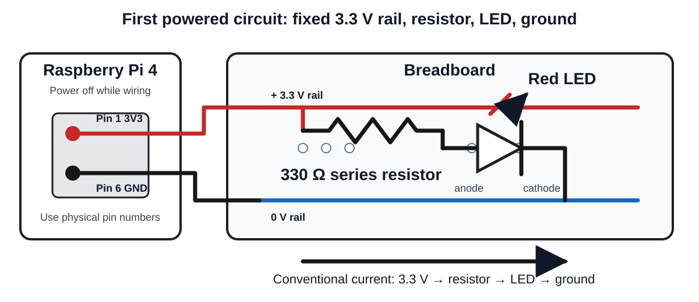
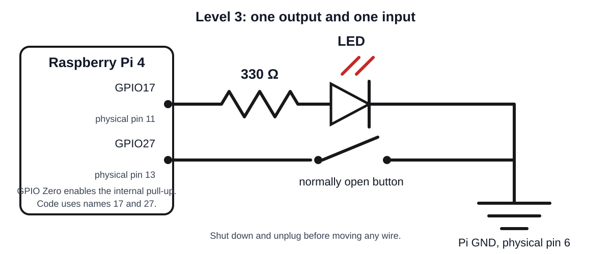

## Your mission

Make one red LED light from a Raspberry Pi's **fixed 3.3 V power pin**. Before power is connected, prove how the breadboard is connected and calculate the LED current. Then measure the working circuit.

This is a hardware lesson. You do not need to write Python to complete the mission.

::: {.callout-important title="Minimum success"}
Your pair is finished when you can show:

1. two breadboard holes that are connected and two that are not;
2. a correct current calculation for a 330 Ω resistor;
3. a resistor-limited LED circuit that passes the power-off check;
4. the lit LED and one measured voltage;
5. a correct Raspberry Pi shutdown and a complete equipment return.
:::

## Equipment for each pair

| Equipment | Quantity |
|:--|--:|
| Raspberry Pi 4 with microSD card and power supply | 1 |
| monitor, keyboard, and mouse | 1 set |
| breadboard | 1 |
| red LED | 1 |
| 330 Ω resistor | 1 |
| female-to-male jumper wires, one red and one black | 2 |
| short breadboard jumper wires | 2 |
| multimeter and test leads | 1 |

One person is the **builder** and one is the **checker**. Swap jobs after Step 2.

## Safety rules

1. Turn the Raspberry Pi off and unplug its power before changing wires.
2. Never connect 3.3 V directly to ground.
3. Never connect an LED without a series resistor.
4. Use **physical pin 1 for 3.3 V** and **physical pin 6 for ground** only after checking the header orientation.
5. Stop for the teacher's power-off check before plugging in the Pi.
6. Do not connect a motor, pump, relay, horn, lamp, large buzzer, or LED strip to the Pi header.

The Raspberry Pi documentation warns that incorrect header alignment can damage the board. Raspberry Pi GPIO uses 3.3 V logic and is not 5 V tolerant. This first circuit uses a fixed power pin, not a programmable GPIO pin. See the official [Raspberry Pi pin layout and electrical warnings](https://www.raspberrypi.com/documentation/computers/raspberry-pi.html#gpio).

## Step 1: shut down and identify the pins

1. Start the Raspberry Pi normally.
2. Open Terminal and run:

   ```sh
   pinout
   ```

3. Find **physical pin 1**, labelled `3V3`, and **physical pin 6**, labelled `GND`.
4. Shut down with:

   ```sh
   sudo shutdown -h now
   ```

5. Wait until the Pi has stopped, then unplug its power supply.

Do not count pins by guessing. Physical pin 1 is identified by the board's printed markings and the `pinout` map.

## Step 2: map the breadboard with continuity mode

The breadboard must be completely unpowered.

1. Put the black lead in `COM` and the red lead in the voltage/resistance jack.
2. Select continuity mode.
3. Touch the probes together. The meter should beep or show nearly 0 Ω.
4. Test two holes in the same five-hole terminal strip. Record **connected** or **not connected**.
5. Test two holes on opposite sides of the centre gap.
6. Test the two ends of one power rail. Some breadboards have a break in the middle.

| Test | Prediction | Meter result |
|:--|:--|:--|
| Same five-hole strip | | |
| Across the centre gap | | |
| Two ends of one power rail | | |

## Step 3: predict the LED current

Use a first model of 2.0 V across a red LED.

$$
I=\frac{V_S-V_{LED}}{R}
=\frac{3.3\,\mathrm{V}-2.0\,\mathrm{V}}{330\,\Omega}
=0.0039\,\mathrm{A}
=3.9\,\mathrm{mA}
$$

Copy the calculation and include the units. Your answer should be close to **3.9 mA**.

## Step 4: build with the power off

{fig-alt="Clean left-to-right wiring diagram. Raspberry Pi physical pin 1 supplies 3.3 volts to a red breadboard rail. A 330 ohm resistor connects that rail to the LED anode. The LED cathode connects to the blue ground rail, which returns to Raspberry Pi physical pin 6." width="100%"}

1. Connect Pi physical pin 1 to the breadboard's red rail.
2. Connect Pi physical pin 6 to the breadboard's blue or black ground rail.
3. Place the 330 Ω resistor from the 3.3 V rail to an unused terminal strip.
4. Put the LED's **anode** in the same terminal strip as the resistor's free end.
5. Put the LED's **cathode** in a different terminal strip.
6. Connect the cathode's terminal strip to the ground rail.

For a standard through-hole LED, the longer lead is usually the anode. The shorter lead and flat edge usually identify the cathode. Check both clues.

## Stop: teacher power-off check

Do not plug in the Raspberry Pi yet. Show the teacher or approved checker:

1. the correct pin 1 and pin 6 locations;
2. no direct connection between the 3.3 V and ground rails;
3. the 330 Ω resistor in series with the LED;
4. the LED polarity;
5. red wire for 3.3 V and black wire for ground.

## Step 5: power and measure

After approval:

1. Plug in the Raspberry Pi and let it start. The LED should light.
2. Set the meter to DC volts.
3. Keep the black probe on the ground rail.
4. Measure the 3.3 V rail. Record the result.
5. Measure the LED anode to ground. Record the result.
6. Measure the LED cathode to ground. It should be close to 0 V.
7. Shut down the Pi before changing anything.

| Measurement | Expected | Actual |
|:--|--:|--:|
| 3.3 V rail to ground | about 3.3 V | |
| LED anode to ground | about 2.0 V | |
| LED cathode to ground | about 0 V | |

Do not move the red meter lead to the current jack. We calculate current from voltage and resistance in this first mission.

## If the LED does not light

Check one thing at a time:

1. Is the Raspberry Pi fully started?
2. Is the red jumper on physical pin 1 and the black jumper on physical pin 6?
3. Does the power rail have 3.3 V?
4. Are the resistor and LED leads actually in connected breadboard holes?
5. Is the LED reversed?
6. Is the resistor 330 Ω rather than 330 kΩ?

Record the fault you found and the change that fixed it. If the 3.3 V rail is missing, shut down and ask for help.

## Evidence to submit

1. the completed current calculation;
2. the breadboard continuity table;
3. the voltage table;
4. one clear **Level 1 photo** showing the whole circuit and wire colours;
5. one sentence naming any fault and the fix, or `Worked after the power-off check.`

The Level 1 photo is a checkpoint. Do not take Level 1 apart until the photo is clear and the teacher has checked it.

## Continue after the Level 1 photo

Complete the levels in order. Shut down and unplug the Pi before every wiring change. Keep a photo or short video of each working level before moving on.

| Level | Build | Evidence |
|:--|:--|:--|
| 1 | Fixed 3.3 V LED | photo and three voltage readings |
| 2 | Python-controlled blinking LED | photo or short video plus `blink.py` |
| 3 | Pushbutton controls the LED | photo plus `button_led.py` |
| 4 | Reaction timer | five results, best time, and average time |

## Level 2: make Python blink the LED

1. Shut down and unplug the Pi.
2. Move the resistor's supply end from the fixed 3.3 V rail to **physical pin 11**, labelled `GPIO17` by the `pinout` command.
3. Keep the LED, resistor, and ground connection in series.
4. Pass another power-off check, then start the Pi.
5. Open Thonny, create `blink.py`, and type:

   ```python
   from gpiozero import LED
   from time import sleep

   led = LED(17)

   for count in range(10):
       led.on()
       sleep(0.5)
       led.off()
       sleep(0.5)
   ```

6. Run the program. Change `0.5` to make a clearly different blink rate.
7. Save the program and take a short video or a photo while the LED is on.

The code uses the GPIO name `17`, not the physical header number `11`.

## Level 3: add a pushbutton

{fig-alt="Two clear branches from a Raspberry Pi. GPIO17 connects through a 330 ohm resistor and LED to ground. GPIO27 connects through a normally open pushbutton to ground, with the internal pull-up shown inside the Pi." width="100%"}

1. Shut down and unplug the Pi.
2. Place a pushbutton across the breadboard's centre gap.
3. Connect one side of the button to **physical pin 13**, labelled `GPIO27`.
4. Connect the opposite side of the button to the ground rail.
5. Pass another power-off check, then start the Pi.
6. Open Thonny, create `button_led.py`, and type:

   ```python
   from gpiozero import Button, LED
   from signal import pause

   led = LED(17)
   button = Button(27, pull_up=True)

   button.when_pressed = led.on
   button.when_released = led.off

   pause()
   ```

7. Run the program. The LED should turn on while the button is pressed.
8. Save the program and take the Level 3 photo.

If the button does nothing, rotate it 90 degrees only after shutting down and unplugging the Pi. Many four-leg pushbuttons have two legs on each side that are already connected internally.

## Level 4: reaction challenge

Keep the Level 3 circuit. Continue with the [Reaction Timer mission](reaction-timer.qmd). Record five reaction times, then calculate the best and average time.

The next mission is [GPIO Blink and Button](../platform/gpio-progression.qmd).

## Teacher running plan

| Time | What happens |
|:--|:--|
| 0 to 10 min | Show a breadboard, continuity mode, pin 1, pin 6, LED polarity, and the finished circuit. |
| 10 to 22 min | Pairs complete the three continuity tests. |
| 22 to 32 min | Students copy and complete the LED current calculation. |
| 32 to 47 min | Students build with the Pi unplugged. Teacher completes power-off checks. |
| 47 to 58 min | Approved pairs power the circuit, measure three voltages, and take the Level 1 photo. |
| 58 to 68 min | Pairs begin Level 2. Fast pairs continue to Level 3. |
| 68 to 75 min | Students save evidence, shut down, and return the complete kit. |

Prepare each pair's parts in a labelled container. The container number is the equipment checkout number. Count the Pi, power supply, microSD card, breadboard, meter leads, jumpers, LED, and resistor when it is returned.
