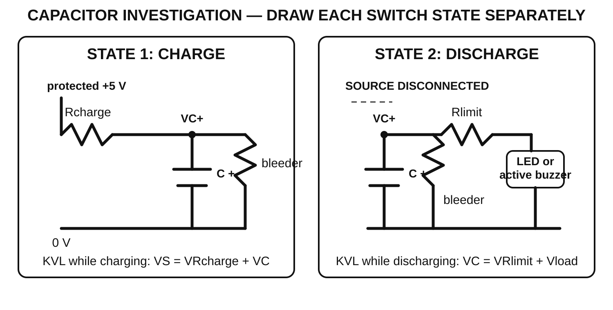
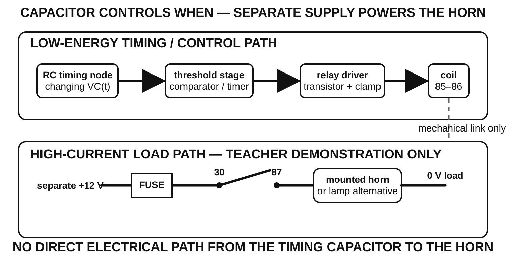

A capacitor can briefly supply energy to a small load, or it can create a timing signal that controls a much larger load. Those are different jobs. This investigation makes the difference measurable.

::: {.callout-important title="Student load and demonstration boundary"}

Students use a resistor-limited LED or a teacher-approved low-current active buzzer at protected extra-low voltage. An automotive horn is used only at a fused, current-limited, teacher-controlled demonstration station. Do not discharge a capacitor directly into a horn, short a capacitor, or connect an electrolytic capacitor with reversed polarity.

:::

## The two models

### Charge and discharge reference

{fig-alt="Left: a protected 5 volt source charges a polarized capacitor through R charge, with a bleeder across the capacitor. Right: the source is disconnected and the capacitor supplies a resistor-limited LED or low-current active buzzer, with the bleeder still present. Charge and discharge KVL equations appear below." width="100%"}

The two switch states are drawn separately so no line crossing or switch ambiguity hides the active loop. The circuit is an original redraw based on the charge/discharge behaviour described in Panasonic's [Basic Knowledge of Capacitors](https://industrial.panasonic.com/ww/ds/ss/technical/b2). Values are not universal: calculate them for the approved source, capacitor, and small load.

### Model 1: the capacitor supplies the load

The capacitor is charged, the source is disconnected, and the capacitor becomes the temporary source for an LED-resistor branch or low-current active buzzer. The stored energy is

$$
E_C=\frac{1}{2}CV_C^2.
$$

Voltage falls as energy leaves, so the LED fades or the buzzer changes and stops.

### Model 2: the capacitor controls timing

The capacitor charges or discharges through a resistor and creates a changing control voltage. A transistor, comparator, timer, or computer input interprets that voltage. A separate supply powers the relay coil and horn or lamp.

**The capacitor decides when; the supply provides the load energy.**

### Teacher demonstration architecture

{fig-alt="The upper low-energy path sends a changing capacitor voltage through a threshold stage and protected relay driver to relay coil 85 and 86. A dashed mechanical link reaches the lower path, where a separate fused 12 volt supply powers a mounted horn or lamp through contacts 30 and 87. There is no direct electrical path from the timing capacitor to the horn." width="100%"}

This is an architecture diagram, not a complete build schematic. The exact threshold device, hysteresis, driver, clamp, relay, fuse, wire, and horn ratings require teacher verification. Students may substitute the lamp and explain the same timing idea without producing sound.

## Choose a pathway

### Minimum: observe stored energy

1. Identify capacitance, voltage rating, tolerance when marked, and polarity.
2. Use a teacher-approved resistor to charge the capacitor from a protected source.
3. Remove the source through the approved switch arrangement.
4. Observe a resistor-limited LED or low-current active buzzer.
5. Record capacitor voltage at regular times until it reaches the specified stop value.
6. Calculate initial stored energy and explain why the output changes.

### Proficient: compare model and evidence

Complete the minimum pathway, then:

- predict the RC time constant $\tau=RC$;
- graph measured capacitor voltage against time;
- apply KVL in the active charge and discharge loops;
- apply KCL at the capacitor/load node;
- estimate capacitor current from voltage change;
- compare energy available from two capacitance values;
- calculate why the same parts cannot sustain a real automotive horn.

### Extension: capacitor-timed relay or computer input

Use the capacitor voltage only as a control signal. Add a teacher-approved transistor/comparator/timer circuit or protected compatible computer input. The control stage switches a relay; the relay contacts switch the separately fused lamp or horn supply.

The extension must define the turn-on/turn-off threshold, protect the input, include coil flyback suppression where needed, and show that the relay coil is not powered by a GPIO pin.

## Suggested student parts

| Item | Starting purpose | Approval information |
|---|---|---|
| 5 V protected source | low-energy student circuit | current limit and polarity |
| Electrolytic capacitor | visible storage interval | capacitance, voltage rating above source, polarity, condition |
| Charging resistor | limit initial current | resistance and power rating |
| LED and resistor | visible output | polarity, forward-voltage model, current limit |
| Low-current active buzzer | optional audible output | operating voltage, documented current, polarity, whether it is active or passive |
| Discharge/bleeder resistor | known safe discharge path | resistance and power rating |
| Switch | select charge/discharge state | contact arrangement and rating |

Do not choose a buzzer from appearance alone. An active buzzer produces a tone from DC; a passive transducer needs a changing waveform. Record the exact part.

## Core calculations

### Stored energy

For a capacitor charged to $V_0$,

$$
E_0=\frac{1}{2}CV_0^2.
$$

A 4700 µF capacitor charged to 5.0 V stores ideally

$$
E_0=\frac{1}{2}(0.0047)(5.0)^2\approx0.059\ \text{J}.
$$

That is enough to make a low-current indicator visibly or audibly change for a short time. It is not a large energy supply.

### Changing current

Capacitor current and voltage are related by

$$
i_C=C\frac{dv_C}{dt}.
$$

Over a short measured interval, use the finite-difference estimate

$$
I_C\approx C\frac{\Delta V_C}{\Delta t}.
$$

When a load draws approximately constant current over a limited interval, rearrange this as a design estimate:

$$
C\approx\frac{I\Delta t}{\Delta V}.
$$

This estimate is not exact for a horn, LED, relay, or buzzer because their current can change with voltage.

## Why an ordinary capacitor cannot sustain a horn

Use a documented or measured horn current only at the teacher station. For an illustrative calculation, suppose a 12 V horn draws 5 A and the design allows the capacitor to fall by 4 V in only 0.10 s:

$$
C\approx\frac{(5\ \text{A})(0.10\ \text{s})}{4\ \text{V}}=0.125\ \text{F}=125{,}000\ \mu\text{F}.
$$

That ideal estimate is already far larger than the common 1000–4700 µF classroom parts, and it ignores equivalent series resistance, changing horn current, wiring loss, and the minimum voltage needed for the horn to sound. The physical student experiment therefore uses the capacitor for a small load or control timing, not direct horn power.

## KVL and KCL

During a simple RC charge,

$$
V_S=V_R+V_C.
$$

During capacitor discharge through a resistor and LED,

$$
V_C=V_R+V_{LED}.
$$

If a charged capacitor node feeds an LED branch, buzzer branch, and bleeder branch, KCL gives

$$
I_C=I_{LED}+I_{buzzer}+I_{bleeder}.
$$

Current directions must be defined on the submitted schematic. KVL and KCL still apply while values change with time; one measurement is only one instant of that process.

## Measurement table

| Time (s) | $V_C$ (V) | $V_R$ (V) | Output observation | Estimated $I_C$ (mA) |
|---:|---:|---:|---|---:|
| 0 |  |  |  |  |
|  |  |  |  |  |
|  |  |  |  |  |
|  |  |  |  |  |

Record the meter loading, sampling interval, and exact stop condition as limitations.

## Test plan

1. Inspect the capacitor for damage and verify value, rating, and polarity.
2. With power removed, confirm the charge/discharge switch connections and bleeder path.
3. Set the source and current limit; receive a power-off inspection.
4. Charge while measuring $V_C$ and confirm $V_S\approx V_R+V_C$.
5. Disconnect the source using the approved switch arrangement.
6. Record $V_C$ and output behaviour during discharge.
7. Verify the capacitor is below the teacher-set safe voltage before rewiring.
8. Repeat with one controlled change, such as capacitance or discharge resistance.

## Troubleshooting

- **No output:** check LED/buzzer polarity, part type, charge voltage, switch state, and whether the load has a complete return.
- **Instant output only:** verify capacitance units, capacitor condition, parallel loads, and discharge resistance.
- **Capacitor does not charge:** check source polarity, charging resistor, switch contacts, and meter placement.
- **Unexpectedly long discharge:** find hidden series resistance, confirm the actual capacitance, and check meter influence.
- **Heating, swelling, smell, or leakage:** remove power immediately and notify the teacher; do not touch or reuse the part.

## Success criteria

- The student load stays within the approved low-voltage, low-current boundary.
- Capacitance, rating, polarity, and part type are documented.
- Charge and discharge loops are traced correctly.
- KVL and KCL use named nodes, loops, and current directions.
- Stored energy and time/current estimates include units and limitations.
- Evidence explains why a capacitor can time a horn circuit without directly powering the horn.
- At least one measured revision is documented.

## Portfolio evidence

Include the two energy-flow models, approved schematic, parts/rating table, stored-energy calculation, voltage-time data and graph, KVL/KCL checks, direct-horn estimate, one comparison test, safety decisions, and a conclusion that distinguishes energy storage from control.

## References

- [Panasonic: capacitor charge/discharge behaviour and circuit examples](https://industrial.panasonic.com/ww/ds/ss/technical/b2)
- [Panasonic: polarized-capacitor precautions and capacitor types](https://industrial.panasonic.com/ww/ds/ss/technical/b3)
- [Texas Instruments: relay-coil current decay and clamping](https://www.ti.com/document-viewer/lit/html/SLVAF04/GUID-6EC58385-6811-4984-B5CF-9CD8D8E7D24E)

