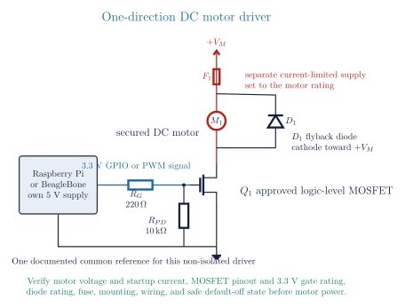

Use the same protected-output idea as the pump mission to control one of the classroom low-voltage DC motors. Begin with on/off in one direction. Add PWM speed control only after the motor and driver remain stable. Reverse direction only through an approved H-bridge.

::: {.callout-important title="Separate logic power from motor power"}
The Raspberry Pi or BeagleBone sends a 3.3 V control signal. It does not supply motor current. The motor uses a separate current-limited DC supply and a driver rated for its startup and stall current. The control board and motor supply share only the documented reference required by the approved non-isolated driver.
:::

::: {.callout-warning title="Mechanical safety"}
Clamp or mount the motor before power. Do not attach propellers, sharp objects, wheels, gears, or unguarded couplings for the first tests. Tie back hair, keep clothing and fingers clear, and remove motor power before touching the shaft or wiring.
:::

## Progression

| Stage | Result | Driver |
|---:|:--|:--|
| 1 | Teacher characterizes the secured motor | Current-limited supply only |
| 2 | Student controls one-direction ON/OFF | Logic-level MOSFET or approved driver |
| 3 | Student controls speed | PWM-capable driver |
| 4 | Student controls forward, stop, and reverse | Approved H-bridge |
| 5 | Student adds feedback or a sensor | Encoder, limit switch, or measured system variable |

Do not skip from an unidentified motor to reversing control.

## Identify the motor and driver

The classroom motor bin contains small low-voltage DC motors and geared mechanisms. Choose one with the teacher. Record any printed voltage or part number. If no rating is visible, the teacher sets a conservative starting voltage and current limit before the first powered test. Do not connect an unknown motor to the fixed 12 V output.

| Check | Record |
|:--|:--|
| Motor manufacturer and part number |  |
| Rated voltage |  |
| No-load or rated current |  |
| Startup or stall current |  |
| Driver part number |  |
| Driver supply range |  |
| Continuous and peak current rating |  |
| 3.3 V input compatibility |  |
| Flyback or recirculation protection |  |
| Motor mounting method |  |

Unknown salvaged motors remain disconnected from the computer until the teacher has tested them with a current-limited supply.

## Stage 1: simulate the state machine

```python
commands = ["stop", "forward", "slow", "stop"]

for command in commands:
    if command == "forward":
        print("Motor forward at full command")
    elif command == "slow":
        print("Motor forward at reduced command")
    else:
        print("Motor stopped")
```

Add an invalid command to the list. The safe response must be `Motor stopped`.

## Stage 2: one-direction driver

{fig-alt="A Raspberry Pi or BeagleBone GPIO controls an N-channel MOSFET through a gate resistor and pull-down. A separate fused supply powers a secured DC motor with a flyback diode across it." width="100%"}

1. Verify the exact MOSFET or driver-module pinout.
2. Confirm that its rating covers the motor's startup current.
3. Build the control input and pull-down with the motor disconnected.
4. Test safe startup, ON, OFF, and `Ctrl+C` using an indicator.
5. Pass a teacher power-off inspection.
6. Connect the secured motor and current-limited external supply.
7. Run a one-second test before longer operation.

## Stage 3: PWM speed control

PWM turns the driver on and off rapidly. The duty cycle changes the average motor voltage, but the motor current is still supplied by the external source.

Test at three teacher-approved commands such as 25%, 50%, and 75%. A motor may not start at a low duty cycle. Record the difference between the command and the observed result instead of changing the data.

| PWM command | Starts from rest? | Supply voltage | Supply current | Observation |
|---:|:--:|---:|---:|:--|
| 25% |  |  |  |  |
| 50% |  |  |  |  |
| 75% |  |  |  |  |

## Stage 4: direction control

Reversing requires an H-bridge or motor-driver module that changes current direction through the motor. Do not reverse a motor by moving live wires.

Before connecting the motor:

1. identify the exact driver and official datasheet;
2. document its logic supply, motor supply, enable, direction, sleep, and ground pins;
3. prove that 3.3 V is accepted as a valid logic high;
4. confirm continuous, peak, and thermal ratings;
5. test forward, coast, brake if supported, and reverse with the motor disconnected;
6. add a stop delay before reversing direction.

## Calculations

Estimate the motor input power from measured supply values:

$$
P_{in}=V_M I_M.
$$

For a MOSFET stage, use the guaranteed resistance at the actual gate voltage:

$$
P_Q\approx I_M^2R_{DS(on)}.
$$

For an H-bridge, use the driver's datasheet model for the two active switches or its stated total on-resistance. Check the thermal limits at the measured current.

## Required tests

1. Power up with the motor stopped.
2. Run a one-second ON/OFF test three times.
3. Press `Ctrl+C` during operation and confirm stop.
4. Disconnect the command input with power removed and verify the documented safe response.
5. Record supply current at each approved speed.
6. Stall testing is teacher-only and only when the motor, driver, supply, current limit, and duration have been approved.
7. For an H-bridge, stop before every direction change.

## Troubleshooting

| Symptom | Evidence to collect first |
|:--|:--|
| Motor does not start | Motor-supply voltage/current limit, driver enable, GPIO command, gate or input voltage |
| Motor twitches but stops | Startup current, current limit, low PWM command, mechanical binding |
| Controller resets | Supply separation, common reference, flyback/recirculation, wiring and supply droop |
| Motor runs at boot | Pull-down, driver enable state, Python initialization |
| Driver becomes hot | Motor current, device rating, gate/input compatibility, switching loss, thermal path |
| Reverse command fails | H-bridge truth table, enable/sleep state, dead time, wiring |

## Extensions

- Add a guarded limit switch.
- Count encoder pulses and graph speed.
- Compare command duty cycle with measured rotational speed.
- Add a ramp instead of an instant speed change.
- Use the motor to drive a safe mechanism with a guarded coupling.
- Adapt the driver to the [water pump mission](water-pump-controller.qmd).

## Submit

Submit the motor and driver table, approved schematic, power and driver calculations, simulation, PWM data, relevant code, test results, one evidence-based repair, and photographs of the secured motor and separate motor supply.

## References

- [Raspberry Pi GPIO voltage and current guidance](https://www.raspberrypi.com/documentation/computers/raspberry-pi.html#gpio-pin-inputs-outputs-and-communication-protocols), Raspberry Pi Ltd.
- [BeagleBoard Cookbook: motors](https://docs.beagleboard.org/books/beaglebone-cookbook/04motors/motors.html), BeagleBoard.org.

Use the manufacturer datasheets for the exact motor, MOSFET or H-bridge, diode, and power supply.
