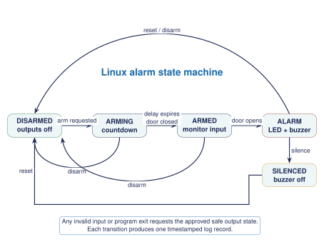
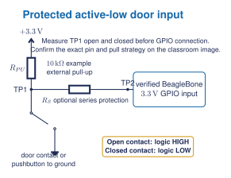
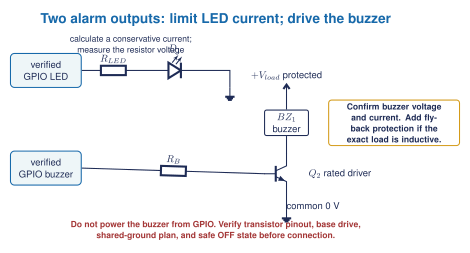
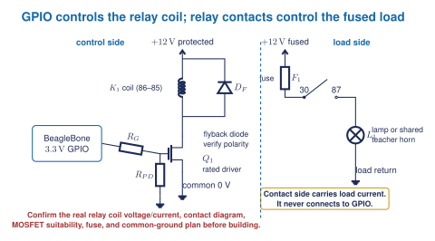

Build a small alarm model that combines a stable switch input, Linux, Python, visible and audible status, and systematic circuit testing.

::: {.callout-important title="Safety boundary"}
The core student output is a resistor-limited LED and a teacher-approved low-current buzzer or buzzer driver. A BeagleBone GPIO must never directly power a buzzer, relay coil, lamp, or automotive horn. The optional lamp uses a rated driver and relay with a separately fused supply. The real horn is a shared, short, supervised demonstration only.
:::

## Choose a level

| Level | Required behaviour | Evidence |
|---|---|---|
| Minimum | A protected door/pushbutton input changes a status LED through a small Python program. | Input/output table, voltage checks, three trials |
| Proficient | A five-state alarm includes an arming delay, stable input, LED, low-current buzzer, safe shutdown, and event log. | State table, log, fault test, repeated trials |
| Extension | Add a relay-controlled lamp, second sensor, configurable delay, or supervised shared-horn demonstration. | Interface calculation, separate load test, added state tests |

## Measurable success criteria

1. DISARMED, ARMING, ARMED, ALARM, and SILENCED states are distinguishable.
2. The program changes from ARMING to ARMED after ______ seconds.
3. Opening the protected input while ARMED produces ALARM within ______ seconds.
4. Opening the input while DISARMED does not activate the alarm output.
5. Every state change produces one timestamped log record.
6. A missing or implausible input produces the documented safe response.
7. `Ctrl+C`, a program error, and normal exit all leave outputs off.
8. GPIO and external-load voltages remain within the documented limits for the exact hardware.

## Parts table

| Role | Core choice | Extension choice | Confirm before use |
|---|---|---|---|
| Controller | BeagleBone Black with verified Linux image | Same | Board model, GPIO map, 3.3 V domain |
| Door input | Normally open pushbutton or magnetic contact | Two contacts | Contact action, pull resistor, wiring length |
| Visible output | LED and series resistor | Separate status LEDs or lamp | Polarity, target current, driver rating |
| Audible output | Teacher-approved low-current active buzzer through suitable driver when required | Shared automotive horn through relay | Buzzer current/voltage; horn and relay ratings |
| Driver | NPN transistor, logic-level MOSFET, or approved module | Relay driver with flyback protection | Pinout, drive requirements, diode orientation |
| Load supply | Protected low-voltage source | Separately fused lamp/horn source | Voltage, current limit, fuse, common-reference plan |
| Measurement | Digital multimeter | Clamp meter for suitable large DC load only | Meter capability and correct ports |

## I/O allocation table

Complete this after the teacher verifies the board image and pin configuration.

| Name | Direction | Active level | Physical pin or line | Electrical interface | Safe state |
|---|---|---|---|---|---|
| `door_input` | Input | High / low |  | Switch plus pull-up or pull-down | Defined, never floating |
| `arm_input` | Input | High / low |  | Switch plus pull-up or pull-down | DISARMED |
| `status_led` | Output | High / low |  | Series resistor or driver | Off |
| `buzzer` | Output | High / low |  | Rated driver | Off |
| `relay_lamp` | Output, extension | High / low |  | Driver + flyback diode + relay | Off |

No physical header pin is approved merely because an online example used it. Confirm pin multiplexing and the classroom Linux image.

## State-transition design

| Current state | Event | Next state | Outputs and log |
|---|---|---|---|
| DISARMED | Arm requested | ARMING | LED indicates countdown; log `arming_started` |
| ARMING | Delay expires and door is closed | ARMED | Armed indication; log `armed` |
| ARMING | Disarm requested | DISARMED | All alarm outputs off; log `disarmed` |
| ARMED | Door opens | ALARM | LED and buzzer pattern; log `alarm_triggered` |
| ARMED | Disarm requested | DISARMED | Outputs off; log `disarmed` |
| ALARM | Silence requested | SILENCED | Buzzer off; alarm indication remains; log `silenced` |
| SILENCED | Door closes | SILENCED | Remain latched until reset |
| ALARM or SILENCED | Disarm/reset requested | DISARMED | All outputs off; log `reset` |
| Any state | Invalid input or program exit | Safe response | Alarm loads off; log or report fault when possible |

Write the table before writing hardware code. The state machine should be testable using keyboard or simulated inputs while the external circuit is disconnected.

{fig-alt="Five alarm states are connected by labelled arrows. Reset and disarm paths return to DISARMED. Invalid input or program exit requests the safe output state." width="100%"}

## Input circuit

A switch input must not float. Use one teacher-approved pattern:

- an external pull-up to 3.3 V with the switch to ground, interpreted as active-low; or
- an external pull-down to ground with the switch to 3.3 V.

Measure the open and closed input-node voltages before connecting the GPIO. Long wires and mechanical contacts may need software timing or a teacher-approved RC debounce network. Do not hide a wiring problem with a very long software delay.

{fig-alt="A ten kilohm example pull-up connects a switch input to 3.3 volts. The switch connects the input to ground. Test points appear before and after an optional series resistor." width="78%"}

*Original classroom drawing based on the official [BeagleBone Black connector cautions](https://docs.beagleboard.org/boards/beaglebone/black/ch07.html). Verify the exact classroom image and header pin.*

## Output circuit

Calculate the LED resistor using a conservative target current:

$$
R=\frac{V_{GPIO}-V_{LED}}{I_{LED}}.
$$

Select an available higher standard value when it keeps the LED visible and reduces GPIO current. Verify the actual board limit; do not treat an example current as universal.

Use a transistor, MOSFET, or approved driver for the buzzer whenever its current is not demonstrably within the GPIO limit. Inductive relay coils require flyback suppression. The relay contact side and external load supply are a separate energy path.

{fig-alt="One verified GPIO drives an LED through a current-limiting resistor. A second verified GPIO drives the base of an NPN transistor through a resistor; the transistor switches a buzzer from a protected load supply." width="100%"}

*Original classroom topology based on the [onsemi 2N3903/2N3904 datasheet](https://www.onsemi.com/pub/Collateral/2N3903-D.PDF). Confirm the exact buzzer type before deciding whether flyback protection is required.*

## Event log

Each line should contain at least:

```text
timestamp,event,previous_state,new_state,input_summary
```

Use ISO-style timestamps and avoid student names, locations, account identifiers, or real security information. A classroom model log is technical evidence, not a surveillance record.

## Test plan: staged sequence

1. **Offline logic:** run state tests using keyboard or simulated inputs.
2. **Input only:** print the protected switch state; outputs remain disconnected.
3. **LED only:** command the LED safely; verify resistor voltage and calculated current.
4. **Buzzer driver only:** use a protected supply and confirm off/on voltage without the alarm logic.
5. **Core integration:** connect input, LED, and buzzer; start DISARMED.
6. **Log check:** compare observed transitions with log rows.
7. **Fault test:** disconnect the input or use a prepared open connection; observe the documented response.
8. **Extension:** test a relay-controlled lamp before any shared horn demonstration.

### Trial record

| Trial | Start state | Input/event | Expected next state | Observed state | Log correct? | Pass/revise |
|---|---|---|---|---|---|---|
| 1 |  |  |  |  |  |  |
| 2 |  |  |  |  |  |  |
| 3 |  |  |  |  |  |  |

## Troubleshooting guide: common faults

| Symptom | Safe diagnostic step | Likely categories |
|---|---|---|
| Input changes randomly | Print raw input and measure its open/closed node voltage | Floating input, loose ground, contact bounce |
| Input logic is reversed | Compare voltage and Boolean state in both positions | Active-low assumption, switch terminal choice |
| LED works but buzzer does not | Test the driver stage independently | Wrong transistor pinout, missing common reference, load mismatch |
| Alarm triggers during arming | Run state tests without GPIO | Transition condition or stale event |
| Multiple log lines per press | Inspect event detection and timing | Bounce, level-triggered instead of edge-aware logic |
| Relay clicks but lamp is off | Measure contact-side source and load voltage | Wrong 87/87a contact, open fuse, load ground |
| Program exits with output on | Exercise the cleanup path deliberately | Missing `finally`/signal cleanup or active-low driver |

## Safe shutdown requirement

The program must establish outputs off before accepting input, catch an intentional keyboard interrupt, and use a cleanup path that requests the safe output state. After stopping it:

1. verify LED, buzzer, and relay commands are off;
2. remove external load power before changing wiring;
3. close the log file cleanly;
4. shut Linux down normally before removing BeagleBone power when directed.

Software cleanup reduces risk but is not an emergency stop. A hardware fuse and correctly designed off state remain necessary.

## Extensions

### Relay-controlled lamp

The GPIO drives the approved transistor/relay interface. The relay switches a separately fused lamp supply. Record coil-side and contact-side voltages separately.

{fig-alt="The control side shows a BeagleBone GPIO, gate resistor, pull-down, MOSFET, relay coil, and flyback diode. A dashed divider separates it from fused relay contacts that switch a lamp or shared teacher horn." width="100%"}

*Original classroom topology based on TI's [guidance for driving inductive loads](https://www.ti.com/document-viewer/lit/html/SLVAF04). It is not a parts list: confirm every real rating and terminal number.*

### Shared automotive horn demonstration

Use the same logic to request the horn, but the teacher controls the fused horn station. Use short pulses and a visible warning. The student circuit never supplies horn current. A capacitor may time or filter the control signal; it does not supply sustained horn energy.

## Exact portfolio evidence

1. problem statement, chosen level, and numbered success criteria;
2. state-transition table and completed I/O allocation table;
3. schematic showing input pull resistor, output resistor/driver, supply rails, and test points;
4. exact component and board documentation used to approve interfaces;
5. LED and driver calculations;
6. measured open/closed input voltages and output voltage evidence;
7. three completed state-machine trials;
8. a short relevant code excerpt plus an explanation of the safe-state logic;
9. a redacted event-log excerpt that matches an observed test;
10. one fault, diagnostic sequence, evidence, and revision;
11. a conclusion against every success criterion and one next test.

Do not publish a real door schedule, location, credential, network address, or security arrangement.

## References

- [BeagleBone Black features and 3.3 V I/O domain](https://docs.beagleboard.org/boards/beaglebone/black/ch04.html), BeagleBoard.org.
- [BeagleBone Black connectors](https://docs.beagleboard.org/boards/beaglebone/black/ch07.html), BeagleBoard.org.
- [Python `csv` documentation](https://docs.python.org/3/library/csv.html), Python Software Foundation.
- [Python `logging` documentation](https://docs.python.org/3/library/logging.html), Python Software Foundation.

The exact switch, buzzer, transistor, relay, and lamp must use their current manufacturer documentation.
