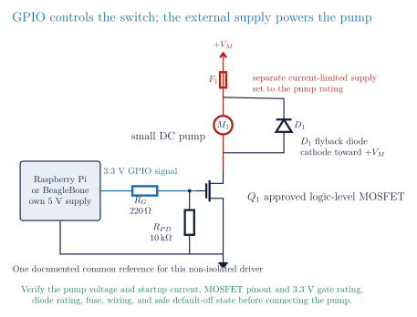

Build a controller that turns a small pump on and off. The first working version uses a pushbutton or simulated input. The water sensor is added only after the pump driver and sensor have each passed separate tests.

::: {.callout-important title="The controller does not power the pump"}
The Raspberry Pi or BeagleBone supplies only a 3.3 V control signal. The pump uses its own teacher-approved, current-limited low-voltage DC supply. A logic-level MOSFET or approved motor-driver module carries the pump current. A flyback diode or the driver module's documented protection handles the inductive turn-off voltage.
:::

::: {.callout-warning title="Wet-work setup"}
Use a shallow plastic tray, a small amount of water, towels, secure tubing, and low-voltage DC equipment. Keep the computer and breadboard dry and above the tray. Confirm whether the exact pump may run dry or must be primed. Disconnect pump power before moving tubing or water.
:::

## Choose a level

| Level | Required result |
|:--|:--|
| Minimum | A button or keyboard command turns the externally powered pump on for a short, fixed time. |
| Proficient | A verified water-sensor state controls the pump with a maximum run time and safe default-off state. |
| Extension | The program logs state changes, includes a lockout or two-sensor rule, and graphs one test. |

## Stage 1: identify the load

| Check | Record |
|:--|:--|
| Pump manufacturer and part number |  |
| Rated voltage |  |
| Rated or measured running current |  |
| Startup or stall current, if documented |  |
| Flow direction and tubing size |  |
| Dry-running or priming requirement |  |
| Driver part number and current rating |  |
| Flyback protection |  |
| External supply voltage and current limit |  |

An unknown salvaged pump is a teacher-characterization item. Begin on a current-limited bench supply at a conservative voltage. Do not guess that a pump is 5 V or 12 V from its size or wire colour.

## Stage 2: simulate the program

Test the decision and maximum run time without GPIO:

```python
requests = [False, True, True, False]
maximum_run_seconds = 2

for pump_requested in requests:
    if pump_requested:
        print(f"Pump ON for no more than {maximum_run_seconds} s")
        print("Pump OFF")
    else:
        print("Pump remains OFF")
```

The physical program must turn the pump off when it starts, when it stops normally, and when the user presses `Ctrl+C`.

## Stage 3: build the driver with the pump disconnected

{fig-alt="A Raspberry Pi or BeagleBone GPIO controls an N-channel MOSFET through a gate resistor. A separate fused DC supply powers the pump. A flyback diode is across the pump and the grounds meet at one documented reference point." width="100%"}

The drawing is a circuit pattern, not approval for an unidentified MOSFET. Confirm the actual gate, drain, and source pinout, 3.3 V gate performance, voltage rating, continuous and startup current rating, diode rating, and thermal limits.

1. Leave the pump disconnected.
2. Build the gate resistor and pull-down network.
3. Use a resistor-limited LED or meter at the driver output for the first logic test.
4. Confirm that the driver remains off while the computer boots.
5. Run ON, OFF, and `Ctrl+C` tests.
6. Pass the teacher's power-off inspection.

## Stage 4: characterize the pump from the external supply

The teacher connects the pump to the current-limited supply without the computer.

1. Set the voltage and current limit from the pump documentation.
2. Secure the pump and tubing in the tray.
3. Run the shortest practical test.
4. Record supply voltage and the supply's current display.
5. Stop if the current limit activates, the pump stalls, wiring heats, or the pump behaves unexpectedly.

Do not place a handheld meter directly across the supply while its lead is in the current jack.

## Stage 5: integrate the pushbutton version

1. Remove pump power.
2. Connect the verified pump and driver.
3. Connect the documented common reference if the non-isolated driver requires it.
4. Restore the current-limited pump supply.
5. Command a one-second test.
6. Measure the pump supply and the voltage across the switching device while on.
7. Increase run time only after the short test passes.

## Stage 6: add the water sensor

Complete the [Water Sensor Warning mission](water-sensor-warning.qmd) first. Keep the sensor code and pump code separate until both pass.

Choose one behaviour and write it plainly:

- **Transfer control:** pump only while the start condition is true, but stop after the maximum run time.
- **Drain model:** water detected requests pumping, but the maximum run time prevents continuous operation.
- **Plant-watering model:** a verified dry-state input requests a short watering cycle, followed by a lockout before the next cycle.

The pump must not run indefinitely because of a disconnected, corroded, reversed, or implausible sensor reading.

## Required calculations

Use the measured or documented running current to estimate pump power:

$$
P_{pump}=V_{pump}I_{pump}.
$$

Estimate switching-device conduction loss using the correct datasheet model. For a MOSFET that is fully enhanced at the actual 3.3 V gate drive,

$$
P_Q\approx I_{pump}^2R_{DS(on)}.
$$

Do not use an $R_{DS(on)}$ value specified only at 10 V gate drive. If the datasheet does not guarantee suitable operation at the actual gate voltage, choose another device or an approved driver module.

## Test table

| Test | Expected | Measured or observed | Pass? |
|:--|:--|:--|:--:|
| Boot with pump supply on | Pump remains off |  |  |
| One-second request | Pump starts and stops |  |  |
| `Ctrl+C` during run | Pump turns off |  |  |
| Sensor disconnected | Pump remains off or enters documented safe state |  |  |
| Maximum run time | Pump turns off at the limit |  |  |
| Three repeated cycles | Same result without leaks or overheating |  |  |

## Troubleshooting

| Symptom | Evidence to collect first |
|:--|:--|
| Pump never starts | External supply voltage, current limit, pump rating, driver command, gate voltage |
| Computer resets when pump starts | Supply separation, common-reference wiring, external supply droop, flyback path |
| Pump runs at boot | Gate pull-down, output initialization, driver polarity |
| Driver becomes hot | Pump current, startup current, MOSFET gate-drive specification, connection and thermal rating |
| Pump runs forever | Timer logic, sensor fault state, stuck input, missing lockout |

## Submit

Submit the part-identification table, approved schematic, pump power and driver calculations, software simulation, measured current and voltage evidence, completed tests, one troubleshooting record, and photographs showing the dry electronics area and wet tray.

## References

- [Raspberry Pi GPIO voltage and current guidance](https://www.raspberrypi.com/documentation/computers/raspberry-pi.html#gpio-pin-inputs-outputs-and-communication-protocols), Raspberry Pi Ltd.
- [BeagleBoard Cookbook: controlling the speed of a DC motor](https://docs.beagleboard.org/books/beaglebone-cookbook/04motors/motors.html#controlling-the-speed-of-a-dc-motor), BeagleBoard.org.

Use the manufacturer datasheets for the exact pump, MOSFET or driver module, diode, and supply.
