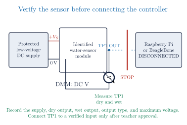

Build a warning system that changes state when water reaches the sensor. The core mission uses an LED. A small buzzer is an optional extension after its voltage and current have been checked.

::: {.callout-important title="Water and electronics boundary"}
Only the probe or sensing surface goes near the water. Keep the controller, breadboard, connections, and power supplies dry and above the tray. Use only teacher-approved low-voltage DC equipment. Disconnect power before moving the cup, probe, or wiring.
:::

::: {.callout-warning title="Do not connect an unknown sensor to GPIO"}
First identify the exact module. Measure its supply and output without the Raspberry Pi or BeagleBone connected. Raspberry Pi GPIO uses 3.3 V logic and is not 5 V tolerant. A Raspberry Pi has no built-in analogue input. BeagleBone Black analogue inputs have a 1.8 V maximum. An analogue sensor output therefore needs an approved ADC or interface.
:::

## Minimum result

1. The program starts with the warning output off.
2. A dry sensor produces the documented dry state.
3. A wet sensor produces the documented wet state.
4. The LED changes state correctly in three repeated trials.
5. Disconnecting the sensor produces a known safe response.

## Stage 1: simulate the decision

Run the logic before touching GPIO:

```python
test_states = [False, False, True, True, False]

for water_detected in test_states:
    if water_detected:
        print("WATER DETECTED - warning on")
    else:
        print("Dry - warning off")
```

Change the test list and predict the five printed lines before running it again.

## Stage 2: identify the sensor

Record the information printed on the sensor and its interface board. Do not use colour or connector order as a pinout.

| Check | Record |
|:--|:--|
| Manufacturer or module name |  |
| Part or board number |  |
| Probe type |  |
| Supply range |  |
| Output type: digital, analogue, I²C, or unknown |  |
| Output-voltage range |  |
| Pin labels and orientation |  |
| Source used to verify the information |  |

If the sensor cannot be identified, use it only for supervised meter investigation. Do not connect it to the controller.

## Stage 3: verify the output with a meter

{fig-alt="A protected low-voltage supply powers an identified sensor module. A voltmeter measures its output at TP1 while the Raspberry Pi or BeagleBone remains disconnected." width="100%"}

1. Place the probe in a dry tray.
2. Connect only the teacher-approved sensor supply.
3. Measure the sensor supply voltage.
4. Measure output test point TP1 while dry.
5. Wet only the approved sensing area and measure TP1 again.
6. Repeat three times and record the range, not only one value.
7. Remove sensor power before connecting or disconnecting anything.

| Trial | Dry output | Wet output | Unit | Digital state, if present |
|---:|---:|---:|:--:|:--|
| 1 |  |  |  |  |
| 2 |  |  |  |  |
| 3 |  |  |  |  |

## Stage 4: choose a safe input route

| Sensor output | Approved route |
|:--|:--|
| Verified digital output that remains between 0 V and 3.3 V | Connect to a teacher-approved GPIO input with a defined pull-up or pull-down arrangement. |
| Open-collector digital output | Use a pull-up to the controller's verified 3.3 V rail. Never pull it up to 5 V. |
| Analogue output | Use a teacher-approved ADC and divider/interface. Do not connect it directly to a Raspberry Pi GPIO. |
| 5 V digital output | Use an approved level shifter or divider designed for that output. Do not connect it directly. |
| Unknown output | Stop at the meter investigation. |

## Stage 5: connect the LED warning

Complete the protected-LED checkout before this step. Test the LED output by itself, then test the sensor input by itself. Combine them only after both stages work.

Your hardware program must include:

- the teacher-approved input identifier;
- the teacher-approved LED output identifier;
- a clearly named `water_detected` value;
- a default-off warning output;
- a clean `Ctrl+C` stop that leaves the output off.

Do not copy a pin number from an Internet example. Use the verified pin record for the exact classroom board.

## Measurements and calculations

For a resistor-limited LED,

$$
I_{LED}\approx\frac{V_S-V_{LED}}{R_{LED}}.
$$

Measure the resistor voltage when the LED is on and calculate the measured current:

$$
I_{LED}=\frac{V_R}{R_{LED}}.
$$

| Quantity | Expected | Measured | Unit |
|:--|--:|--:|:--:|
| Sensor supply |  |  | V |
| Maximum sensor output |  |  | V |
| LED resistor voltage |  |  | V |
| LED current from $V_R/R$ |  |  | mA |

## Test the system

1. Start dry and confirm the warning is off.
2. Apply water to the approved sensing area and time the response.
3. Dry the probe and confirm recovery.
4. Repeat the wet/dry cycle three times.
5. Disconnect the sensor with power removed, restore power, and record the fault response.
6. Stop the program and confirm the LED is off.

## Optional extensions

- Add a low-current buzzer through an approved driver.
- Record state changes and times in a CSV file.
- Plot a verified analogue reading using an approved ADC.
- Add a delay so a single splash does not trigger a long alarm.
- Continue to the [water pump controller](water-pump-controller.qmd).

## Submit

Submit the sensor identification table, three dry/wet measurements, the approved schematic or input diagram, LED calculation, relevant code, test results, one troubleshooting record, and clear photographs. Do not submit invented measurements.

## References

- [Raspberry Pi GPIO voltage and current guidance](https://www.raspberrypi.com/documentation/computers/raspberry-pi.html#gpio-pin-inputs-outputs-and-communication-protocols), Raspberry Pi Ltd.
- [BeagleBone Black expansion voltage domains](https://docs.beagleboard.org/boards/beaglebone/black/ch04.html), BeagleBoard.org.

Use the manufacturer documentation for the exact classroom sensor or interface board.
