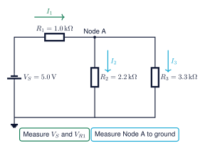
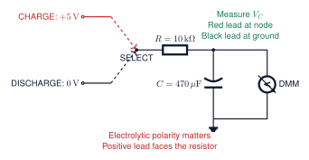

This page holds the component-sorting procedure for this week and two possible circuit stations for later. The teacher will check the available hardware before assigning either circuit.

::: {.callout-important title="This week: use only the sorting section"}

Most students complete the printed capacitor worksheet. A small group sorts resistors and capacitors, then rotates. Use the multimeter only in resistance mode on disconnected resistors. Read capacitor markings and polarity, but do not connect a powered circuit yet. Stations 1 and 2 are future plans.

:::

## Station 0: Sort and identify the real components

Use this before students build the two circuits. It turns the mixed component bins into a usable class inventory and gives every student practice reading parts and checking a value with a meter.

::: {.callout-warning title="Sort by markings and measurements, not appearance alone"}

A physically larger capacitor is not automatically a larger capacitance. Read the printed value, identify the type, record the voltage rating, and use a meter with capacitance mode when available. Put every uncertain or damaged part in the **CHECK WITH TEACHER** tray.

:::

### Set up the organizer

Label temporary trays first. Move parts into the permanent organizer only after a second person checks them.

| Resistor trays | Capacitor trays |
|---|---|
| Less than 1 kΩ | Ceramic or film, less than 1 µF |
| 1 kΩ to 9.9 kΩ | Electrolytic, 1 µF to 99 µF |
| 10 kΩ to 99 kΩ | Electrolytic, 100 µF to 999 µF |
| 100 kΩ and above | Electrolytic, 1000 µF and above |
| CHECK WITH TEACHER | CHECK WITH TEACHER |

After the broad sort, make smaller labeled sections for the common values actually found, such as 220 Ω, 1 kΩ, 2.2 kΩ, 3.3 kΩ, 10 kΩ, 100 µF, 220 µF, and 470 µF.

### Student procedure

1. Take one small handful, not the whole bin.
2. Separate resistors from capacitors and remove visibly damaged parts.
3. Decode each resistor's colour bands, then verify it with the resistance setting while the part is disconnected.
4. For each capacitor, identify ceramic, film, or electrolytic. Read its capacitance and voltage rating. Mark the negative stripe on polarized electrolytics.
5. If a ceramic capacitor uses a three-digit code, use the first two digits followed by the stated number of zeros in picofarads. For example, **104 = 100 000 pF = 100 nF = 0.1 µF**.
6. Ask a second student to check the value before placing the part in its permanent bin.
7. Record the final count on the organizer label.

### Useful challenge without extra theory

Give each group one resistor and one capacitor chosen by another group. They must identify both parts, verify the resistor with a meter, explain capacitor polarity and voltage rating when present, and return both to the correct bins. No written reflection is required.

::: {.callout-note collapse="true" title="Future teacher planning: powered circuit stations"}

Do not use these stations this week. Revisit them after checking the actual components, meters, breadboards, and power supplies.

Set the bench supply to **5.0 V** before connecting it. Use a current limit of **20 mA or less**. Turn power off before changing components or using the resistance setting. Never place a meter in current mode directly across the supply.

The sequence is adapted from the measurement method in *Grob Basic Electronics Experiments*, especially Experiment 2-2, Experiment 9-1, and Experiment 22-1. The component values, wiring, procedure, and questions below are original classroom adaptations for a 5 V supply.

## Station 1: Measure and verify KCL and KVL

{fig-alt="A 5 V source feeds a 1 kΩ resistor and then splits into 2.2 kΩ and 3.3 kΩ branches. Current arrows identify the incoming and two outgoing currents."}

### Teacher build

| Part | Value or setting |
|---|---|
| Supply | 5.0 V DC, current limit 20 mA |
| $R_1$ | 1.0 kΩ, 1/4 W |
| $R_2$ | 2.2 kΩ, 1/4 W |
| $R_3$ | 3.3 kΩ, 1/4 W |
| Meter | DC voltage and resistance modes |
| Wiring | Red for +5 V, black for ground, another colour for Node A |

1. With power off, measure and label the three resistors.
2. Build the network and check that the red and black rails are not shorted.
3. Set the supply to 5.0 V and limit the current before connecting the board.
4. Power the circuit and measure the supply, the drop across $R_1$, and Node A to ground.
5. Mark the three measurement points directly on the breadboard with removable labels.

### Expected readings

Component tolerances will cause small differences.

| Quantity | Approximate result |
|---|---:|
| $R_2\parallel R_3$ | 1.32 kΩ |
| Total resistance | 2.32 kΩ |
| $I_1$ | 2.16 mA |
| Node A voltage | 2.84 V |
| $I_2$ | 1.29 mA |
| $I_3$ | 0.86 mA |

### Student progression

1. **Meter check:** measure each resistor with power off.
2. **Voltage check:** measure $V_S$, $V_{R1}$, and Node A to ground.
3. **Ohm's law:** calculate each current from a measured voltage and resistance.
4. **KCL:** test whether $I_1\approx I_2+I_3$.
5. **KVL:** test whether $5.0\,\mathrm{V}\approx V_{R1}+V_A$ for each loop.
6. **Power:** calculate the power in each resistor and compare their total with $V_SI_1$.

Students do not need to move the meter lead to the current jack. Calculating current from measured voltage and resistance is safer and still provides experimental evidence for KCL.

## Station 2: Watch a capacitor charge and discharge

{fig-alt="A movable jumper selects either 5 V for charging or ground for discharging. A 10 kΩ resistor connects to a 470 µF polarized capacitor, and a voltmeter measures capacitor voltage."}

### Teacher build

| Part | Value or setting |
|---|---|
| Supply | 5.0 V DC, current limit 10 mA |
| Resistor | 10 kΩ, 1/4 W |
| Capacitor | 470 µF electrolytic, rated 10 V or higher |
| Meter | DC voltage mode across the capacitor |
| Timing | Phone stopwatch or classroom timer |
| Optional comparison | 100 µF and 220 µF capacitors |

Use one movable jumper. Connect it to **+5 V to charge** or **0 V to discharge**. Both actions must go through the 10 kΩ resistor. Never discharge the capacitor by shorting its leads.

For the main setup,

$$
\tau=RC=(10\,000)(470\times10^{-6})\approx4.7\ \mathrm{s}
$$

### Expected voltage readings

| Time | Charging | Discharging from 5 V |
|---:|---:|---:|
| 0 s | 0.00 V | 5.00 V |
| 5 s | 3.27 V | 1.73 V |
| 10 s | 4.40 V | 0.60 V |
| 15 s | 4.79 V | 0.21 V |
| 20 s | 4.93 V | 0.07 V |
| 25 s | 4.98 V | 0.02 V |

Real readings will differ because capacitor values have wide tolerances.

### Student progression

1. **Safety check:** identify the capacitor's positive and negative leads and confirm its voltage rating.
2. **Predict:** sketch the charging curve before touching the jumper.
3. **Charge:** record $V_C$ every five seconds for 25 seconds.
4. **Discharge:** move the jumper to 0 V and record $V_C$ every five seconds.
5. **Graph:** plot both data sets on the same axes.
6. **One time constant:** find when the charging voltage first reaches about 3.16 V.
7. **Change one part:** replace the capacitor and predict whether the response will be faster or slower.

### Optional oscilloscope view

Complete the DMM version first.

1. Connect the probe tip to the capacitor's positive node.
2. Connect the scope ground clip only to the circuit's 0 V rail.
3. Start with DC coupling, 1 V/div, and 5 s/div.
4. Trigger on a rising edge near 2.5 V or use roll mode.
5. Move the jumper to +5 V and watch the curve.

## Running the stations with one board each

Use groups of four or five. Assign one student as meter operator, one as power operator, one as recorder, one as timer, and one as checker. Students who are waiting for a circuit board work at the component-sorting station or on Jupyter and graphing.

| Stage | Sorting station | Station 1 | Station 2 |
|---|---|---|---|
| First visit | Broad-sort and verify values | Measure resistance and voltage | Check polarity and record charging data |
| Second visit | Make labels and count parts | Verify KCL, KVL, and power | Record discharge and change capacitance |
| Later extension | Build a class inventory | Measure current in series after a meter-safety lesson | Capture the curve with the oscilloscope |

## Where this leads

The same RC station can later feed a transistor switch or an op-amp buffer. The XL741 kit should come after students can explain the charging curve, identify a polarized capacitor, and use a meter safely. Its 33 pF capacitor is a compensation component, not the large timing capacitor used in this station.

:::
