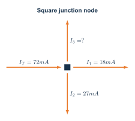
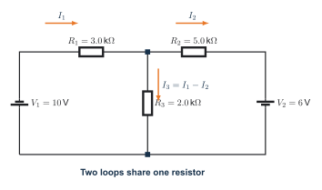

## Learning goals

**I will be able to** apply Kirchhoff's current law at a node and Kirchhoff's voltage law around a loop.

**This is useful because I can** write equations for a circuit that cannot be reduced by inspection.

**Used in college or university:** Nodal analysis, mesh analysis, electronics, power systems, and control hardware. [[1, Ch. 9]](../../references.qmd#ref-grob2016)

**Where you see it:** In a car wiring harness, current splits between lights and control modules. In a robot, it splits between the controller, sensors, and motors.

## Kirchhoff's current law

<figure class="ter-circuit-figure" id="fig-kirchhoff-node-loop">

<figcaption><a class="ter-figure-label" href="#fig-kirchhoff-node-loop">Figure 1.</a> At a square junction node, total current entering equals total current leaving. <a class="ter-figure-anchor" href="#fig-kirchhoff-node-loop" aria-label="Link to Figure 1">#</a></figcaption>
</figure>

$$
\sum I_{\mathrm{in}} = \sum I_{\mathrm{out}}
$$ {#eq-kirchhoff-current}

A negative answer means the real current is opposite the arrow you selected.

## Kirchhoff's voltage law

<figure class="ter-circuit-figure" id="fig-kirchhoff-two-loop">

<figcaption><a class="ter-figure-label" href="#fig-kirchhoff-two-loop">Figure 2.</a> Two loops share one resistor and create two simultaneous equations. <a class="ter-figure-anchor" href="#fig-kirchhoff-two-loop" aria-label="Link to Figure 2">#</a></figcaption>
</figure>

$$
\sum_{k=1}^{n}\Delta V_k = 0
$$ {#eq-kirchhoff-voltage}

Choose one loop direction and keep the signs consistent. A source rise is positive; a resistor drop in the current direction is negative.

## Workflow

1. Mark the essential nodes and independent loops.
2. Choose and label unknown current directions.
3. Write current-law and voltage-law equations.
4. Replace resistor voltage with $V=IR$.
5. Solve without rounding, then check every original node and loop equation.
6. Build the same network in Tinkercad and compare the simulated values.

## Slides and problem set

- [Circuit teaching-materials folder](https://drive.google.com/drive/folders/1NWvgVWTRJ9oHrWCLrAia8LP-1lxUvfdZ)
- [Kirchhoff's Laws teaching slides](https://docs.google.com/presentation/d/1WrkLYglw84qdaNbmFo1N80fFNo9uCr5nSOZ7JmsHgbw/edit)
- [Kirchhoff's Laws student problem set](https://docs.google.com/document/d/1pKpmcnNJlRVb74YJNFDIcpXS6LeGvjkO1e3KAgAD8JE/edit)
- [Electronics formula and calculator reference](https://docs.google.com/document/d/1DyGsEwpLrrwSRnyMXN5kze2qRYFoAY2t-P09wnfUS6c/edit)

Teachers can [email Andrew for the complete answer key](mailto:andrew@andrewandrade.ca?subject=TEJ%20Kirchhoff%20answer%20key).

## Worked solutions {#worked-solutions}

::: {.callout-note collapse="true" title="Question 2 — Missing loop voltage"}
Kirchhoff's voltage law requires the source rise to equal the voltage drops:

$$
V_3=12.0\,\mathrm{V}-2.4\,\mathrm{V}-4.1\,\mathrm{V}=5.5\,\mathrm{V}.
$$

**Check:** $12.0-2.4-4.1-5.5=0.0\,\mathrm{V}$.
:::

::: {.callout-note collapse="true" title="Question 4 — Two loops with two sources"}
The two loop equations are

$$
5I_1-2I_2=10
$$

$$
-2I_1+7I_2=6.
$$

Solving them gives $I_1=2.645161\ldots\,\mathrm{mA}$ and $I_2=1.612903\ldots\,\mathrm{mA}$.

The shared-branch current is

$$
I_3=I_1-I_2=1.032258\ldots\,\mathrm{mA}.
$$

**Final answers:** $I_1=2.65\,\mathrm{mA}$, $I_2=1.61\,\mathrm{mA}$, and $I_3=1.03\,\mathrm{mA}$.
:::
