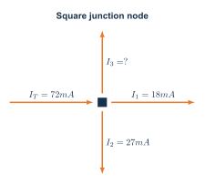
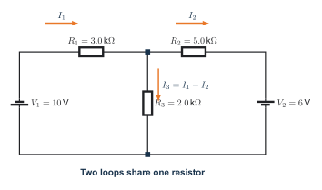

You will apply Kirchhoff's current law at a node and Kirchhoff's voltage law around a loop. These laws let you write equations for a circuit that cannot be reduced by inspection.

**Used in college or university:** Nodal analysis, mesh analysis, electronics, power systems, and control hardware. [[1, Ch. 9]](../../references.qmd#ref-grob2016)

**Where you see it:** In a car wiring harness, current splits between lights and control modules. In a robot, it splits between the controller, sensors, and motors.

::: {.callout-note title="Reference and polarity"}
The bottom rail is normally the 0 V or ground reference, and higher-voltage nodes are drawn above it. On a vertical battery symbol, the long line is positive. Keep that polarity consistent with every current arrow and voltage sign when writing Kirchhoff equations.
:::

## Class materials

- [Teaching slides](https://docs.google.com/presentation/d/1WrkLYglw84qdaNbmFo1N80fFNo9uCr5nSOZ7JmsHgbw/edit)
- [Assignment: Verify Kirchhoff Equations with Jupyter](../computational-engineering/kirchhoff-jupyter-assignment.qmd)
- [Make a copy of the current student problem set](https://docs.google.com/document/d/1qOS16EaUEUCnIGm16eN_7o76OlFKHrzABY3nfJ-v4i8/copy)
- [TEJ Electronics Quick Reference](https://andrewandrade.ca/assets/TEJ-Electronics-Quick-Reference.pdf)
- [Make a copy of the General Schematic and GUESS handout](https://docs.google.com/document/d/1RCkfqUT5U0FMKTOJ_ScyiDLmiGF-bCpyo-6y6Pm8ZUo/copy)
- [Grob Chapter 9: Kirchhoff's Laws](https://drive.google.com/file/d/1RXDje9v9TuuNF4V1Jlqemcsn1qJlKcjz/view)
- [Grob Problems Manual](https://drive.google.com/file/d/125X4YkWq2HO8evqYM9jRUuKPsbMXHhdG/view) for Chapter 9 practice
- [ElectroBOOM101-008: Lumped Model, Kirchhoff Circuit Laws](https://www.youtube.com/watch?v=d-a9Pr2z-qg)
- **Teacher answers:** restricted

::: {.callout-tip title="Monday: theory, discussion, and a live Jupyter demonstration"}
Watch ElectroBOOM101-008 together as the unit capstone rather than restarting the completed assignment. While watching, record one statement about the lumped-circuit model, one KCL statement, and one KVL statement. The teacher will then use the completed Question 4 equations to introduce standard form, the matrix equation $A\mathbf{x}=\mathbf{b}$, `numpy.linalg.solve`, negative-current interpretation, and residual verification. Predict each result before the live code runs. Monday is for explanation, prediction, and questions; the independent lab is Tuesday.
:::

### Tuesday: Jupyter verification and first debugging checkpoint

Open the [complete student assignment and submission instructions](../computational-engineering/kirchhoff-jupyter-assignment.qmd), then download the [Kirchhoff systems notebook](../../assets/tej-computational/notebooks/03-kirchhoff-systems.ipynb). Use one completed two-loop problem and its released teacher answer. This is not another KCL/KVL worksheet: it is a computational verification and investigation task.

1. Run the known-working demonstration before changing any code.
2. Copy the two original equations, state the variable order and units, and construct $A$ and $\mathbf{b}$.
3. Solve with Python, calculate $A\mathbf{x}-\mathbf{b}$, and compare the handwritten, teacher, and Python results.
4. Complete the easy documentation task: repair one incorrect `numpy.round` keyword using `help()`, `?`, or the official documentation.
5. Use the [technical help-request template](../computational-engineering/finding-documentation-and-asking-for-help.qmd) if a problem remains: include the goal, exact symptom, minimal code, environment, attempts, source, hypothesis, and one focused question.
6. Predict what will happen when one source value changes, then run and interpret the parameter sweep.

**Tuesday submission:** the completed `.ipynb` file through the working KCL/KVL verification, Stage 1 documentation task, comparison, prediction, parameter investigation, and assigned reflections. Stage 1 evidence includes the original symptom, search terms, documentation source, requirement found, minimal repair, and verification. No new circuit theory is introduced while the regular teacher is absent.

::: {.callout-note title="Later debugging lessons"}
Do not compress the complete debugging ladder into Tuesday. A later lesson uses the non-square `numpy.linalg.solve` input to practise exception-driven shape diagnosis. Another later lesson uses the silent factor-of-1000 unit bug to show that code can run and residuals can pass while the reported engineering answer is still wrong.
:::

## Kirchhoff's current law

<figure class="ter-circuit-figure" id="fig-kirchhoff-node-loop" data-diagram-source="../../assets/electronics/schematics/kirchhoff-node-loop-reference.tex">

<figcaption><a class="ter-figure-label" href="#fig-kirchhoff-node-loop">Figure 1.</a> At a square junction node, total current entering equals total current leaving. <a class="ter-figure-anchor" href="#fig-kirchhoff-node-loop" aria-label="Link to Figure 1">#</a></figcaption>
</figure>

$$
\sum I_{\mathrm{in}} = \sum I_{\mathrm{out}}
$$ {#eq-kirchhoff-current}

A negative answer means the real current is opposite the arrow you selected.

## Kirchhoff's voltage law

<figure class="ter-circuit-figure" id="fig-kirchhoff-two-loop" data-diagram-source="../../assets/electronics/schematics/kirchhoff-node-loop-reference.tex">

<figcaption><a class="ter-figure-label" href="#fig-kirchhoff-two-loop">Figure 2.</a> Two loops share one resistor and create two simultaneous equations. <a class="ter-figure-anchor" href="#fig-kirchhoff-two-loop" aria-label="Link to Figure 2">#</a></figcaption>
</figure>

$$
\sum_{k=1}^{n}\Delta V_k = 0
$$ {#eq-kirchhoff-voltage}

Choose one loop direction and keep the signs consistent. A source rise is positive; a resistor drop in the current direction is negative.

## Workflow

1. Mark the essential nodes and independent loops.
2. Choose and label unknown current directions.
3. Write current-law and voltage-law equations.
4. Replace resistor voltage with $V=IR$.
5. Solve without rounding, then check every original node and loop equation.
6. Build the same network in Tinkercad and compare the simulated values.

## Worked solutions {#worked-solutions}

::: {.callout-note collapse="true" title="Question 2: Missing loop voltage"}
Kirchhoff's voltage law requires the source rise to equal the voltage drops:

$$
V_3=12.0\,\mathrm{V}-2.4\,\mathrm{V}-4.1\,\mathrm{V}=5.5\,\mathrm{V}.
$$ {#eq-kirchhoff-worked-q2-voltage}

**Check:** $12.0-2.4-4.1-5.5=0.0\,\mathrm{V}$.
:::

::: {.callout-note collapse="true" title="Question 4: Two loops with two sources"}
The two loop equations are

$$
5I_1-2I_2=10
$$ {#eq-kirchhoff-worked-q4-left-loop}

$$
-2I_1+7I_2=6.
$$ {#eq-kirchhoff-worked-q4-right-loop}

Solving them gives $I_1=2.645161\ldots\,\mathrm{mA}$ and $I_2=1.612903\ldots\,\mathrm{mA}$.

The shared-branch current is

$$
I_3=I_1-I_2=1.032258\ldots\,\mathrm{mA}.
$$ {#eq-kirchhoff-worked-q4-shared-current}

**Final answers:** $I_1=2.65\,\mathrm{mA}$, $I_2=1.61\,\mathrm{mA}$, and $I_3=1.03\,\mathrm{mA}$.
:::

## Practical pathway: test the node and loops

**Core learning:** derive the node and loop equations by hand before using a simulator or solver. Follow **Define Variables → Write Equations → Standard Form or Matrix → Solve → Verify**.

**Guided practice:** if Tinkercad can represent the same sources and passive components faithfully, build the two-loop network with the [Tinkercad tutorial](tinkercad-circuits.qmd). Otherwise, use the teacher-approved physical circuit or simulator and identify the substitution. Measure the currents needed for one KCL check and voltages needed for one KVL check.

| Check | Predicted total | Simulated or measured total | Residual |
|---|---:|---:|---:|
| Current entering minus leaving (mA) | 0 |  |  |
| Left-loop voltage sum (V) | 0 |  |  |
| Right-loop voltage sum (V) | 0 |  |  |

**Independent challenge:** deliberately reverse one current arrow without changing the circuit. Rewrite the affected signs, solve again, and explain why a negative result is meaningful rather than automatically wrong.

::: {.callout-tip collapse="true" title="Progressive hints"}
1. Keep one chosen loop direction from start to finish.
2. Compare every matrix row with its original KCL or KVL equation.
3. A residual near zero checks the entered equations; compare signs and units with the schematic to check the model.
:::

Use [Notebook 3](../../assets/tej-computational/notebooks/03-kirchhoff-systems.ipynb) only after deriving the equations. Record the coefficient order and verify by substitution.

**Reflection:** What did the residual establish, and what mistake could still produce a near-zero residual?
