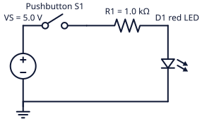
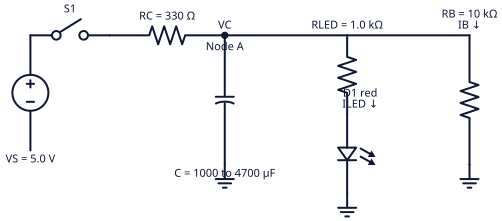

This sequence adds one idea at a time. Every physical circuit must first be completed, tested, and approved in Tinkercad.

::: {.callout-important title="The hardware gate"}

1. Submit the matching Tinkercad circuit by its deadline.
2. The simulation must earn **100%** on the readiness checklist before physical parts are issued.
3. The next lab class is a correction day. Students who are not yet at 100% keep working in Tinkercad and can ask for another check.
4. Students begin the physical version only after the teacher marks the simulation **READY TO BUILD**.
5. Reaching 100% later still unlocks the physical build. The gate protects the parts and students; it is not a permanent lockout.

:::

## Current schedule

| Date | Location | Work |
|---|---|---|
| Wednesday, November 18 | Lab 225 | Complete the RC data and functions notebook. Plot the measured dots, draw the functions, and model LED fade. |
| Thursday, November 19 | Portable 1 | Sort components and complete the Stage 1 calculation and paper wiring plan. No powered build. |
| Friday, November 20 | Lab 220 | Build and test Stage 1 in Tinkercad. |
| Sunday, November 22 at 7:00 PM | Online deadline | Submit the Stage 1 Tinkercad link and screenshot. |
| Monday, November 23 | Lab 225 | Correction day. Fix the simulation and receive the 100% readiness check. |
| Tuesday, November 24 | Portable 1 | Hardware preparation buffer. If materials are ready, a small group completes the unpowered Stage 0 breadboard map using its approved Tinkercad circuit. No supply or capacitor is connected. |

Physical build dates are announced only after the teacher has sorted the required parts, tested one complete reference circuit, and confirmed the power-supply limits. A 100% simulation makes a student eligible for the matching physical stage; it does not force the physical stage to happen immediately.

**[Download the two-page Stage 1 planning and readiness sheet](../../assets/electronics/worksheets/led-stage1-readiness-sheet.pdf)**

## Stage 0: breadboard from the approved simulation

Students do not begin with a different practice circuit. They use the same Stage 1 LED, resistor, and pushbutton circuit that they already built and tested in Tinkercad.

### First, map the Tinkercad breadboard

With the simulation stopped:

1. Orient the breadboard so the centre gap is vertical and the power rails are easy to identify.
2. Find one five-hole terminal group. All five holes in that group are the same electrical node.
3. Confirm that the centre gap separates the left and right terminal groups.
4. Check whether each red or blue power rail is continuous or split in the middle. Do not assume every breadboard is identical.
5. Record the exact row used by each Stage 1 connection:

| Stage 1 connection | Tinkercad breadboard location |
|---|---|
| +5 V wire to pushbutton | ____________________ |
| Pushbutton to 1.0 kΩ resistor | ____________________ |
| Resistor to LED anode | ____________________ |
| LED cathode to ground | ____________________ |

The row number is not electrically special. It is a location that helps the student reproduce the approved simulation accurately.

### Then, reproduce only the placement

This first physical session is unpowered.

1. Place the real breadboard in the same orientation as the Tinkercad breadboard.
2. Point to one connected five-hole group, the centre gap, the positive rail, and the ground rail.
3. Insert one jumper at a time by following the approved Tinkercad row map.
4. Add the 1.0 kΩ resistor so its two leads are in different nodes.
5. Identify the LED anode and cathode before inserting it.
6. Place the pushbutton across the centre gap so opposite sides are not accidentally shorted together.
7. Compare every physical connection with the simulation. Do not connect the power supply.

### Stage 0 check

A student is ready to continue when they can show the teacher:

1. Which five holes are connected in one terminal group.
2. Why the centre gap separates the two sides.
3. Why both resistor leads cannot be placed in the same connected group.
4. Which LED leg is the anode and which is the cathode.
5. Where +5 V and ground will connect later.
6. That the physical row map matches the approved Tinkercad circuit.

Stage 0 does not use current mode, a powered circuit, a capacitor, or an oscilloscope.

## Stage 1: LED, resistor, and pushbutton

{fig-alt="A complete 5 V series circuit with a normally open pushbutton, 1 kilohm current-limiting resistor, and red LED."}

The 1.0 kΩ resistor keeps the current low and still produces visible light in a red LED.

### Predict before simulating

Use a first model of $V_{LED}=2.0\,\mathrm{V}$.

$$
V_R=V_S-V_{LED}=5.0-2.0=3.0\,\mathrm{V}
$$

$$
I=\frac{V_R}{R}=\frac{3.0\,\mathrm{V}}{1000\,\Omega}=3.0\,\mathrm{mA}
$$

$$
P_R=I^2R=(0.0030)^2(1000)=0.0090\,\mathrm{W}=9.0\,\mathrm{mW}
$$

KVL predicts

$$
V_S=V_R+V_{LED}.
$$

### Build in Tinkercad

1. Open the [TEJ Tinkercad classroom](https://www.tinkercad.com/classrooms/9Km3yctGOwi/home){target="_blank"} and create a circuit named `studentnumber-lastname-stage1-led`.
2. Add a breadboard, 5 V source, normally open pushbutton, 1.0 kΩ resistor, red LED, and multimeter.
3. Place the pushbutton across the breadboard centre gap.
4. Connect **5 V → pushbutton → 1.0 kΩ resistor → LED anode**. Connect the LED cathode to ground.
5. Use red for +5 V, black for ground, and another colour for the switched connection.
6. Start the simulation. The LED must be off when the button is released and on only while it is pressed.
7. Measure $V_R$ and $V_{LED}$. Confirm that their sum is approximately 5 V.
8. In the simulation only, measure current in series and compare it with the 3.0 mA prediction.
9. Save the direct Tinkercad URL and one clear screenshot with the simulation running and the button pressed.

Use the [step-by-step Tinkercad controls and measurement guide](tinkercad-circuits.qmd) if you need screenshots of the editor, component settings, schematic view, or meter placement.

### Stage 1 readiness checklist: 100%

| Evidence | Marks |
|---|---:|
| Correct filename and working share URL | 5 |
| One complete series path with a normally open pushbutton | 20 |
| 5 V source, 1.0 kΩ resistor, and red LED | 15 |
| Correct LED polarity | 10 |
| Clear red, black, and switched-wire convention | 10 |
| LED off when released and on when pressed | 10 |
| KVL calculation with units | 10 |
| Current and resistor-power calculations with units | 10 |
| Simulated voltage and current evidence | 10 |
| **Total** | **100** |

## The correction day

Students who do not yet have 100% remain in Tinkercad for the next lab class.

1. Open the teacher's checklist feedback.
2. Stop the simulation before changing wires or values.
3. Fix one item at a time.
4. Restart the simulation and test the button, polarity, voltages, and current.
5. Submit the updated link for another check.
6. Begin hardware only after receiving **READY TO BUILD**.

## Stage 1 physical verification

This stage begins only when the teacher announces that the hardware station is ready. Start with a small supervised group while the rest of the class continues simulation, Jupyter, calculations, or corrections.

Before opening the station, the teacher:

1. Builds and tests one reference circuit.
2. Sorts the required LEDs, 1.0 kΩ resistors, pushbuttons, breadboards, and leads.
3. Sets a 5.0 V supply with a current limit of 20 mA or less.
4. Confirms that the multimeters are in voltage mode with the leads in the correct jacks.

Students calculate current from the resistor voltage. They do not move the meter lead to the current jack in the first physical build.

1. Identify the resistor, LED anode and cathode, and pushbutton terminals.
2. With power off, reproduce the approved Tinkercad topology on the breadboard.
3. Ask for the teacher's power-off wiring check.
4. Turn on the supply and test the button.
5. Measure $V_S$, $V_R$, and $V_{LED}$.
6. Verify KVL and calculate $I=V_R/R$.
7. Stop immediately for heat, smell, flicker, or unexpected current limiting.

## Stage 2: add capacitor storage

Duplicate the approved Stage 1 simulation. Add the capacitor section only after the original still works.

{fig-alt="A 5 V source and pushbutton charge a capacitor node. A polarized capacitor, resistor-limited red LED, and bleeder resistor connect from the node to ground."}

Start with:

| Part | Value |
|---|---:|
| Source | 5.0 V |
| Charging resistor $R_C$ | 330 Ω |
| LED resistor $R_{LED}$ | 1.0 kΩ |
| Capacitor | 1000 µF to 4700 µF, rated 10 V or higher |
| LED | Red |

Pressing the button charges the capacitor. Releasing it disconnects the source, and the capacitor drives the resistor and LED. The light should fade as $V_C$ falls.

The physical Stage 2 circuit is locked until the Tinkercad version earns 100% for capacitor polarity, LED polarity, resistor values, wiring, observed operation, and a voltage-versus-time table.

## Stage 3: measurement, KCL, KVL, and Jupyter

Add the 10 kΩ bleeder resistor and label Node A. The bleeder provides a complete discharge path after the LED turns off.

During charging, use KCL:

$$
I_S=I_C+I_{LED}+I_B.
$$

During LED discharge, use KVL:

$$
V_C=V_{RLED}+V_{LED}.
$$

Use the [RC data and functions notebook](https://jupyter.org/try-jupyter/lab/index.html?fromURL=https%3A%2F%2Fandrewandrade.ca%2Ftech-edu-resources%2Fassets%2Ftej-computational%2Fnotebooks%2F11-rc-charge-discharge.ipynb){target="_blank"} to:

1. Plot measured voltages as dots.
2. Define the charging and discharging functions.
3. Draw the smooth model curves.
4. Use $V_C$ to model LED current.
5. Compare calculated, simulated, and measured evidence without treating them as identical.

The oscilloscope is an extension after the DMM measurements and safety checks work reliably.

## What to submit at each gate

1. Direct Tinkercad share URL.
2. One readable simulation screenshot.
3. Completed calculation or notebook specified for that stage.
4. Values measured at clearly named locations.
5. Teacher checklist showing 100% before beginning the physical circuit.

## References

- *Grob's Basic Electronics*, Chapter 9 for KCL and KVL.
- *Grob's Basic Electronics*, Chapter 22 and Experiment 22-1 for RC time constants.
- *Grob's Basic Electronics*, Chapter 27 for LED direction, forward voltage, and current limiting.
- [RC Charging and Discharging](../electronics-library/components/rc-charge-discharge.qmd)
- [Diodes and LEDs](../electronics-library/components/diodes-leds.qmd)

The three-stage circuit sequence, readiness gate, values, and evidence checklist are original classroom adaptations.

## Help improve this lesson

If a diagram, Tinkercad step, or measurement location is unclear, identify the exact step and explain what happened. A specific report can improve the instructions for the next group.
