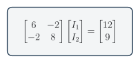
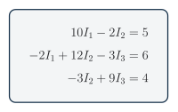

You will turn node or loop equations into a two- or three-variable system and solve it using elimination, matrices, or software. The method finds several unknown currents or voltages at the same time.

**Used in college or university:** Linear algebra, numerical methods, circuits, structures, process models, and control. [[28, Chs. 9, 12]](../../references.qmd#ref-chapra2010)

**Where you see it:** A technician can model several currents in a car wiring network at once. A robotics engineer uses the same mathematics for sensor networks, motor currents, and control models.

## Class materials

- [Teaching slides](https://docs.google.com/presentation/d/1xmE338oWNkDwXAWNaUER9ykXmzFtUNycNhcWU597A0A/edit)
- [Make a copy of the current student problem set](https://docs.google.com/document/d/1DmXKhtsC0AEfR24zmJSCQgU_JLvrGYfIFtn9nOvnmbI/copy)
- [TEJ Electronics Quick Reference](https://andrewandrade.ca/assets/TEJ-Electronics-Quick-Reference.pdf)
- **Teacher answers:** restricted

## A system of equations

Do not force the GUESS method onto a simultaneous system. Use this sequence: **define the variables, write the circuit equations, put them in standard or matrix form, solve, and verify by substitution**.

Each independent Kirchhoff loop gives one equation. Write every equation in the same variable order:

$$
\begin{aligned}
a_{11}x_1 + a_{12}x_2 &= b_1 \\
a_{21}x_1 + a_{22}x_2 &= b_2
\end{aligned}
$$ {#eq-linear-system}

<figure class="ter-circuit-figure" id="fig-circuit-matrix-form">

<figcaption><a class="ter-figure-label" href="#fig-circuit-matrix-form">Figure 1.</a> Coefficients form $A$, unknown currents form $\mathbf{x}$, and source voltages form $\mathbf{b}$. <a class="ter-figure-anchor" href="#fig-circuit-matrix-form" aria-label="Link to Figure 1">#</a></figcaption>
</figure>

The same system is

$$
\underbrace{
\begin{bmatrix}
a_{11} & a_{12} \\
a_{21} & a_{22}
\end{bmatrix}}_{A}
\underbrace{
\begin{bmatrix}
x_1 \\
x_2
\end{bmatrix}}_{\mathbf{x}}
=
\underbrace{
\begin{bmatrix}
b_1 \\
b_2
\end{bmatrix}}_{\mathbf{b}}
$$ {#eq-linear-matrix-form}

In compact form:

$$
A\mathbf{x}=\mathbf{b}
$$ {#eq-linear-compact}

## Solve and check

Use substitution or elimination for a small system. Use a simultaneous-equation or matrix solver for a larger system. Keep the variable order and units consistent, then substitute the answer into the original equations or calculate the residual:

$$
\mathbf{r}=A\mathbf{x}-\mathbf{b}
$$ {#eq-linear-residual}

$$
\mathbf{r}\approx\mathbf{0}
$$ {#eq-linear-zero-residual}

A large residual can flag a wrong sign, wrong measurement, or wiring fault.

## Three unknowns

<figure class="ter-circuit-figure" id="fig-circuit-matrix-three">

<figcaption><a class="ter-figure-label" href="#fig-circuit-matrix-three">Figure 2.</a> Three independent equations solve three unknown currents using the same workflow. <a class="ter-figure-anchor" href="#fig-circuit-matrix-three" aria-label="Link to Figure 2">#</a></figcaption>
</figure>

## Worked solutions {#worked-solutions}

On the course calculator, the **Casio fx-991ES PLUS C**, press `MODE`, then `5` for **EQN**. Press `1` for two unknowns or `2` for three unknowns. Enter each coefficient in equation order and press `=` after every value; after the final coefficient, each additional `=` displays the next solution. This sequence is verified against the [official Casio fx-991ES PLUS C equation guide](https://support.casio.com/global/en/calc/manual/fx-115ESPLUS_991ESPLUSC_en/using_calculation_modes/equation_calculations.html).

::: {.callout-note collapse="true" title="Question 2: Solve a two-by-two system"}
Enter the rows $(10,-4,6)$ and $(-4,12,3)$.

$$
\begin{bmatrix}
10 & -4 \\
-4 & 12
\end{bmatrix}
\begin{bmatrix}
I_1 \\ I_2
\end{bmatrix}
=
\begin{bmatrix}
6 \\ 3
\end{bmatrix}
$$ {#eq-linear-worked-q2-system}

**Final answers:** $I_1=0.808\,\mathrm{mA}$ and $I_2=0.519\,\mathrm{mA}$.

Substitution into both original rows gives a residual of approximately zero.
:::

::: {.callout-note collapse="true" title="Question 4: Solve a three-by-three system"}
Enter the coefficient rows $(10,-2,0,5)$, $(-2,12,-3,6)$, and $(0,-3,9,4)$. The zeros keep the variable columns aligned.

**Final answers:** $I_1=0.657\,\mathrm{mA}$, $I_2=0.786\,\mathrm{mA}$, and $I_3=0.706\,\mathrm{mA}$.

Substitute the three currents into all three original rows to check the solution.
:::
