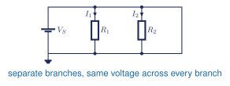

You will identify parallel branches and calculate equivalent resistance, source current, branch current, and power. This explains how several loads can operate independently from one source.

**Used in college or university:** Circuit analysis, electrical distribution, instrumentation, and electronics.

**Where you see it:** A car connects lights and control modules in parallel so each receives battery voltage. A robot does the same when several sensors share one supply.

## Class materials

**Package 1: Basic Electricity to Computer Loads**

- [Teaching slides](https://docs.google.com/presentation/d/1FD7od7Hi5-tcddWI44oEDzjqIKGQnsp7sOmaokiyH5o/edit)
- [Make a copy of the parallel-circuit calculations handout](https://docs.google.com/document/d/11ooJTlUf7ckOjkTP9eyJr8FyojWuOHV9-IFjZ5IoCeA/copy)
- [Make a copy of the circuit-calculations photo submission](https://docs.google.com/document/d/12rTTMbWPdcCYSY07amSF5Ap3b0m08L5NT6NM4pAba_g/copy)
- [Student models for Questions 1 and 2](https://docs.google.com/document/d/1kaUIVX08SYaNkRgvyr9Odzhq9mKNebJ2oXO7mMRjmek/edit)

**Package 2: Parallel Review and Series Circuits**

- [Teaching slides](https://docs.google.com/presentation/d/1kT3OA4uzqouoM693cY6Sl6T6LTt56Ee5V22iqucsO60/edit)
- [Make a copy of the six-question student problem set](https://docs.google.com/document/d/1PIFENbdpPcvp-gOeiFf4zIRl6Lw0TqHrUbFwf6pbE-I/copy)
- [Student worked models for Questions 2 and 4](https://docs.google.com/document/d/1W-SnG4eF0N2PR0vZ3hV8-P-0mhAmmZ-LaEedMVeLZpw/edit)
- [Series-circuit notes](series-circuits.qmd)
- [Sigma notation LaTeX source](https://github.com/mrandrewandrade/tech-edu-resources/blob/master/site/assets/tej/sigma-notation/sigma-notation.tex)

**Core references**

- [TEJ Electronics Quick Reference](https://andrewandrade.ca/assets/TEJ-Electronics-Quick-Reference.pdf)
- [Standard 5% resistor values, page 2](https://andrewandrade.ca/assets/TEJ-Electronics-Quick-Reference.pdf#page=2)
- [Make a copy of the General Schematic and GUESS handout](https://docs.google.com/document/d/1RCkfqUT5U0FMKTOJ_ScyiDLmiGF-bCpyo-6y6Pm8ZUo/copy)
- **Teacher answers:** restricted

## Textbook and laboratory support

- [Grob Chapter 5: Parallel Circuits](https://drive.google.com/file/d/1QwATa8MLIPw76NxLfrvFmx3k-sqrJPZ1/view) - the main reference for branch voltage, current, resistance, and power.
- [Grob Problems Manual](https://drive.google.com/file/d/125X4YkWq2HO8evqYM9jRUuKPsbMXHhdG/view) - solved examples and additional Chapter 5 practice.
- [Experiment 5-1: Parallel Circuits](https://drive.google.com/file/d/13LHObgjmcIDpGDcDyTX0zj0EsjIugOLD/view) - build and verify the common-voltage rule.
- [Experiment 5-2: Parallel Circuits - Resistance Branches](https://drive.google.com/file/d/13QopEG2wKByrspBynRIVA3n8QYQwuuVS/view) - optional resistance extension.
- [Experiment 5-3: Parallel Circuits - Analysis](https://drive.google.com/file/d/13TPd66TjFbvxcFJMJoGYkHXKL_robfmf/view) - optional complete-analysis extension.

## Common voltage

Components are in parallel when both ends connect to the same two nodes. Every branch has the same voltage:

<figure class="ter-circuit-figure" id="fig-parallel-rule">

<figcaption><a class="ter-figure-label" href="#fig-parallel-rule">Figure 1.</a> Parallel-circuit reference schematic. Every branch connects to the same two nodes. <a class="ter-figure-anchor" href="#fig-parallel-rule" aria-label="Link to Figure 1">#</a></figcaption>
</figure>

$$
V_k = V_T
$$ {#eq-parallel-voltage}

## General parallel rules

The source current is the sum of the branch currents:

$$
I_T = \sum_{k=1}^{n} I_k
$$ {#eq-parallel-current}

The equivalent resistance is

$$
\frac{1}{R_T} = \sum_{k=1}^{n}\frac{1}{R_k}
$$ {#eq-parallel-resistance}

For exactly two parallel resistors, the product-over-sum shortcut is

$$
R_T = \frac{R_aR_b}{R_a+R_b}
$$ {#eq-parallel-two-resistors}

Calculate any branch current with Ohm's law:

$$
I_k = \frac{V_T}{R_k}
$$ {#eq-parallel-branch-current}

Total power equals the sum of the branch powers:

$$
P_T = \sum_{k=1}^{n}P_k = V_T I_T
$$ {#eq-parallel-power}

### How sigma notation works

$$
I_T=\sum_{k=1}^{n}I_k=I_1+I_2+\cdots+I_n
$$ {#eq-parallel-sigma-current}

$$
\frac{1}{R_T}=\sum_{k=1}^{n}\frac{1}{R_k}
=\frac{1}{R_1}+\frac{1}{R_2}+\cdots+\frac{1}{R_n}
$$ {#eq-parallel-sigma-resistance}

| Symbol | Meaning |
|---|---|
| $R_T$ or $R_{eq}$ | total or equivalent resistance |
| $R_k$ or $I_k$ | the value at position $k$ |
| $k$ | the index variable; it changes through $1,2,3,\ldots,n$ |
| $n$ | the fixed last index; the sum stops here |

$\Sigma$ means add each term while $k$ runs from $1$ to $n$. The final expanded term uses $n$.

## Check the answer

$$
\sum_{k=1}^{n} I_k \overset{?}{=} I_T
$$ {#eq-parallel-current-check}

Equation @eq-parallel-current-check checks the branch currents. The equivalent resistance from Equation @eq-parallel-resistance must be smaller than the smallest branch resistance.

Question 1 in the review problem set is the parallel review. Teachers can [email Andrew for the complete answer key](mailto:andrew@andrewandrade.ca?subject=TEJ%20parallel%20and%20series%20answer%20key).

These notes follow *Grob's Basic Electronics*, Chapter 5. [[1, Ch. 5]](../../references.qmd#ref-grob2016)

