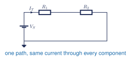

## Learning goals

**I will be able to** identify a series circuit and calculate its total resistance, current, voltage drops, and power.

**This is useful because I can** predict every electrical value before building the circuit and check whether my measurements make sense.

**Used in college or university:** Direct-current circuit analysis and circuit laboratories. [[1, Ch. 4]](../../references.qmd#ref-grob2016)

**Where you see it:** In a car, a lamp circuit can form one path through the battery, fuse, switch, and lamp. In a robot, a status light and current-limiting resistor form the same kind of path.

## Series and parallel

A series circuit has one path, so the current is the same everywhere. A parallel circuit has branches that share the same two nodes, so each branch has the same voltage.

<figure class="ter-circuit-figure" id="fig-series-rule">

<figcaption><a class="ter-figure-label" href="#fig-series-rule">Figure 1.</a> Series-circuit reference schematic. The same current passes through every component. <a class="ter-figure-anchor" href="#fig-series-rule" aria-label="Link to Figure 1">#</a></figcaption>
</figure>

Opening any component stops current everywhere.

## General rules

$$
I_k = I_T
$$ {#eq-series-current}

$$
R_T = \sum_{k=1}^{n} R_k
$$ {#eq-series-resistance}

$$
V_T = \sum_{k=1}^{n} V_k
$$ {#eq-series-voltage}

$$
P_T = \sum_{k=1}^{n} P_k = V_T I_T
$$ {#eq-series-power}

$$
I_T = \frac{V_T}{R_T}
$$ {#eq-series-total-current}

$$
V_k = I_T R_k
$$ {#eq-series-component-voltage}

Here, $k$ means any component in the path. Keep full calculator precision until the final answer.

$$
\sum_{k=1}^{n} V_k \overset{?}{=} V_T
$$ {#eq-series-voltage-check}

Use Equation @eq-series-voltage-check to check the voltage drops. Also check power ratings.

## Calculate then simulate

Calculate the circuit first. Build the same series and parallel circuits in Tinkercad, measure current and voltage, then compare the calculated and simulated values.

## Slides and problem set

- [Parallel Review and Series Circuits teaching slides](https://docs.google.com/presentation/d/1kT3OA4uzqouoM693cY6Sl6T6LTt56Ee5V22iqucsO60/edit)
- [Parallel Review and Series Circuits student problem set](https://docs.google.com/document/d/1PIFENbdpPcvp-gOeiFf4zIRl6Lw0TqHrUbFwf6pbE-I/edit)
- [Electronics formula and calculator reference](https://docs.google.com/document/d/1DyGsEwpLrrwSRnyMXN5kze2qRYFoAY2t-P09wnfUS6c/edit)

The teacher answer key is restricted.
