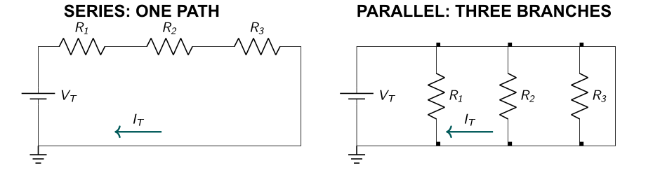
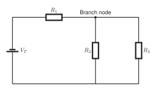
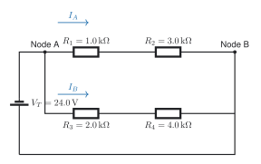
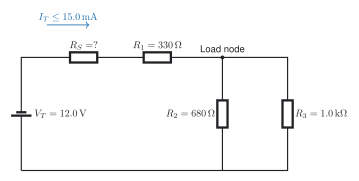

You will identify series and parallel groups, reduce a mixed circuit one group at a time, calculate the total values, and then work back to each resistor. This is useful when one protected power source feeds several loads in a robot, vehicle, computer, or sensor system.

**Used in college or university:** circuit laboratories, electronics, robotics, instrumentation, and preparation for Kirchhoff’s laws. The same circuit pattern lets cars and robots power several loads from one protected source.

**Where you see it:** A car uses a fuse and switch to feed parallel lamps or control modules. A robot uses one protected supply for sensors, indicators, and control boards.

## Class materials

- [Teaching slides](https://docs.google.com/presentation/d/177liW0qHi3201A6RaZl1r-xWMSVoo0rhj-a9np2jsoQ/edit)
- [Make a copy of the student handout](https://docs.google.com/document/d/1AIOR80hBtAXB8klvf509k_TjPQGi4dZ3Wlv_1dJtDK4/copy)
- [TEJ Electronics Quick Reference](https://andrewandrade.ca/assets/TEJ-Electronics-Quick-Reference.pdf)
- [General Schematic and GUESS handout](https://docs.google.com/document/d/1RCkfqUT5U0FMKTOJ_ScyiDLmiGF-bCpyo-6y6Pm8ZUo/copy)
- [LaTeX equations and worked solutions](https://github.com/mrandrewandrade/tech-edu-resources/blob/master/site/assets/tej/series-parallel-latex/series-parallel-assets.tex)
- [TikZ circuit diagram source](https://github.com/mrandrewandrade/tech-edu-resources/blob/master/site/assets/tej/series-parallel-latex/series-parallel-circuits.tex)
- [Asset build script](https://github.com/mrandrewandrade/tech-edu-resources/blob/master/site/assets/tej/series-parallel-latex/render-assets.ps1)
- **Teacher answer key:** restricted

## Chapter and experiment support

- [Grob’s Basic Electronics, Chapter 6: Series-Parallel Circuits](https://drive.google.com/file/d/1QxHUIKGTfRlhZuo7rQmm5SvmqHikY1jL/view) - read Sections 6-1 to 6-7, pages 174-194. [[1, Ch. 6]](../../references.qmd#ref-grob2016)
- [Grob Problems Manual](https://drive.google.com/file/d/125X4YkWq2HO8evqYM9jRUuKPsbMXHhdG/view) - Chapter 6, pages 79-91, has analysis, random-unknown, and Wheatstone-bridge practice.
- [Experiment 6-1: Series-Parallel Circuits - Resistance](https://drive.google.com/file/d/13fG4oiClYfP4AwCF06bAYHwt2I7jQUVs/view)
- [Experiment 6-2: Series-Parallel Circuits - Networks](https://drive.google.com/file/d/13fwCy98RfPBSNvjyKbDY1V6yooTSVw69/view)
- [Experiment 6-3: Series-Parallel Circuits - Analysis](https://drive.google.com/file/d/13peG7DHQd1NQdmmtAQbapZz0EMpWQdzp/view)

## Start with a real system

A robot may have a fuse, switch, and current-limiting resistor in series with several parallel loads. A vehicle uses the same pattern when one protected supply feeds lamps, sensors, or control modules. The series parts affect every load; each parallel branch still receives the same branch voltage.

For an engaging introduction, watch [ElectroBOOM101-005](https://www.youtube.com/watch?v=AMXWm_bnsTE), then use [The Organic Chemistry Tutor’s series and parallel explanation](https://www.youtube.com/watch?v=7mdc-lRrW1c) or [Khan Academy’s circuit review](https://www.khanacademy.org/science/hs-physics-tx/x52b5e54e482d5bbe%3Acircuits-and-electromagnetics/x52b5e54e482d5bbe%3Avoltage-current-resistance/v/electric-circuits-part-2) for the calculation steps.

## Identify the connections

Components are in **series** when the same current must pass through them. Components are in **parallel** when both ends connect to the same two nodes. Trace nodes and current paths; do not decide from visual appearance alone.

<figure class="ter-circuit-figure" id="fig-series-parallel-comparison">

<figcaption><a class="ter-figure-label" href="#fig-series-parallel-comparison">Figure 1.</a> Series has one current path; parallel has branches connected to the same two nodes. <a class="ter-figure-anchor" href="#fig-series-parallel-comparison" aria-label="Link to Figure 1">#</a></figcaption>
</figure>

## Rules and equations

For a series group, current is common, voltage drops add, and resistance adds:

$$
I_T=I_1=I_2=\cdots
$$ {#eq-mixed-series-current}

$$
V_T=\sum_{k=1}^{n}V_k
$$ {#eq-mixed-series-voltage}

$$
R_{\mathrm{series}}=\sum_{k=1}^{n}R_k
$$ {#eq-mixed-series-resistance}

For a parallel group, voltage is common, branch currents add, and reciprocal resistance adds:

$$
V_T=V_1=V_2=\cdots
$$ {#eq-mixed-parallel-voltage}

$$
I_T=\sum_{k=1}^{n}I_k
$$ {#eq-mixed-parallel-current}

$$
\frac{1}{R_{\mathrm{parallel}}}
=\sum_{k=1}^{n}\frac{1}{R_k}
$$ {#eq-mixed-parallel-resistance}

For exactly two parallel resistors:

$$
R_{\mathrm{parallel}}=\frac{R_aR_b}{R_a+R_b}
$$ {#eq-mixed-two-resistors}

For any resistor, use Ohm’s law and power:

$$
V_k=I_kR_k
$$ {#eq-mixed-ohms-law}

$$
P_k=V_kI_k=I_k^2R_k=\frac{V_k^2}{R_k}
$$ {#eq-mixed-power}

## Reduce, solve, expand, and check

1. Mark one true series or parallel group.
2. Replace it with an equivalent resistance and redraw the whole circuit.
3. Repeat until only total resistance remains.
4. Solve the equivalent circuit with $I_T=V_T/R_T$.
5. Work backward. Use common current for series parts and common voltage for parallel branches.
6. Check that branch currents add, voltage drops add around a path, and component powers add to total power.

<figure class="ter-circuit-figure" id="fig-series-parallel-example">

<figcaption><a class="ter-figure-label" href="#fig-series-parallel-example">Figure 2.</a> The common mixed-network pattern used in Questions 1, 2, and 4. <a class="ter-figure-anchor" href="#fig-series-parallel-example" aria-label="Link to Figure 2">#</a></figcaption>
</figure>

## Question 1 worked example {#question-1-worked-example}

A $12.0\,\mathrm{V}$ source supplies $R_1=1.0\,\mathrm{k\Omega}$ in series with $R_2=2.0\,\mathrm{k\Omega}$ and $R_3=2.0\,\mathrm{k\Omega}$ in parallel. This is the complete model for the questions that follow.

**Given**

$$
V_T=12.0\,\mathrm{V},\qquad
R_1=1.0\,\mathrm{k\Omega},\qquad
R_2=R_3=2.0\,\mathrm{k\Omega}
$$ {#eq-mixed-example-given}

**Unknowns**

$$
R_{23},\ R_T,\ I_T,\ V_1,\ V_{23},\ I_2,\ I_3,\ P_T
$$ {#eq-mixed-example-unknowns}

**General equations**

$$
R_{\mathrm{parallel}}=\frac{R_aR_b}{R_a+R_b},\qquad
R_{\mathrm{series}}=\sum_{k=1}^{n}R_k,\qquad
I=\frac{V}{R}
$$ {#eq-mixed-example-general-reduction}

$$
V=IR,\qquad
P=VI
$$ {#eq-mixed-example-general-branches}

**Circuit-specific equations**

$$
R_{23}=\frac{R_2R_3}{R_2+R_3},\qquad
R_T=R_1+R_{23},\qquad
I_T=\frac{V_T}{R_T}
$$ {#eq-mixed-example-circuit-reduction}

$$
V_1=I_TR_1,\qquad
V_{23}=V_T-V_1,\qquad
I_2=\frac{V_{23}}{R_2},\qquad
I_3=\frac{V_{23}}{R_3}
$$ {#eq-mixed-example-circuit-branches}

### Step 1: Equivalent resistance

$$
R_{23}=\frac{(2.0\,\mathrm{k\Omega})(2.0\,\mathrm{k\Omega})}
{2.0\,\mathrm{k\Omega}+2.0\,\mathrm{k\Omega}}
=1.0\,\mathrm{k\Omega}
$$ {#eq-mixed-example-parallel}

$$
R_T=1.0\,\mathrm{k\Omega}+1.0\,\mathrm{k\Omega}
=2.0\,\mathrm{k\Omega}
$$ {#eq-mixed-example-total-resistance}

### Step 2: Total current and section voltages

$$
I_T=\frac{12.0\,\mathrm{V}}{2.0\,\mathrm{k\Omega}}
=6.0\,\mathrm{mA}
$$ {#eq-mixed-example-total-current}

$$
V_1=(6.0\,\mathrm{mA})(1.0\,\mathrm{k\Omega})=6.0\,\mathrm{V}
$$ {#eq-mixed-example-series-voltage}

$$
V_{23}=12.0\,\mathrm{V}-6.0\,\mathrm{V}=6.0\,\mathrm{V}
$$ {#eq-mixed-example-parallel-voltage}

### Step 3: Branch currents and power

$$
I_2=I_3=\frac{6.0\,\mathrm{V}}{2.0\,\mathrm{k\Omega}}
=3.0\,\mathrm{mA}
$$ {#eq-mixed-example-branch-current}

$$
P_T=V_TI_T=(12.0\,\mathrm{V})(6.0\,\mathrm{mA})
=72\,\mathrm{mW}
$$ {#eq-mixed-example-power}

**Calculator entries**

~~~text
(2 EXP 3 × 2 EXP 3) ÷ (2 EXP 3 + 2 EXP 3)
12 ÷ (2 EXP 3)
6 ÷ (2 EXP 3)
~~~

### Step 4: Check

$$
I_2+I_3=3.0\,\mathrm{mA}+3.0\,\mathrm{mA}=6.0\,\mathrm{mA}=I_T
$$ {#eq-mixed-example-current-check}

$$
V_1+V_{23}=6.0\,\mathrm{V}+6.0\,\mathrm{V}=12.0\,\mathrm{V}=V_T
$$ {#eq-mixed-example-voltage-check}

### Final answers

| Quantity | $R_{23}$ | $R_T$ | $I_T$ | $V_1$ | $V_{23}$ | $I_2$ | $I_3$ | $P_T$ |
|---|---:|---:|---:|---:|---:|---:|---:|---:|
| Answer | **<u>$1.0\,\mathrm{k\Omega}$</u>** | **<u>$2.0\,\mathrm{k\Omega}$</u>** | **<u>$6.0\,\mathrm{mA}$</u>** | **<u>$6.0\,\mathrm{V}$</u>** | **<u>$6.0\,\mathrm{V}$</u>** | **<u>$3.0\,\mathrm{mA}$</u>** | **<u>$3.0\,\mathrm{mA}$</u>** | **<u>$72\,\mathrm{mW}$</u>** |

The full calculation, check, and final-answer table are shown here before students begin guided or independent questions.

## Student questions

Use the [student handout](https://docs.google.com/document/d/1AIOR80hBtAXB8klvf509k_TjPQGi4dZ3Wlv_1dJtDK4/copy) for the fillable GUESS tables and work space.

### Question 1: worked model

[Review the complete Question 1 solution](#question-1-worked-example), then use the same sequence for the remaining questions.

### Question 2: unequal parallel branches

An $18.0\,\mathrm{V}$ source supplies $R_1=3.0\,\mathrm{k\Omega}$ in series with $R_2=6.0\,\mathrm{k\Omega}$ and $R_3=3.0\,\mathrm{k\Omega}$ in parallel. Find $R_{23}$, $R_T$, $I_T$, $V_1$, $V_{23}$, $I_2$, $I_3$, and $P_T$. Check current and voltage.

### Question 3: two series branches in parallel

A $24.0\,\mathrm{V}$ source is connected across two branches. Branch A has $R_1=1.0\,\mathrm{k\Omega}$ and $R_2=3.0\,\mathrm{k\Omega}$ in series. Branch B has $R_3=2.0\,\mathrm{k\Omega}$ and $R_4=4.0\,\mathrm{k\Omega}$ in series. Find the branch resistances and currents, every resistor voltage, total current, equivalent resistance, and total power.

<figure class="ter-circuit-figure" id="fig-series-parallel-q3">

<figcaption><a class="ter-figure-label" href="#fig-series-parallel-q3">Figure 3.</a> Question 3 has two series branches connected in parallel. <a class="ter-figure-anchor" href="#fig-series-parallel-q3" aria-label="Link to Figure 3">#</a></figcaption>
</figure>

### Question 4: find an unknown branch resistor

A $20.0\,\mathrm{V}$ source supplies $R_1=1.2\,\mathrm{k\Omega}$ in series with a parallel group. One branch is $R_2=2.4\,\mathrm{k\Omega}$ and the other is an unknown $R_3$. The source current is $10.0\,\mathrm{mA}$. Find $V_1$, $V_{23}$, $I_2$, $I_3$, $R_3$, and $R_T$.

### Question 5: current-limit design

A $12.0\,\mathrm{V}$ source supplies $R_S$, $R_1=330\,\mathrm{\Omega}$, and a parallel load made from $R_2=680\,\mathrm{\Omega}$ and $R_3=1.0\,\mathrm{k\Omega}$. Find the minimum $R_S$ that keeps source current at or below $15.0\,\mathrm{mA}$. Select the next safe [standard 5% value](https://andrewandrade.ca/assets/TEJ-Electronics-Quick-Reference.pdf#page=2), then calculate current, load voltage, branch currents, resistor powers, and suitable power ratings.

<figure class="ter-circuit-figure" id="fig-series-parallel-q5">

<figcaption><a class="ter-figure-label" href="#fig-series-parallel-q5">Figure 4.</a> Question 5 turns the analysis process into a current-limit design. <a class="ter-figure-anchor" href="#fig-series-parallel-q5" aria-label="Link to Figure 4">#</a></figcaption>
</figure>

## Worked student models {#worked-solutions}

Question 1 is the complete example. Questions 2 and 4 are additional models. Complete Questions 3 and 5 independently.

::: {.callout-note collapse="true" title="Question 2: GUESS solution"}
**Given:** $V_T=18.0\,\mathrm{V}$, $R_1=3.0\,\mathrm{k\Omega}$, $R_2=6.0\,\mathrm{k\Omega}$, $R_3=3.0\,\mathrm{k\Omega}$.

**Unknowns:** $R_{23}$, $R_T$, $I_T$, $V_1$, $V_{23}$, $I_2$, $I_3$, $P_T$.

**General equations:** use Equations @eq-mixed-two-resistors, @eq-mixed-series-resistance, @eq-mixed-ohms-law, @eq-mixed-parallel-current, and @eq-mixed-power.

**Substitute and solve**

$$
R_{23}=\frac{(6.0\,\mathrm{k\Omega})(3.0\,\mathrm{k\Omega})}
{6.0\,\mathrm{k\Omega}+3.0\,\mathrm{k\Omega}}
=2.0\,\mathrm{k\Omega}
$$ {#eq-mixed-q2-parallel}

$$
R_T=3.0\,\mathrm{k\Omega}+2.0\,\mathrm{k\Omega}
=5.0\,\mathrm{k\Omega}
$$ {#eq-mixed-q2-total-resistance}

$$
I_T=\frac{18.0\,\mathrm{V}}{5.0\,\mathrm{k\Omega}}
=3.60\,\mathrm{mA}
$$ {#eq-mixed-q2-total-current}

$$
V_1=(3.60\,\mathrm{mA})(3.0\,\mathrm{k\Omega})
=10.8\,\mathrm{V}
$$ {#eq-mixed-q2-series-voltage}

$$
V_{23}=18.0\,\mathrm{V}-10.8\,\mathrm{V}
=7.2\,\mathrm{V}
$$ {#eq-mixed-q2-parallel-voltage}

$$
I_2=\frac{7.2\,\mathrm{V}}{6.0\,\mathrm{k\Omega}}
=1.20\,\mathrm{mA},\qquad
I_3=\frac{7.2\,\mathrm{V}}{3.0\,\mathrm{k\Omega}}
=2.40\,\mathrm{mA}
$$ {#eq-mixed-q2-branch-currents}

$$
P_T=(18.0\,\mathrm{V})(3.60\,\mathrm{mA})
=64.8\,\mathrm{mW}
$$ {#eq-mixed-q2-power}

**Statement:** $R_{23}=2.0\,\mathrm{k\Omega}$, $R_T=5.0\,\mathrm{k\Omega}$, $I_T=3.60\,\mathrm{mA}$, $V_1=10.8\,\mathrm{V}$, $V_{23}=7.2\,\mathrm{V}$, $I_2=1.20\,\mathrm{mA}$, $I_3=2.40\,\mathrm{mA}$, and $P_T=64.8\,\mathrm{mW}$.

**Check:** $I_2+I_3=I_T$ and $V_1+V_{23}=V_T$.
:::

::: {.callout-note collapse="true" title="Question 4: GUESS solution"}
**Given:** $V_T=20.0\,\mathrm{V}$, $R_1=1.2\,\mathrm{k\Omega}$, $R_2=2.4\,\mathrm{k\Omega}$, $I_T=10.0\,\mathrm{mA}$.

**Unknowns:** $V_1$, $V_{23}$, $I_2$, $I_3$, $R_3$, $R_T$.

**General equations**

$$
V_1=I_TR_1,\qquad V_{23}=V_T-V_1,\qquad
I_2=\frac{V_{23}}{R_2}
$$ {#eq-mixed-q4-general-known-branch}

$$
I_3=I_T-I_2,\qquad
R_3=\frac{V_{23}}{I_3},\qquad
R_T=\frac{V_T}{I_T}
$$ {#eq-mixed-q4-general-unknown-branch}

**Substitute and solve**

$$
V_1=(10.0\,\mathrm{mA})(1.2\,\mathrm{k\Omega})
=12.0\,\mathrm{V}
$$ {#eq-mixed-q4-series-voltage}

$$
V_{23}=20.0\,\mathrm{V}-12.0\,\mathrm{V}
=8.0\,\mathrm{V}
$$ {#eq-mixed-q4-parallel-voltage}

$$
I_2=\frac{8.0\,\mathrm{V}}{2.4\,\mathrm{k\Omega}}
=3.333333\ldots\,\mathrm{mA}
$$ {#eq-mixed-q4-known-current}

$$
I_3=10.0\,\mathrm{mA}-3.333333\ldots\,\mathrm{mA}
=6.666667\ldots\,\mathrm{mA}
$$ {#eq-mixed-q4-unknown-current}

$$
R_3=\frac{8.0\,\mathrm{V}}{6.666667\,\mathrm{mA}}
=1.20\,\mathrm{k\Omega}
$$ {#eq-mixed-q4-unknown-resistance}

$$
R_T=\frac{20.0\,\mathrm{V}}{10.0\,\mathrm{mA}}
=2.00\,\mathrm{k\Omega}
$$ {#eq-mixed-q4-total-resistance}

**Statement:** $V_1=12.0\,\mathrm{V}$, $V_{23}=8.0\,\mathrm{V}$, $I_2=3.33\,\mathrm{mA}$, $I_3=6.67\,\mathrm{mA}$, $R_3=1.20\,\mathrm{k\Omega}$, and $R_T=2.00\,\mathrm{k\Omega}$.

**Check:** $I_2+I_3=10.0\,\mathrm{mA}=I_T$.
:::

## Lab connection

Use [Experiment 6-1](https://drive.google.com/file/d/13fG4oiClYfP4AwCF06bAYHwt2I7jQUVs/view) to verify equivalent resistance before applying power. Continue with [Experiment 6-2](https://drive.google.com/file/d/13fwCy98RfPBSNvjyKbDY1V6yooTSVw69/view) or [Experiment 6-3](https://drive.google.com/file/d/13peG7DHQd1NQdmmtAQbapZz0EMpWQdzp/view) to compare calculated and measured values.

**Equipment:** breadboard, digital multimeter, low-voltage direct-current supply, and leads.

**Consumables:** the resistor values specified by the selected experiment.

**Evidence:** circuit photo, measured-value table, calculated-value table, percent differences, and one brief explanation of the largest difference.

**Safety:** switch off the supply before moving components or measuring resistance. Measure current with the meter placed in series, never directly across a source.

Teachers can [email Andrew for the complete answer key](mailto:andrew@andrewandrade.ca?subject=TEJ%20series-parallel%20answer%20key).

