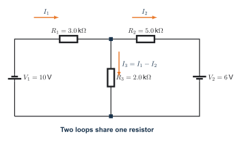
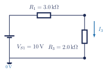
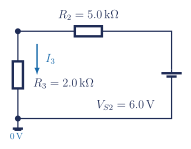
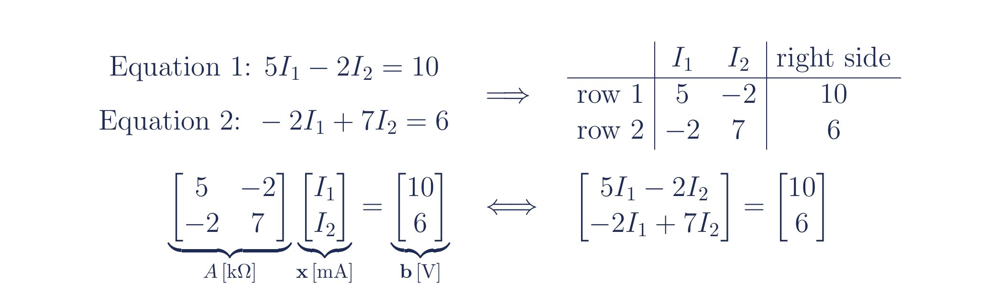

## Learning goals

- I can define the current directions in a two-loop circuit.
- I can write one signed KVL equation for each loop.
- I can rearrange both equations into the same variable order.
- I can build $A\mathbf{x}=\mathbf{b}$ and solve it with NumPy and SymPy.
- I can verify the answer using residuals, substitution, and KCL.

## Why this is useful

Two loops share one component, so the current through the shared component depends on both loop currents. A matrix does not replace the circuit reasoning. It organizes the equations after the arrows, signs, units, and KVL equations are correct.

This bridge has two parts. Question 4 is the fully worked teaching example. Question 5 is the independent transfer task: the helper questions reveal the process, but not the completed coefficients, matrix, or currents.

## What you will make

Submit one Jupyter notebook showing this complete chain:

::: {.tej-process-chain role="list" aria-label="Assignment workflow"}
<span class="tej-process-chain__step" role="listitem">arrows</span>
<span class="tej-process-chain__arrow" aria-hidden="true">&rarr;</span>
<span class="tej-process-chain__step" role="listitem">two KVL equations</span>
<span class="tej-process-chain__arrow" aria-hidden="true">&rarr;</span>
<span class="tej-process-chain__step" role="listitem">standard form</span>
<span class="tej-process-chain__arrow" aria-hidden="true">&rarr;</span>
<span class="tej-process-chain__step" role="listitem">$A\mathbf{x}=\mathbf{b}$</span>
<span class="tej-process-chain__arrow" aria-hidden="true">&rarr;</span>
<span class="tej-process-chain__step" role="listitem">two solver methods</span>
<span class="tej-process-chain__arrow" aria-hidden="true">&rarr;</span>
<span class="tej-process-chain__step" role="listitem">verification</span>
:::

## Before you start

1. Complete [Python and NumPy Foundations](python-numpy-foundations.qmd). You should already be able to run all cells, inspect an array, call a function, read basic documentation, and make an assertion pass.
2. Download the [printable two-loop-to-matrix guide](../../assets/electronics/handouts/two-loop-to-matrix-bridge.pdf).
3. Download [Notebook 3A: From Two Loops to a Matrix](../../assets/tej-computational/notebooks/03a-two-loop-to-matrix-bridge.ipynb).
4. Keep your returned Question 4 and Question 5 work available. Use the released Question 4 answer for comparison, but do not copy the released Question 5 answer into the scaffold.
5. Choose a Jupyter route:
   - **Browser route:** click **[OPEN JUPYTERLITE NOW](https://jupyter.org/try-jupyter/lab/){target="_blank"}**. In JupyterLite, click **Upload Files**, select `03a-two-loop-to-matrix-bridge.ipynb`, and double-click it. Choose **Python (Pyodide)** if asked. See the [step-by-step JupyterLite instructions](jupyterlite.qmd) for saving, downloading, and reopening work.
   - **Local route:** [run Jupyter locally using WSL, Windows, macOS, or Linux](local-python-jupyter.qmd).
6. Rename the notebook before working:

```text
studentnumber-lastname-kirchhoff-jupyter.ipynb
```

Example: `123456789-Smith-kirchhoff-jupyter.ipynb`. Keep the `.ipynb` ending.

::: {.callout-note title="Textbook and lesson support"}
- [Grob, Chapter 9: Kirchhoff's Laws, pp. 264–281](https://drive.google.com/file/d/1RXDje9v9TuuNF4V1Jlqemcsn1qJlKcjz/view)
- [Problems Manual, Chapter 9](https://drive.google.com/file/d/125X4YkWq2HO8evqYM9jRUuKPsbMXHhdG/view)
- [ElectroBOOM101-008: Lumped Model and Kirchhoff Circuit Laws](https://www.youtube.com/watch?v=d-a9Pr2z-qg)
- [Kirchhoff lesson and worked Question 4](../circuits/kirchhoffs-laws.qmd#worked-solutions)

This checkpoint is a computational verification activity. No physical lab is required tomorrow.
:::

## Part A: Worked Question 4

Follow the complete example once. Each line performs one algebra move, so you can reuse the method without reusing the numbers.

### 1. Use Kirchhoff's Current Law to define the three currents

:::: {.tej-current-visual}
<figure class="ter-circuit-figure" id="fig-question4-current-map">

<figcaption><a class="ter-figure-label" href="#fig-question4-current-map">Figure 1.</a> Read the current arrows before reading the equations. The top centre junction connects all three current paths. <a class="ter-figure-anchor" href="#fig-question4-current-map" aria-label="Link to Figure 1">#</a></figcaption>
</figure>

::: {.tej-current-node-card}
#### Kirchhoff's Current Law at the junction

At the top centre junction:

<div class="tej-current-flow" role="list" aria-label="Current directions at the top junction">
  <div class="tej-current-flow__row is-entering" role="listitem"><span class="tej-current-flow__tag">$I_1$</span><strong>enters</strong><span>from the left</span></div>
  <div class="tej-current-flow__row is-leaving" role="listitem"><span class="tej-current-flow__tag">$I_2$</span><strong>leaves</strong><span>to the right</span></div>
  <div class="tej-current-flow__row is-leaving" role="listitem"><span class="tej-current-flow__tag">$I_3$</span><strong>leaves</strong><span>downward</span></div>
</div>

::: {.tej-current-equation}
**current entering = current leaving**

$$
I_1=I_2+I_3
$$

$$
I_1-I_2-I_3=0
$$

$$
\boxed{I_3=I_1-I_2}
$$
:::
:::
::::

Use clockwise mesh currents $I_1$ and $I_2$. Define $I_3$ downward through the shared resistor, as shown. Keep the arrows and the equation $I_3=I_1-I_2$ visible beside the work.

### 2. Derive Equation 1 from Loop 1

:::: {.tej-loop-equation-visual}
<figure class="ter-circuit-figure" id="fig-question4-loop1-isolated">

<figcaption><a class="ter-figure-label" href="#fig-question4-loop1-isolated">Figure 2.</a> Isolate Loop 1 before writing its KVL equation. Only the three components crossed by this loop are shown. <a class="ter-figure-anchor" href="#fig-question4-loop1-isolated" aria-label="Link to Figure 2">#</a></figcaption>
</figure>

::: {.tej-loop-sign-card}
#### Turn the circuit into signed terms

<div class="tej-loop-sign-list" role="list" aria-label="Loop 1 signed KVL terms">
  <div class="tej-loop-sign-row is-rise" role="listitem"><span class="tej-loop-sign-symbol">$V_{S1}$</span><span>source rise</span><strong>$+10$</strong></div>
  <div class="tej-loop-sign-row is-drop" role="listitem"><span class="tej-loop-sign-symbol">$R_1$</span><span>with $I_1$</span><strong>$-3I_1$</strong></div>
  <div class="tej-loop-sign-row is-drop" role="listitem"><span class="tej-loop-sign-symbol">$R_3$</span><span>with $I_3$</span><strong>$-2I_3$</strong></div>
</div>

::: {.tej-loop-sign-equation}
$$
+10-3I_1-2I_3=0
$$
:::
:::
::::

Use the printable guide and record each signed KVL term:

| Element | Signed term | Reason |
|---|---:|---|
| $V_{S1}=10\,\mathrm{V}$ | $+10$ | source rise |
| $R_1=3.0\,\mathrm{k\Omega}$ | $-3I_1$ | travel with $I_1$ |
| $R_3=2.0\,\mathrm{k\Omega}$ | $-2I_3$ | travel with the defined $I_3$ |

Do not replace the resistor-voltage symbols with numbers in one jump. Show the complete chain:

$$
+10-V_{R1}-V_{R3}=0,
$$

$$
V_{R1}=I_1R_1=3I_1,\qquad V_{R3}=I_3R_3=2I_3,
$$

$$
+10-3I_1-2I_3=0,
$$

$$
+10-3I_1-2(I_1-I_2)=0,
$$

$$
+10-3I_1-2I_1+2I_2=0,
$$

$$
+10-5I_1+2I_2=0,
$$

$$
-5I_1+2I_2=-10,
$$

$$
\boxed{5I_1-2I_2=10}.
$$

The second-last line subtracts $10$ from both sides. The final line multiplies the complete equation by $-1$ so the leading coefficient is positive.

### 3. Derive Equation 2 from Loop 2

:::: {.tej-loop-equation-visual}
<figure class="ter-circuit-figure" id="fig-question4-loop2-isolated">

<figcaption><a class="ter-figure-label" href="#fig-question4-loop2-isolated">Figure 3.</a> Isolate Loop 2. This loop crosses the shared resistor in the direction opposite the defined $I_3$ arrow. <a class="ter-figure-anchor" href="#fig-question4-loop2-isolated" aria-label="Link to Figure 3">#</a></figcaption>
</figure>

::: {.tej-loop-sign-card}
#### The shared-resistor sign changes

<div class="tej-loop-sign-list" role="list" aria-label="Loop 2 signed KVL terms">
  <div class="tej-loop-sign-row is-rise" role="listitem"><span class="tej-loop-sign-symbol">$V_{S2}$</span><span>source rise</span><strong>$+6$</strong></div>
  <div class="tej-loop-sign-row is-drop" role="listitem"><span class="tej-loop-sign-symbol">$R_2$</span><span>with $I_2$</span><strong>$-5I_2$</strong></div>
  <div class="tej-loop-sign-row is-rise" role="listitem"><span class="tej-loop-sign-symbol">$R_3$</span><span>against $I_3$</span><strong>$+2I_3$</strong></div>
</div>

::: {.tej-loop-sign-equation}
$$
+6-5I_2+2I_3=0
$$
:::
:::
::::

Loop 2 travels through the shared resistor against the defined direction of $I_3$. Its resistor term is therefore positive.

| Element | Signed term | Reason |
|---|---:|---|
| $V_{S2}=6.0\,\mathrm{V}$ | $+6$ | source rise |
| $R_2=5.0\,\mathrm{k\Omega}$ | $-5I_2$ | travel with $I_2$ |
| $R_3=2.0\,\mathrm{k\Omega}$ | $+2I_3$ | travel against the defined $I_3$ |

Again, begin with resistor-voltage symbols and show one algebra move per line:

$$
+6-V_{R2}+V_{R3}=0,
$$

$$
V_{R2}=I_2R_2=5I_2,\qquad V_{R3}=I_3R_3=2I_3,
$$

$$
+6-5I_2+2I_3=0,
$$

$$
+6-5I_2+2(I_1-I_2)=0,
$$

$$
+6-5I_2+2I_1-2I_2=0,
$$

$$
+6+2I_1-5I_2-2I_2=0,
$$

$$
+6+2I_1-7I_2=0,
$$

$$
2I_1-7I_2=-6,
$$

$$
\boxed{-2I_1+7I_2=6}.
$$

Multiplying the complete equation by $-1$ does not change its solution.

### 4. Build the matrix

State the variable order before entering any coefficients:

$$
[I_1,I_2].
$$

<figure class="tej-matrix-bridge-figure" id="fig-question4-matrix-bridge">

<figcaption><a class="ter-figure-label" href="#fig-question4-matrix-bridge">Figure 4.</a> Each circuit equation becomes one matrix row. The variable order $[I_1,I_2]$ fixes the column order. <a class="ter-figure-anchor" href="#fig-question4-matrix-bridge" aria-label="Link to Figure 4">#</a></figcaption>
</figure>

Read each standard-form equation from left to right:

| Equation | coefficient of $I_1$ | coefficient of $I_2$ | right side |
|---|---:|---:|---:|
| $5I_1-2I_2=10$ | $5$ | $-2$ | $10$ |
| $-2I_1+7I_2=6$ | $-2$ | $7$ | $6$ |

Therefore,

$$
\underbrace{\begin{bmatrix}5&-2\\-2&7\end{bmatrix}}_{A\,[\mathrm{k\Omega}]}
\underbrace{\begin{bmatrix}I_1\\I_2\end{bmatrix}}_{\mathbf{x}\,[\mathrm{mA}]}
=
\underbrace{\begin{bmatrix}10\\6\end{bmatrix}}_{\mathbf{b}\,[\mathrm{V}]}.
$$

The matrix multiplication is only a compact way to write the same two row equations:

$$
\begin{bmatrix}
5I_1+(-2)I_2\\
(-2)I_1+7I_2
\end{bmatrix}
=
\begin{bmatrix}10\\6\end{bmatrix}.
$$

Read the top row as Equation 1 and the bottom row as Equation 2. If either read-back equation differs from the boxed KVL equation, fix the matrix before calling a solver.

Use the row-reading cells in Notebook 3A to turn both rows back into equations. Do not continue until they match the two boxed equations above.

### 5. Solve with numerical linear algebra

Run the NumPy cells using:

```python
A = np.array([
    [ 5.0, -2.0],  # Equation 1 coefficients
    [-2.0,  7.0],  # Equation 2 coefficients
])
b = np.array([10.0, 6.0])
currents_mA = np.linalg.solve(A, b)
residual_V = A @ currents_mA - b
```

Print $I_1$, $I_2$, and the two residuals with units. Keep the residual assertion in the code.

### 6. Solve symbolically

Run the SymPy cells. Keep the exact fractional results visible before converting them to decimals.

```python
I1, I2 = sp.symbols("I1 I2")
equations = [
    sp.Eq(5*I1 - 2*I2, 10),
    sp.Eq(-2*I1 + 7*I2, 6),
]
exact_solution = sp.solve(
    equations,
    (I1, I2),
    dict=True,
)[0]
```

Calculate $I_3=I_1-I_2$ symbolically and numerically.

### 7. Compare and verify

Complete the notebook comparison table:

::: {.tej-table-scroll}
| Quantity | Original work | Released answer | NumPy | SymPy exact | Agreement and explanation |
|---|---:|---:|---:|---:|---|
| $I_1$ |  |  |  |  |  |
| $I_2$ |  |  |  |  |  |
| $I_3$ |  |  |  |  |  |
:::

Then verify:

- Equation 1 by substitution;
- Equation 2 by substitution;
- $I_3=I_1-I_2$;
- the NumPy residual vector.

## Part B: Build Question 5 without being given the matrix

Use your original Question 5 circuit and work through the prompts below. The symbols $a_{11}$, $a_{12}$, $a_{21}$, $a_{22}$, $b_1$, and $b_2$ are placeholders. Replace them with coefficients obtained from **your own algebra**.

::: {.callout-warning title="Do not start with the released answer"}
The purpose is to translate a circuit into a system. Complete the two standard-form equations, coefficient table, matrix, and row read-back before comparing currents with the released answer.
:::

### B1. Define the currents before doing algebra

Answer these questions in a Markdown cell:

1. Which direction did you assign to $I_1$?
2. Which direction did you assign to $I_2$?
3. Which direction did you assign to the shared-branch current $I_3$?
4. Is your shared-current relationship $I_3=I_1-I_2$ or $I_3=I_2-I_1$? Why does it match your arrow?

### B2. Rearrange both loop equations one move at a time

For **each** loop, show all seven lines below. Do not combine multiple algebra moves on one line.

1. Write signed KVL using resistor-voltage symbols such as $V_{R1}$.
2. Replace every resistor voltage with $IR$.
3. Substitute your expression for $I_3$.
4. Distribute the resistance coefficient through the bracket.
5. Reorder the terms into the variable order $[I_1,I_2]$.
6. Combine like terms.
7. Move the constant to the right side. If you multiply by $-1$, multiply **every** term.

Your final equations must have this form:

$$
\boxed{a_{11}I_1+a_{12}I_2=b_1}
$$

$$
\boxed{a_{21}I_1+a_{22}I_2=b_2}.
$$

### B3. Extract coefficients instead of guessing them

Copy this table into the notebook and replace every blank:

| Question 5 equation | coefficient of $I_1$ | coefficient of $I_2$ | right side |
|---|---:|---:|---:|
| Equation 1 |  |  |  |
| Equation 2 |  |  |  |

Now construct the matrix using the same variable order in both rows:

$$
\underbrace{\begin{bmatrix}a_{11}&a_{12}\\a_{21}&a_{22}\end{bmatrix}}_{A}
\underbrace{\begin{bmatrix}I_1\\I_2\end{bmatrix}}_{\mathbf{x}}
=
\underbrace{\begin{bmatrix}b_1\\b_2\end{bmatrix}}_{\mathbf{b}}.
$$

Replace the six placeholders with your Question 5 numbers. Then expand the top matrix row back into Equation 1 and the bottom row back into Equation 2. The read-back equations must match your boxed equations exactly.

### B4. Use Jupyter as a check, not as the source of the equations

Enter your coefficients only after completing B1-B3. Use the Question 5 scaffold in Notebook 3A to:

- print both rows beside the equations they represent;
- solve $A\mathbf{x}=\mathbf{b}$ numerically;
- calculate the shared current using your chosen current definition;
- calculate $A\mathbf{x}-\mathbf{b}$;
- compare with the released answer only after the residual and row read-back checks pass.

## Progressive hints

::: {.callout-tip collapse="true" title="Hint 1: concept clue"}
The mesh currents oppose each other in the shared resistor. Start with $I_3=I_1-I_2$ and substitute that expression into both KVL equations.
:::

::: {.callout-tip collapse="true" title="Hint 2: documentation clue"}
Search `numpy.linalg.solve A shape` or `SymPy solve simultaneous equations`. Use the official [NumPy solve documentation](https://numpy.org/doc/stable/reference/generated/numpy.linalg.solve.html) and [SymPy solver documentation](https://docs.sympy.org/latest/guides/solving/solve-system-of-equations-algebraically.html).
:::

::: {.callout-tip collapse="true" title="Hint 3: technical clue"}
With variable order $[I_1,I_2]$, use Row 1 $[5,-2]$, Row 2 $[-2,7]$, and right side $[10,6]$. Read both rows back as equations before solving.
:::

::: {.callout-tip collapse="true" title="Question 5 hint: matrix structure, not the answer"}
The first boxed equation supplies $[a_{11},a_{12}]$ and $b_1$. The second supplies $[a_{21},a_{22}]$ and $b_2$. Keep the order $[I_1,I_2]$ in both rows. This tells you where coefficients go without revealing their values.
:::

## Common issues

### The shared resistor has the wrong sign

Loop 1 travels with the defined $I_3$, so its term is $-2I_3$. Loop 2 travels against $I_3$, so its term is $+2I_3$.

### The matrix solves the wrong equations

Check the variable order and read each row back as an equation. A solver cannot recognize that a coefficient was copied into the wrong column.

### SymPy is not installed

If you see `ModuleNotFoundError: No module named 'sympy'`, use the current course JupyterLite environment or install the provided requirements in the local virtual environment:

```bash
python -m pip install -r requirements-jupyter.txt
```

### A negative current appears

A negative current means the real current is opposite the arrow selected before solving. It is not automatically an error.

## Check your work

- [ ] The current arrows and $I_3=I_1-I_2$ are visible.
- [ ] Both loop sign tables are present.
- [ ] Every algebra line from KVL to standard form is visible.
- [ ] The variable order and units are stated.
- [ ] Both matrix rows are read back as equations.
- [ ] NumPy produces the currents and residual vector.
- [ ] SymPy produces exact fractional results.
- [ ] $I_3$ is calculated and interpreted.
- [ ] Original, released, numerical, and symbolic results are compared.
- [ ] Question 5 includes both seven-line rearrangements, two boxed standard-form equations, a completed coefficient table, and a matrix row read-back.
- [ ] Question 5 is solved only after its matrix has been derived.

## Save and submit

1. Restart the kernel.
2. Run all required cells from top to bottom.
3. Confirm that no required cell ends with an unexpected error.
4. Save and download `studentnumber-lastname-kirchhoff-jupyter.ipynb`.
5. Reopen the downloaded notebook and confirm that the Markdown, code, and output are present.
6. Submit the `.ipynb` file through the assigned classroom system.

## Later hands-on verification

::: {.callout-important title="Build later - not required for this notebook submission"}
Students can eventually test the model with a low-voltage circuit board. Start with a one-battery, three-resistor network to verify KCL and KVL. To reproduce a two-source problem like Question 4, use two isolated battery holders or a current-limited dual bench supply.

A practical classroom system should include:

- switched AA battery holders or a current-limited low-voltage supply - never wall voltage;
- $1\,\mathrm{k\Omega}$ to $4.7\,\mathrm{k\Omega}$ resistors so currents remain in the milliampere range;
- a breadboard or labelled terminal board with colour-coded current paths;
- power-off wiring checks before connecting either source;
- voltage measurements across each resistor, followed by $I=V/R$ to infer current before students attempt direct current measurement;
- a comparison table for predicted, simulated, and measured values.

Use the measured battery voltages in the equations because real batteries will not equal their printed values exactly. The physical goal is agreement within component and measurement tolerance, not perfect decimal matching.
:::

## Next lesson

The intentional keyword error, array-shape error, silent unit bug, parameter sweep, capacitors, and RC response are later checkpoints. They are not required tomorrow.

## Help improve this lesson (optional)

If something got in the way, tell the teacher which step, sign, diagram, or code cell was unclear, what you still do not know how to do, and one change that would help the next student. If you can fix the wording, schematic, example, or starter code, show the teacher. A useful fix may be added to the course website and credited to you.
