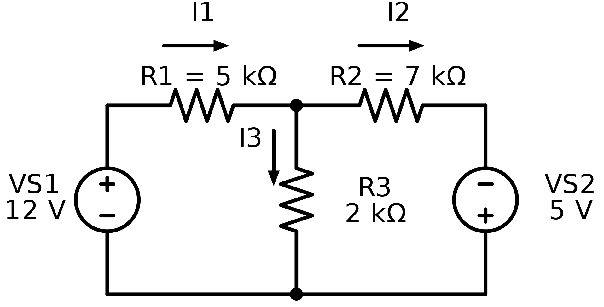

::: {.callout-important title="One assignment for Monday and Tuesday"}
Use the **same notebook for both days**. Begin with the short Jupyter activity, then improve your Life Checkpoint.

**This is your opportunity to improve your Life Checkpoint mark to 100%. Correct every section, show your calculations, and use Tinkercad and Python to verify your work.**
:::

## What you will submit

1. One completed notebook named `studentnumber-lastname-life-checkpoint-upgrade.ipynb`.
2. One saved Tinkercad circuit named `studentnumber-lastname-life-checkpoint`.
3. The direct URL for the saved Tinkercad circuit.
4. One screenshot with the simulation running and a meter reading visible: `studentnumber-lastname-life-checkpoint.png`.

Use a fake name only in public examples. Keep your student number, class code, and work inside the approved classroom systems.

## Two-day plan

| Day | Work in the same notebook | Evidence to save |
|---|---|---|
| Monday | Open and rename the notebook, complete the circuit-themed Python warm-up, then digitize Ohm's law, power, the simple schematic, the two loop diagrams, and KCL | working code, rendered calculations, and clear diagrams |
| Tuesday | Complete the KVL algebra, matrix, NumPy solution, circuit dashboard, and Tinkercad build | checked calculations, Tinkercad URL, and meter screenshot |

If one section stops you, continue to the next section and return later.

## 1. Open the notebook

1. Download [the Life Checkpoint Upgrade notebook](../../assets/tej-computational/notebooks/09-midterm-three-current-circuit.ipynb).
2. Open **[JupyterLite](https://jupyter.org/try-jupyter/lab/){target="_blank"}**.
3. Select **Upload Files** and choose the downloaded `.ipynb` file.
4. Double-click the uploaded notebook. Choose **Python (Pyodide)** if asked.
5. Rename it `studentnumber-lastname-life-checkpoint-upgrade.ipynb`.
6. Work in this same file on Monday and Tuesday. Download a backup before leaving each day.

Use the [step-by-step JupyterLite instructions](jupyterlite.qmd) if the notebook does not open.

::: {.callout-note title="No Linux command is required"}
Try Jupyter runs inside the browser. Complete the Python cells in the notebook; do not spend assignment time trying to run `apt`, `!pwd`, `!ls`, or other Linux shell commands.
:::

## 2. Start with something fun

The notebook begins with a visual **Circuit Grid**:

1. **Complete the circuit:** change one number in a pixel grid. An open path stays red; a closed path lights the lamp and gives an immediate success message.
2. **Bug Hunt:** repair a broken resistance value by recognizing when Python is treating a number as text.
3. **Customize the Lab:** change the circuit-lab title card and colours.
4. **Unlock the Checkpoint:** correct Python calculations produce a `CIRCUIT VERIFIED` screen.
5. **Tinkercad Boss Level:** enter the three measured currents. If they agree with Python, the notebook displays `SIMULATION MATCH: LIFE CHECKPOINT 100% AVAILABLE`.

The warm-up teaches the same Python tools used in the engineering work:

- a variable stores a value;
- a list stores several values in order;
- `print()` displays text;
- a function reuses instructions;
- NumPy stores the solved currents;
- Matplotlib turns the number grid and verified results into a circuit board, graph, and unlock screens.

Students change one clearly marked value, run the cell, and use immediate visual feedback. The games lead directly into the same Ohm's law and verification skills required by the checkpoint.

## 3. Digitize the original checkpoint

The notebook contains the original tasks in order:

1. Ohm's law and resistor power for a $12\,\mathrm{V}$ source and $2.0\,\mathrm{k\Omega}$ resistor;
2. a simple series schematic with a $9\,\mathrm{V}$ source, closed switch, $1\,\mathrm{k\Omega}$ resistor, polarity, and a current arrow;
3. the complete two-loop circuit and each loop by itself;
4. KCL at the centre node;
5. both KVL equations with every algebra move;
6. the $2\times2$ matrix and NumPy solution;
7. an independent KCL and KVL check;
8. Tinkercad measurements.

Use a **Markdown** cell for calculations. Press **Shift+Enter** to render the LaTeX.

| What you need | Type this | It renders as |
|---|---|---|
| inline math | `$V=IR$` | $V=IR$ |
| subscript | `$I_1$` | $I_1$ |
| fraction | `$I=\frac{V}{R}$` | $I=\frac{V}{R}$ |
| units | `$12\,\mathrm{V}$` | $12\,\mathrm{V}$ |
| displayed equation | `$$V=IR$$` | $$V=IR$$ |

## 4. Life Checkpoint circuit

{fig-alt="Life Checkpoint circuit with two sources, three resistors, and labelled current arrows."}

Read the arrows before writing KCL. In this diagram, $I_1$ enters the centre node while $I_2$ and $I_3$ leave:

$$
I_1=I_2+I_3.
$$

The notebook gives restart equations after the derivation so that one algebra error does not block the remaining work:

$$
7I_1-2I_2=12,
$$

$$
-2I_1+9I_2=5.
$$

Students must still show how each equation was produced. NumPy then checks the completed matrix.

## 5. Build and verify in Tinkercad

1. Open the assigned Tinkercad Classroom starter.
2. Set the sources to $12\,\mathrm{V}$ and $5\,\mathrm{V}$.
3. Set the resistors to $5\,\mathrm{k\Omega}$, $7\,\mathrm{k\Omega}$, and $2\,\mathrm{k\Omega}$.
4. Wire the exact circuit shown above.
5. Follow the [Tinkercad wiring and measurement guide](../circuits/tinkercad-circuits.qmd).
6. Start the simulation and measure the voltage across all three resistors.
7. Use $I=V/R$ to obtain all three currents.
8. Directly measure at least one current with the meter placed in series.
9. Record the results, direct circuit URL, and screenshot filename in the notebook.

Use consistent wire colours:

- **red:** positive supply connections;
- **black:** shared return;
- **blue:** left loop;
- **green:** right loop;
- **purple:** shared resistor branch.

Route wires around components and labels. A crossing is not a connection unless a junction is visible.

{fig-alt="Actual Tinkercad Circuits workspace showing the incomplete starter and the Start Simulation button."}

## Marks: opportunity to earn 100%

| Evidence | Marks |
|---|---:|
| Circuit Grid, Bug Hunt, and title card are complete | 10 |
| Ohm's law, power, units, and simple schematic | 15 |
| Complete circuit, isolated loops, and KCL | 15 |
| KVL algebra and LaTeX shown one move at a time | 20 |
| Matrix, NumPy solution, graph, and independent checks | 20 |
| Tinkercad topology, values, measurements, URL, screenshot, and comparison | 20 |
| **Total** | **100** |

Correct work earns marks at every stage. An error in one section does not erase correct work in a later section.

## Check and submit

1. Select **Kernel > Restart Kernel and Run All Cells**.
2. Fix every unexpected red error.
3. Confirm that the LaTeX renders and the graph appears.
4. Confirm that the Tinkercad results table, URL, and screenshot filename are complete.
5. Download the finished `.ipynb` file.
6. Reopen the downloaded file and confirm that the work and outputs are present.
7. Submit the notebook and screenshot. Paste the Tinkercad URL in the assignment post.

## Common issues

| Problem | Fix |
|---|---|
| LaTeX appears as code | Change the cell to Markdown and press **Shift+Enter**. |
| Code runs but no graph appears | Run the setup cell first, then run the graph cell again. |
| Answer is off by 1000 | Keep $\mathrm{k\Omega}$ with $\mathrm{mA}$, or $\Omega$ with $\mathrm{A}$. |
| NumPy reports a matrix error | Check that `A` has two rows and two columns and `b` has two values. |
| Tinkercad current is zero | Trace the complete branch and make sure the current meter is in series. |
| Tinkercad disagrees with Python | Compare one component value, node, polarity, and meter connection at a time. |

## Help improve this lesson (optional)

If one instruction, diagram, or code scaffold was unclear, show the teacher the exact place and suggest one specific improvement. A useful fix may be added to the course site and credited to you.
