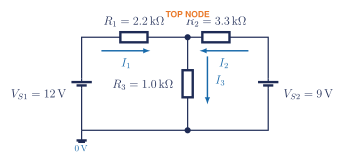
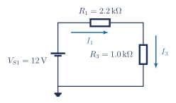
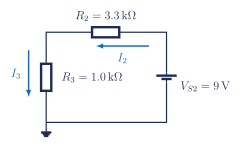
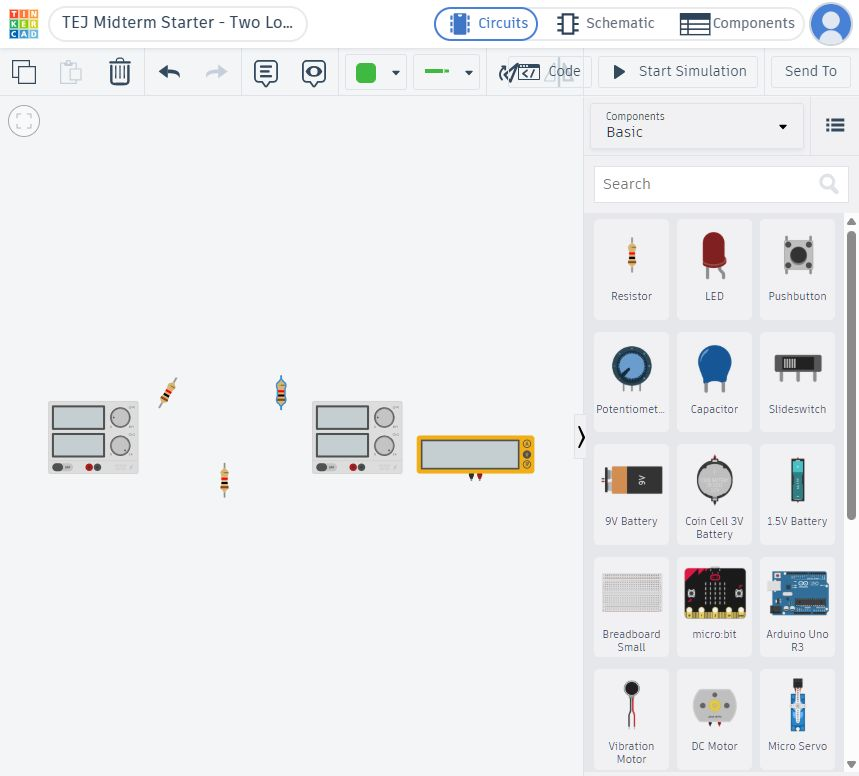
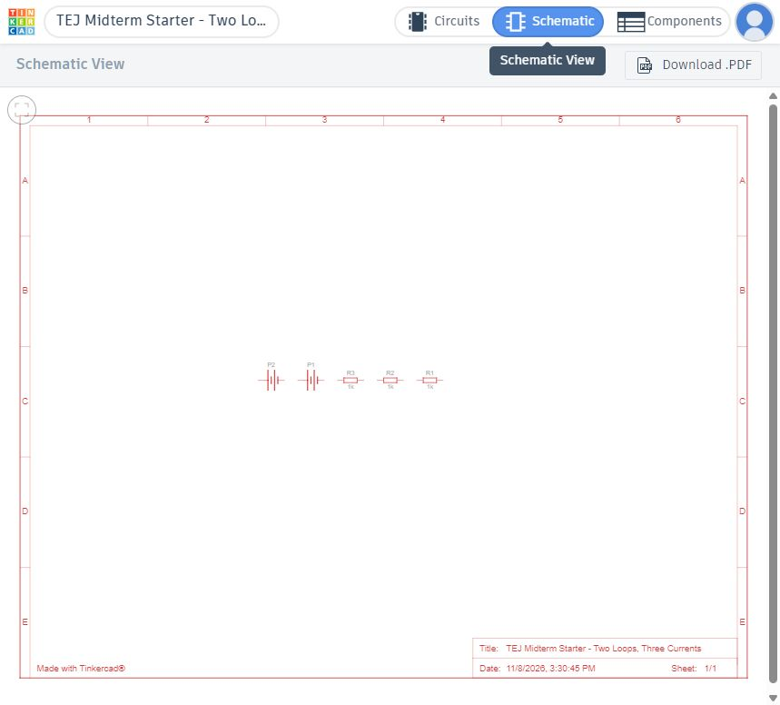

## What you will submit

1. One completed Jupyter notebook: `studentnumber-lastname-midterm-circuit.ipynb`.
2. One saved Tinkercad circuit named `studentnumber-lastname-midterm-circuit`.
3. The direct URL for your saved Tinkercad circuit.
4. One screenshot with the simulation running and a meter reading visible: `studentnumber-lastname-midterm-circuit.png`.

Use a fake name only in public examples. Keep your student number, class code, and work inside the approved classroom systems.

## Learning goals

- I can show circuit calculations with basic LaTeX in a Jupyter Markdown cell.
- I can write one KCL equation and two KVL equations from a schematic.
- I can arrange three equations as $A\mathbf{x}=\mathbf{b}$ and solve them with NumPy.
- I can build the same circuit in Tinkercad and compare predicted and simulated values.

## This week's plan

| Day | Main work | Evidence to save |
|---|---|---|
| Monday | Open the notebook; learn the five LaTeX patterns; define the currents; write KCL; isolate both loops; derive both KVL equations; build the $3\times3$ matrix | rendered LaTeX, Equations 1–3, and completed coefficient table |
| Tuesday | Open the attached Tinkercad starter; set the values; arrange and wire the circuit; simulate and measure | saved simulation and clear meter evidence |
| Wednesday | Solve with NumPy; check Ohm's law and power; compare the calculated and simulated values | currents, residuals, power, and comparison table |
| Thursday | Restart and run all; fix errors; complete and submit missing course work | notebook, Tinkercad URL, and screenshot |

If you finish early, use the remaining time to complete missing work.

## 1. Open the notebook

1. Download [the Midterm Three-Current Circuit notebook](../../assets/tej-computational/notebooks/09-midterm-three-current-circuit.ipynb).
2. Open **[JupyterLite](https://jupyter.org/try-jupyter/lab/){target="_blank"}**.
3. Click **Upload Files**. Choose the downloaded `.ipynb` file.
4. Double-click the uploaded notebook. Choose **Python (Pyodide)** if asked.
5. Rename it `studentnumber-lastname-midterm-circuit.ipynb` before doing the work.

Use the [step-by-step JupyterLite instructions](jupyterlite.qmd) if the notebook does not open.

::: {.callout-note title="No Linux command is required"}
Try Jupyter runs JupyterLite inside the browser. It is not a normal Linux computer. Complete the small Python environment cell in the notebook; do not spend assignment time trying to make `!pwd`, `!ls`, `apt`, or other shell commands work. Local Jupyter or WSL commands are an optional extension only.
:::

## 2. Type calculations with LaTeX

Double-click a **Markdown** cell to edit it. Press **Shift+Enter** to render it.

| What you need | Type this in a Markdown cell | It renders as |
|---|---|---|
| inline math | `$V=IR$` | $V=IR$ |
| subscript | `$I_1$` | $I_1$ |
| fraction | `$I=\frac{V}{R}$` | $I=\frac{V}{R}$ |
| units | `$12\,\mathrm{V}$` | $12\,\mathrm{V}$ |
| displayed equation | `$$V=IR$$` | $$V=IR$$ |

Use one displayed line for each algebra move. For example:

$$
I=\frac{V}{R}
$$

$$
I=\frac{5.00\,\mathrm{V}}{1.00\,\mathrm{k\Omega}}
$$

$$
I=5.00\,\mathrm{mA}
$$

Do not submit a screenshot of handwritten math in place of the required LaTeX cells.

## 3. The circuit problem

The two sources feed the top node. Use the current arrows shown. Do not change an arrow after beginning the equations.

<figure class="ter-circuit-figure" id="fig-midterm-three-current-network">

<figcaption><a class="ter-figure-label" href="#fig-midterm-three-current-network">Figure 1.</a> The original midterm circuit. Use $I_1$, $I_2$, and $I_3$ in this order throughout the notebook.</figcaption>
</figure>

### Equation 1: KCL at the top node

Write one equation using

$$
\text{current entering}=\text{current leaving}.
$$

Then move every current term to the left so the right side is zero. Show both lines in LaTeX.

### Equation 2: KVL around the left loop

<figure class="ter-circuit-figure" id="fig-midterm-loop1">

<figcaption><a class="ter-figure-label" href="#fig-midterm-loop1">Figure 2.</a> Use only the source and two resistor drops crossed by the left loop.</figcaption>
</figure>

Show these steps in separate displayed lines:

1. Source rise and resistor-voltage drops.
2. Replace each resistor voltage with $IR$.
3. Substitute the given values in $\mathrm{k\Omega}$ and $\mathrm{V}$.
4. Move the current terms into the variable order $[I_1,I_2,I_3]$.
5. Box the standard-form equation.

### Equation 3: KVL around the right loop

<figure class="ter-circuit-figure" id="fig-midterm-loop2">

<figcaption><a class="ter-figure-label" href="#fig-midterm-loop2">Figure 3.</a> Use only the source and two resistor drops crossed by the right loop.</figcaption>
</figure>

Repeat the same five steps. Keep the variable order $[I_1,I_2,I_3]$, even when one current is missing from an equation. A missing current has coefficient zero.

## 4. Build the matrix

Copy the coefficients from the three standard-form equations. Do not guess them from the picture.

| Equation | coefficient of $I_1$ | coefficient of $I_2$ | coefficient of $I_3$ | right side |
|---|---:|---:|---:|---:|
| KCL |  |  |  |  |
| left-loop KVL |  |  |  |  |
| right-loop KVL |  |  |  |  |

Then write

$$
\underbrace{\begin{bmatrix}
a_{11}&a_{12}&a_{13}\\
a_{21}&a_{22}&a_{23}\\
a_{31}&a_{32}&a_{33}
\end{bmatrix}}_{A}
\underbrace{\begin{bmatrix}I_1\\I_2\\I_3\end{bmatrix}}_{\mathbf{x}}
=
\underbrace{\begin{bmatrix}b_1\\b_2\\b_3\end{bmatrix}}_{\mathbf{b}}.
$$

Replace every placeholder with your coefficients. Read each row back as an equation before running the solver.

## 5. Solve and check in Python

The notebook contains the code scaffold. Complete `A` and `b`, then run:

```python
currents_mA = np.linalg.solve(A, b)
residual_V = A @ currents_mA - b
```

The residuals should be extremely close to zero. That proves the solution satisfies the equations you entered. It does **not** prove those equations match the circuit, so complete these independent checks:

- KCL at the top node;
- KVL around the left loop;
- KVL around the right loop;
- resistor power using $P=I^2R$ for all three resistors.

Use $\mathrm{k\Omega}$ with $\mathrm{mA}$ in the matrix so the voltage result is in $\mathrm{V}$. Convert to amperes and ohms before calculating watts.

## 6. Build and measure it in Tinkercad

### Start from the class activity

1. Open the teacher's Tinkercad class.
2. Open **Midterm Circuit Investigation - LaTeX, NumPy, and Tinkercad**.
3. Choose **Tinker this** to make your own copy of the starter.
4. Rename the copy `studentnumber-lastname-midterm-circuit`.

The starter already contains two DC power supplies, three resistors, and a multimeter. It is intentionally incomplete: students must set the values, arrange the parts, and build the circuit from Figure 1.

{fig-alt="Actual Tinkercad Circuits workspace showing the incomplete starter with two power supplies, three resistors, and a multimeter."}

### Set the component values

1. Click one resistor.
2. In its settings box, type the resistance number.
3. Choose the correct unit: **kΩ**.
4. Repeat for all three resistors.
5. Click each power supply and set its voltage.

Use the schematic values: $R_1=2.2\,\mathrm{k\Omega}$, $R_2=3.3\,\mathrm{k\Omega}$, $R_3=1.0\,\mathrm{k\Omega}$, $V_{S1}=12\,\mathrm{V}$, and $V_{S2}=9\,\mathrm{V}$.

{fig-alt="Actual Tinkercad resistor settings panel with the Resistance field and kilohm unit menu."}

### Keep the wiring clear

Use the same wire colours throughout the circuit:

- **red:** positive supply connections;
- **black:** the shared negative or ground return;
- **blue:** the left-loop branch;
- **green:** the right-loop branch;
- **purple:** the shared $R_3$ branch.

1. Move the parts into the same left, centre, and right positions as Figure 1.
2. Click one terminal and then its destination terminal.
3. Click an empty point to make a right-angle bend.
4. Route wires around parts and labels, not through them.
5. Keep wires separated when they are not connected.
6. Make every real junction obvious. A crossing by itself is not a connection.

Do not copy a finished Tinkercad circuit. Use Figure 1 as the electrical plan and the colour list above as the wiring convention.

### Use Tinkercad's Schematic view as a check

The screenshot below is the real starter in **Schematic** view before wiring. The parts appear, but there are no connection lines. After wiring the Circuits view, return here: the connection lines should match Figure 1. Missing or extra lines mean the topology still needs work.

{fig-alt="Actual Tinkercad Schematic view showing the unwired starter components without connection lines."}

### Simulate and measure

1. Compare every node with Figure 1.
2. Choose **Start Simulation**.
3. Measure the voltage across each resistor.
4. Use $I=V/R$ to calculate each branch current.
5. Directly measure at least one current by opening that branch and placing the multimeter in series.
6. Stop the simulation before moving any wire or meter.

Complete this table in the notebook:

| Quantity | NumPy prediction | Tinkercad result | absolute difference |
|---|---:|---:|---:|
| $I_1$ (mA) |  |  |  |
| $I_2$ (mA) |  |  |  |
| $I_3$ (mA) |  |  |  |
| top-node voltage (V) |  |  |  |
| $P_{R3}$ (mW) |  |  |  |

Copy the direct circuit URL from the browser after the design is saved. If the class account does not allow a share link, submit the URL, exact design name, and screenshot; the teacher can open the design through the Tinkercad Classroom.

## Marks: 50

| Evidence | Marks |
|---|---:|
| LaTeX renders correctly and every value has a unit | 6 |
| KCL and both KVL derivations are shown one move at a time | 14 |
| coefficient table, $3\times3$ matrix, NumPy solution, and residuals | 12 |
| Ohm's law, KCL/KVL substitution, and resistor-power checks | 6 |
| Tinkercad topology, values, measurements, URL, screenshot, and comparison | 10 |
| notebook runs from top to bottom and is named correctly | 2 |
| **Total** | **50** |

Correct work earns marks at each stage. A wrong final current does not erase correct current directions, equations, LaTeX, matrix rows, code, or simulation evidence.

## Check and submit

1. Choose **Kernel > Restart Kernel and Run All Cells**.
2. Fix every unexpected red error.
3. Confirm the equations, code, outputs, Tinkercad table, and URL are present.
4. Download the finished `.ipynb` file from JupyterLite.
5. Reopen the downloaded file and confirm your work is still there.
6. Submit the notebook and screenshot. Paste the Tinkercad URL in the assignment post.
7. Submit any missing course work in its original post.

## Common issues

| Problem | Fix |
|---|---|
| LaTeX shows as plain text | Put it in a Markdown cell, include `$...$` or `$$...$$`, then press **Shift+Enter**. |
| `np.linalg.solve` reports a singular matrix | One row is still zero, duplicated, or copied in the wrong order. Read all three matrix rows back as equations. |
| Answer is off by 1000 | Keep $\mathrm{k\Omega}$ with $\mathrm{mA}$, or $\Omega$ with $\mathrm{A}$. Do not mix the two pairs. |
| Tinkercad current is zero | Trace the branch, confirm a complete return path, and check that the meter is in series. |
| Tinkercad value disagrees with Python | Compare one component value, one node, one polarity, and one meter connection at a time. |

## Course source

The method is adapted from the branch-current workflow in **Grob's Basic Electronics, Chapter 9: Kirchhoff's Laws** and the accompanying [Problems Manual, Section 9-3](https://drive.google.com/file/d/14tvslnLyvOMci-5YBw_jHbHw_jxmsTfQ/view){target="_blank"}. The circuit, values, diagrams, notebook, and assessment are original course materials.

## Help improve this lesson (optional)

If one step, diagram, or code scaffold was unclear, show the teacher the exact place and one specific fix. A useful fix may be added to the course site and credited to you.
