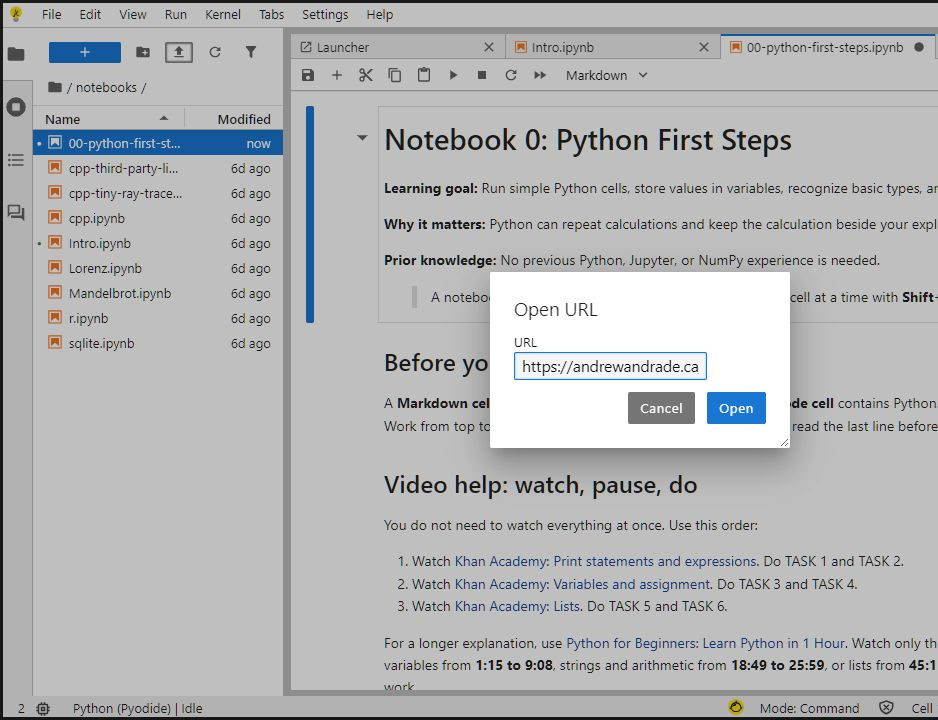
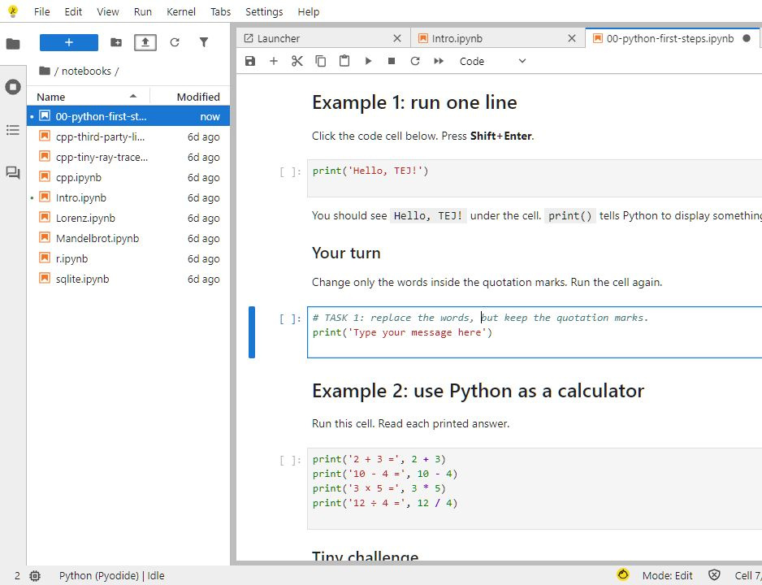
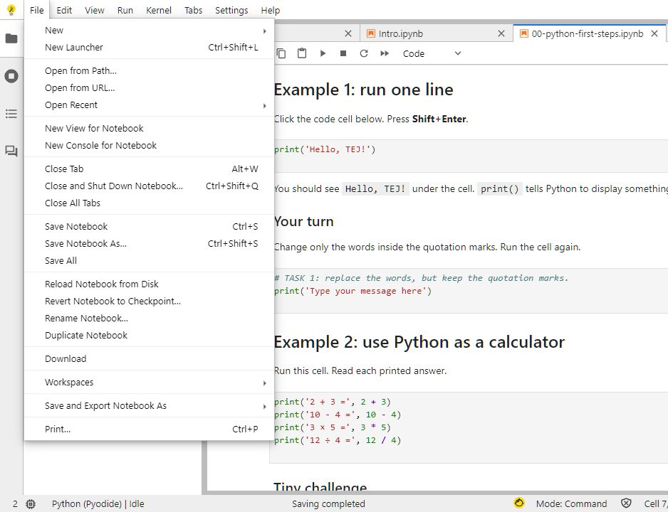

## What you will do

- Run Python code with **Shift+Enter**.
- Change text and numbers.
- Use variables, types, lists, and one NumPy array.
- Fix the code until its checks pass.

## Why this is useful

Python follows instructions exactly. Quotation marks, brackets, commas, names, and spelling matter.

## What you will make

You will complete a small notebook that starts with `print('Hello, TEJ!')`. By the end, you will change one number in a three-number array.

You do **not** need previous Python, Jupyter, NumPy, or linear-algebra experience.

## Before you start

::: {.callout-important title="Open the beginner notebook"}
1. Click **[OPEN JUPYTERLITE](https://jupyter.org/try-jupyter/lab/){target="_blank"}**.
2. Choose **File > Open from URL**.
3. Paste this notebook link:

   `https://andrewandrade.ca/tech-edu-resources/assets/tej-computational/notebooks/00-python-first-steps.ipynb`

4. Click **Open**.
5. Choose **Python (Pyodide)** if asked.
:::

If that does not work, [download Notebook 0](../../assets/tej-computational/notebooks/00-python-first-steps.ipynb), then use the **Upload Files** button in JupyterLite.

## What to click

### 1. Open the notebook

Choose **File > Open from URL**. Paste the notebook link and click **Open**.

{fig-alt="JupyterLite Open URL box with the Notebook 0 web address entered"}

### 2. Run a cell

Click a code cell. Press **Shift+Enter**.

{fig-alt="Notebook 0 showing the first print example and TASK 1"}

### 3. Download your work

Choose **File > Download** before you leave.

{fig-alt="JupyterLite File menu showing the Download command"}

Need more help opening the notebook? Use the [step-by-step JupyterLite guide](jupyterlite.qmd).

## Videos

Watch one short video. Then do the matching tasks.

| Watch | Then do |
|---|---|
| [Khan Academy: Print statements and expressions](https://www.khanacademy.org/computing/intro-to-python-fundamentals/x5279a44ae0ab15d6%3Acomputational-thinking-with-variables/x5279a44ae0ab15d6%3Aprogram-execution/v/plus-operator-and-the-print-function) | TASK 1 and TASK 2 |
| [Khan Academy: Variables and assignment](https://www.khanacademy.org/computing/intro-to-python-fundamentals/x5279a44ae0ab15d6%3Acomputational-thinking-with-variables/x5279a44ae0ab15d6%3Avariables/v/what-is-a-variable-python) | TASK 3 and TASK 4 |
| [Khan Academy: Lists](https://www.khanacademy.org/computing/intro-to-python-fundamentals/x5279a44ae0ab15d6%3Aautomating-tasks-with-lists/x5279a44ae0ab15d6%3Alist-indices/v/lists) | TASK 5 and TASK 6 |

### Need more help?

Open [Python for Beginners: Learn Python in 1 Hour](https://www.youtube.com/watch?v=kqtD5dpn9C8). Watch only the part you need.

| Topic | Watch this part |
|---|---:|
| First program and variables | `1:15 to 9:08` |
| Strings and arithmetic | `18:49 to 25:59` |
| Lists | `45:11 to 48:47` |

Pause the video while you work. If YouTube is blocked, use the short videos.

## Basic assignment

1. Open Notebook 0.
2. Watch the first short video. Complete TASK 1 and TASK 2.
3. Watch the variables video. Complete TASK 3 and TASK 4.
4. Watch the lists video. Complete TASK 5 and TASK 6.
5. Run the notebook from top to bottom.
6. Fix any red errors until the checks pass.
7. Download and submit the `.ipynb` file.

Submit only your completed notebook. You do not need video notes.

## 1. Learn the two cell types

| Cell type | What it contains | What you do |
|---|---|---|
| Markdown | directions | read it |
| Code | Python instructions | edit it and press **Shift+Enter** |

Work from the top of the notebook to the bottom. Run every working example before changing it.

## 2. Print one line

Run:

```python
print("Hello, TEJ!")
```

You should see `Hello, TEJ!` under the cell. Change only the words inside the quotation marks and run it again.

## 3. Use Python as a calculator

The notebook shows four operations:

```python
2 + 3
10 - 4
3 * 5
12 / 4
```

Python uses `*` for multiplication and `/` for division. Complete the tiny challenge by changing two numbers so the answer is `10`.

## 4. Store values in variables

A **variable** is a name that stores a value.

```python
voltage_V = 9.0
```

Read this as “store `9.0` in `voltage_V`.” The `=` sign stores the value; it is not asking a question.

## 5. Recognize four basic types

| Python type | Plain meaning | Example |
|---|---|---|
| `int` | whole number | `1000` |
| `float` | number with a decimal point | `9.0` |
| `str` | text inside quotation marks | `"resistor"` |
| `bool` | `True` or `False` | `False` |

Run `type(value)` to ask Python what kind of value it is. Complete the four starter variables in the notebook.

## 6. Calculate with variables

The notebook uses Ohm's law:

$$
I=\frac{V}{R}
$$

```python
current_A = voltage_V / resistance_ohm
```

Change the resistance to `2000.0`. Run the cell and check the new current.

## 7. Keep several values together

Suppose you test a circuit at three voltages. You could create three separate variables:

```python
voltage_1_V = 1.5
voltage_2_V = 3.0
voltage_3_V = 4.5
```

That code works, but the three readings are not grouped together. A **list** puts them together under one name.

## 8. Use a list as the first container

A **list** stores several values inside square brackets:

```python
voltage_list_V = [1.5, 3.0, 4.5]
```

Each stored value has a numbered position called an **index**:

| Index | `0` | `1` | `2` |
|---|---:|---:|---:|
| Stored voltage | `1.5 V` | `3.0 V` | `4.5 V` |

Python starts counting indexes at zero:

- `[0]` selects the first value;
- `[1]` selects the second value;
- `[2]` selects the third value.

Replace the starter list and print its third value.

## 9. Make a NumPy array

A **NumPy array stores numbers in order.** Square brackets hold the numbers, and commas separate them.

| Place | First | Middle | Last |
|---|---:|---:|---:|
| Number | `1.0` | `2.0` | `3.0` |

## 10. Build the first NumPy array

NumPy is the tool that makes the array. Run this code without changing it:

```python
import numpy as np
numbers = np.array([1.0, 2.0, 3.0])
print(numbers)
```

The output is `[1. 2. 3.]`. Those are the same three numbers.

## 11. Small task

1. Find the middle number, `2.0`.
2. Change only `2.0` to `4.0`.
3. Press **Shift+Enter**.
4. Keep fixing the code until it prints `Checks passed.`

## Check your work

- TASK 1 through TASK 6 are complete.
- Every cell has been run from top to bottom.
- The final code cell prints three numbers.
- The final code cell prints `Checks passed.`

## Save and submit

Choose **File > Download**. Rename the file:

```text
studentnumber-lastname-python-first-steps.ipynb
```

Example: `123456789-Smith-python-first-steps.ipynb`. Keep the `.ipynb` ending.

## Common issues

| Problem | Try this |
|---|---|
| Nothing happens | Click inside the cell and press **Shift+Enter**. |
| `NameError` | Check the variable spelling and run the earlier cell that creates it. |
| `SyntaxError` | Check quotation marks, brackets, and punctuation. |
| The answer looks old | Choose **Kernel > Restart Kernel and Run All Cells**. |
| NumPy does not load | Confirm that the selected kernel is **Python (Pyodide)**. |
