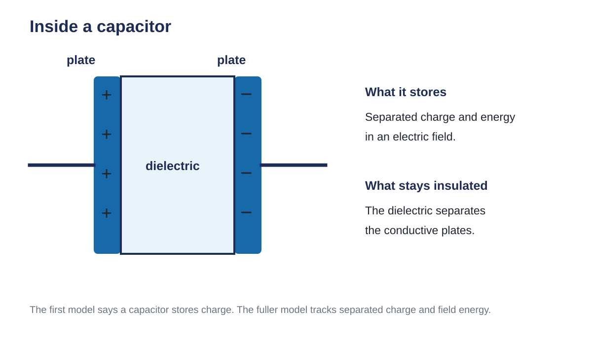
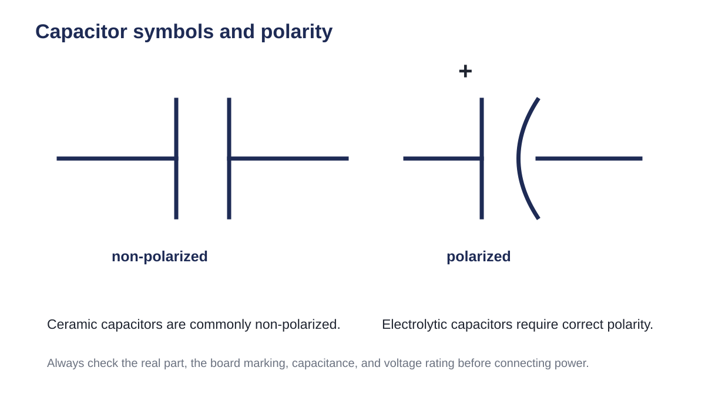
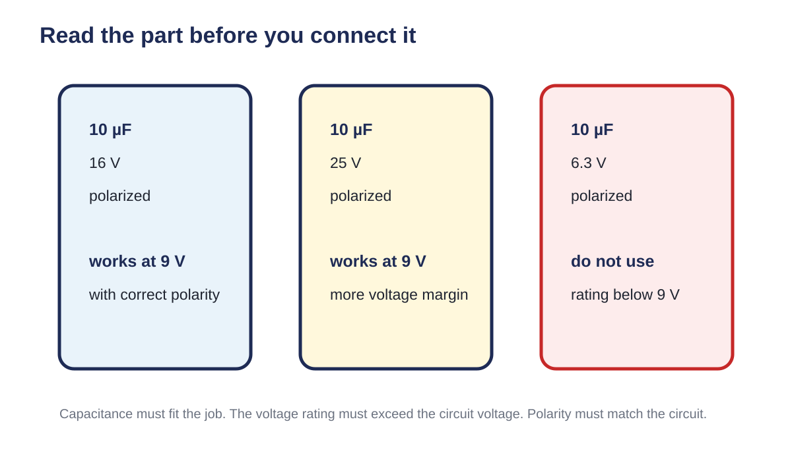

This is the first lesson in the capacitor sequence. Start here even if the hardware is not available.

::: {.callout-note title="This week: November 16 to 20"}

1. **Monday, Lab 225:** Open the [capacitor slides](https://docs.google.com/presentation/d/1QKVYTvEYKO5p1Tl6bNlBuRuYwMWiad3VUAgJcsY9Dbg/edit){target="_blank"}. Start at slide 1, play the ElectroBOOM video on slide 3, and continue through slide 18. Then complete Parts 1 and 2 of the [beginner notebook](https://jupyter.org/try-jupyter/lab/index.html?fromURL=https%3A%2F%2Fandrewandrade.ca%2Ftech-edu-resources%2Fassets%2Ftej-computational%2Fnotebooks%2F10-capacitors-from-zero.ipynb){target="_blank"}. Stop there.
2. **Tuesday, Portable 1:** Most students complete the [two-page capacitor worksheet](../../../assets/electronics/worksheets/capacitors-tuesday-worksheet.pdf). A small group will rotate through the [component-sorting table](../../circuits/hands-on-circuit-stations.qmd), using resistance mode to check resistors and reading the markings on capacitors. No powered circuit is required.
3. **Wednesday to Friday:** Finish Monday and Tuesday work and follow the teacher's directions. The next hardware lesson will be chosen after the components and meters are checked. RC circuits, Tinkercad, and the circuit stations are not assigned yet.

:::

::: {.callout-important title="Open the lesson materials"}

- **[Teaching slides](https://docs.google.com/presentation/d/1QKVYTvEYKO5p1Tl6bNlBuRuYwMWiad3VUAgJcsY9Dbg/edit){target="_blank"}**
- **[Make a copy of the five-question sheet](https://docs.google.com/document/d/138IqjbDNyc9cwkKJ89LeYGx-B810x_O3lUpjP9jJKz4/copy){target="_blank"}**
- **[Open the notebook in JupyterLite](https://jupyter.org/try-jupyter/lab/index.html?fromURL=https%3A%2F%2Fandrewandrade.ca%2Ftech-edu-resources%2Fassets%2Ftej-computational%2Fnotebooks%2F10-capacitors-from-zero.ipynb){target="_blank"}**
- [Download the notebook](../../../assets/tej-computational/notebooks/10-capacitors-from-zero.ipynb)
- **[Download the Tuesday printable worksheet](../../../assets/electronics/worksheets/capacitors-tuesday-worksheet.pdf)**

:::

## What you will learn

- A capacitor has two conductors separated by an insulating dielectric.
- Capacitance is measured in farads.
- Many capacitors use microfarads, nanofarads, or picofarads.
- A polarized capacitor must be connected the correct way.
- The voltage rating must be greater than the circuit voltage.

## Look inside a capacitor

<figure class="ter-circuit-figure" id="fig-capacitor-structure" data-diagram-source="../../../assets/electronics/schematics/capacitor-structure.svg">

<figcaption><a class="ter-figure-label" href="#fig-capacitor-structure">Figure 1.</a> Charge does not pass straight through the dielectric. The separated charge creates an electric field.</figcaption>
</figure>

## Symbols and polarity

<figure class="ter-circuit-figure" id="fig-capacitor-symbols" data-diagram-source="../../../assets/electronics/schematics/capacitor-symbols.svg">

<figcaption><a class="ter-figure-label" href="#fig-capacitor-symbols">Figure 2.</a> Check polarity before connecting an electrolytic capacitor.</figcaption>
</figure>

## Units

$$
1\,\mathrm{F}=10^6\,\mu\mathrm{F},\qquad
1\,\mu\mathrm{F}=10^3\,\mathrm{nF},\qquad
1\,\mathrm{nF}=10^3\,\mathrm{pF}
$$

Example:

$$
220\,\mathrm{nF}\left(\frac{1\,\mu\mathrm{F}}{1000\,\mathrm{nF}}\right)=0.220\,\mu\mathrm{F}
$$

The unit you do not want cancels.

## Read the part before connecting it

<figure class="ter-circuit-figure" id="fig-capacitor-selection" data-diagram-source="../../../assets/electronics/schematics/capacitor-selection.svg">

<figcaption><a class="ter-figure-label" href="#fig-capacitor-selection">Figure 3.</a> Check capacitance, voltage rating, polarity, and physical fit.</figcaption>
</figure>

## Charge and energy

The charge stored by an ideal capacitor is:

$$
Q=CV
$$

The stored energy is:

$$
E=\frac{CV^2}{2}
$$

Use farads for $C$, volts for $V$, coulombs for $Q$, and joules for $E$.

::: {.callout-warning title="Safe handling"}
Disconnect power, discharge through a suitable resistor, and verify the voltage before handling a capacitor. Do not short a charged capacitor with a screwdriver.
:::

## Worked example using GUESS

A $68\,\mu\mathrm{F}$ capacitor is charged to $9.0\,\mathrm{V}$. Find the stored charge.

**Given**

$$C=68\times10^{-6}\,\mathrm{F},\qquad V=9.0\,\mathrm{V}$$

**Unknown**

$$Q=?$$

**Equation**

$$Q=CV$$

**Substitute and solve**

$$
Q=(68\times10^{-6}\,\mathrm{F})(9.0\,\mathrm{V})
=612\times10^{-6}\,\mathrm{C}
$$

**Statement**

The capacitor stores $612\,\mu\mathrm{C}$ of charge.

## Complete the work

1. Watch [ElectroBOOM101-006: Capacitors](https://www.youtube.com/watch?v=rbCXKhhzBN0){target="_blank"} and the short calculation sections in [The Organic Chemistry Tutor capacitor lesson](https://www.youtube.com/watch?v=7H4I5dUnBB0){target="_blank"}.
2. Complete the five-question sheet.
3. Run the notebook and use it to check the arithmetic.
4. Submit the question sheet and the completed `.ipynb` file.

If the direct notebook link does not open, [download the notebook](../../../assets/tej-computational/notebooks/10-capacitors-from-zero.ipynb), open **[JupyterLite](https://jupyter.org/try-jupyter/lab/){target="_blank"}**, click **Upload Files**, and double-click the notebook.

**Textbook support:** Grob, Chapter 16, sections 16-1 to 16-4, pp. 484-515. Practice support: Problems Manual, Chapter 16, pp. 238-250. Optional teacher-approved lab: Experiment 16-1. [[1, Ch. 16]](../../../references.qmd#ref-grob2016)

Equation and diagram source files

- [LaTeX equation source](../../../assets/electronics/equations/capacitor-rc-slides/capacitor-rc-equations.tex)
- [Capacitor symbols](../../../assets/electronics/schematics/capacitor-symbols.svg)
- [Capacitor structure](../../../assets/electronics/schematics/capacitor-structure.svg)

## Next lesson

Continue to [RC Charging and Discharging](rc-charge-discharge.qmd).

## Help improve this lesson

If a direction, diagram, or code cell is unclear, identify the exact step. Explain what you tried and what happened. A specific report can improve the lesson for everyone.
