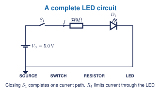

## Learning goals

- I can identify the anode and cathode using a symbol, marking, or verified datasheet.
- I can explain forward bias and reverse bias using a useful beginner model.
- I can select an LED current-limiting resistor.
- I can use diode mode with circuit power removed.

## What is a diode?

A **diode** is a two-terminal semiconductor component that conducts much more readily in one direction than the other. Its terminals are the **anode** and **cathode**.

In the schematic symbol, the vertical bar marks the cathode side. Many cylindrical diodes place a physical stripe near the cathode. A stripe, flat edge, or lead length must be interpreted using the correct part documentation rather than a rule borrowed from another package.

## A beginner model

- **Forward biased:** the diode can conduct after its forward voltage is reached.
- **Reverse biased:** the diode normally blocks current until a reverse limit is exceeded.

The diode is not a perfect one-way switch. Forward voltage changes with current, temperature, construction, and device type. Reverse voltage and current ratings must not be exceeded.

## LEDs

An LED is a light-emitting diode. It still requires correct polarity and current limiting.

<figure class="ter-circuit-figure" id="fig-led-current-limiter" data-diagram-source="../../../assets/electronics/schematics/first-led-circuit.tex">

<figcaption><a class="ter-figure-label" href="#fig-led-current-limiter">Figure 1.</a> The resistor limits LED current; the LED is not connected directly across the source.</figcaption>
</figure>

For a first estimate:

$$R=\frac{V_S-V_F}{I_{LED}}$$

Then choose an available standard resistance that stays within the LED, resistor, and source limits.

## The XL741 connection

The available XL741 v2.0 kit uses two BAT85 diodes. The kit documentation explains that they help the discrete circuit match characteristics of the original integrated 741 more closely. Students should identify diode polarity and understand forward and reverse operation before assembling the kit.

## Five-question starter

1. Name the two diode terminals and identify the cathode on the schematic symbol.
2. Explain forward bias and reverse bias without calling a diode a perfect switch.
3. A diode-mode test shows a plausible forward reading in one direction and overload in the other. What does that evidence suggest, and what does it not prove?
4. Calculate a first resistor estimate for a 5.0 V source, a 2.0 V LED, and 10 mA target current. Choose a nearby standard value conservatively.
5. A student reverses the LED and then removes the resistor because it does not light. Identify both reasoning errors and propose a safe diagnostic sequence.

## Jupyter and lab pathway

Use Notebook 1 or a copied engineering-calculator notebook to compare candidate LED resistors and calculate resistor power. A circuit simulator can compare polarity and available values before a physical build.

For physical work, use a protected low-voltage source, retain the current-limiting resistor, and use diode mode only with power removed. Do not use a student breadboard for mains rectification.

**Textbook support:** Grob, Chapter 27 and the matching Problems and Experiments Manual sections. [[1, Ch. 27]](../../../references.qmd#ref-grob2016) *Open Circuits* may be used in class to inspect semiconductor packaging and internal connections. [[2]](../../../references.qmd#ref-opencircuits2023)
