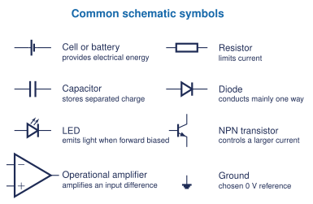

This sequence assumes no prior component knowledge. Begin with the difference between a physical circuit and a schematic, then study one component family at a time. Each lesson identifies terminals, polarity, value, rating, symbol, functional role, first equations, safety boundary, five student questions, and a simulation or lab pathway.

## Start from zero

1. [Circuits and Schematics](schematic-basics.qmd): circuit roles, symbols, nodes, junctions, ground, and a first complete schematic.
2. [Resistors](resistors.qmd): resistance, colour code, tolerance, power, Ohm's law, and current limiting.
3. [Capacitors](capacitors.qmd): charge, capacitance, polarity, energy, time constants, and RC response.
4. [Diodes and LEDs](diodes-leds.qmd): direction, forward voltage, reverse blocking, current limiting, and diode-mode testing.
5. [Transistors](transistors.qmd): NPN and PNP devices, terminals, switching, ratings, and pinout verification.
6. [Operational Amplifiers](op-amps.qmd): differential inputs, supplies, negative feedback, followers, real limits, and the XL741.

<figure class="ter-circuit-figure" id="fig-component-foundation-map" data-diagram-source="../../../assets/electronics/schematics/component-symbols-foundation.tex">

<figcaption><a class="ter-figure-label" href="#fig-component-foundation-map">Figure 1.</a> Students meet the physical part, internal function, symbol, terminals, ratings, and circuit role as one coordinated concept.</figcaption>
</figure>

## Component catalogue

| Component | Role | Modules | Selection fields | Status |
|:--|:--|:--|:--|:--|
| Resistor | current limiting and division | H06-H12, H21-H24 | resistance, tolerance, power, package | foundation published |
| Fuse | overcurrent protection | H01, H14, H16 | current, voltage, speed, interrupt rating | H01 complete |
| Switch | manual control | all modules | poles, throws, current, voltage, action | H01 complete |
| LED | indication and light output | H01, H21 | colour, forward voltage, current, power | H01 complete |
| Capacitor | storage, timing, filtering | H19, H22, H24 | capacitance, voltage, polarity, ESR | foundation published |
| Diode | polarity, protection, rectification | H21, H22 | current, forward drop, reverse voltage, recovery | foundation published |
| BJT or MOSFET | switching and amplification | H23, H26 | voltage, current, power, drive, pinout | BJT foundation published |
| Op-amp / XL741 | feedback, amplification, integration, and differentiation | H26 | supply range, input and output limits, gain, bandwidth, offset, stability | foundation published; hardware optional |
| Relay | isolated electromechanical switching | H18 | coil and contact ratings, form | planned |
| Motor | electrical to mechanical conversion | H18, H23 | voltage, stall current, speed, torque | planned |

Copyrighted cutaway artwork remains a restricted visual reference. Public pages use original diagrams or appropriately licensed open media.

Grob's *Basic Electronics*, Problems Manual, and Experiments Manual provide the teacher sequencing, problem patterns, and experiment checks. *Open Circuits* provides classroom cutaway views. The public lessons do not copy their artwork, questions, answers, or procedures; they use original diagrams, explanations, values, and activities with bibliographic references.

## Jupyter before components are available

[Notebook 8: Electronic Components from Zero](../../../assets/tej-computational/notebooks/08-electronic-components-from-zero.ipynb) provides a complete start-now activity across resistors, capacitors, LEDs, transistor switches, and op-amp followers. Every model includes an explicit limitation so students do not mistake a Python result for a datasheet check, safe build, or physical measurement.

The XL741 pathway is an optional extension after capacitors, diodes, and transistor fundamentals. The available v2.0 kit contains a discrete network of 2N3904 and 2N3906 transistors, BAT85 diodes, resistors, and a 33 pF compensation capacitor. Formal calculus is not required for assembly or basic characterization; slope, accumulated area, finite differences, and running sums provide the initial mathematical model. Follow the current manufacturer documentation and a teacher-approved current-limited dual-supply procedure for any physical build or test.
