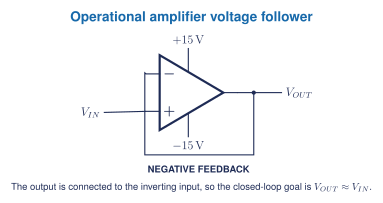

## Learning goals

- I can identify the non-inverting input, inverting input, output, and supply rails.
- I can explain that an op-amp responds to the difference between its input voltages.
- I can trace negative feedback in a voltage follower.
- I can distinguish an ideal op-amp model from a real 741 or XL741.

## What is an op-amp?

An **operational amplifier**, or **op-amp**, is a high-gain differential amplifier. Its basic relationship is:

$$V_{OUT}=A_{OL}(V_+-V_-)$$

$V_+$ is the non-inverting input, $V_-$ is the inverting input, and $A_{OL}$ is open-loop gain. Because open-loop gain is very large, useful circuits normally apply **feedback** rather than operate the amplifier open loop.

An op-amp also needs power-supply connections. The triangle symbol often omits those rails to keep a schematic readable, but the physical circuit cannot operate without them.

## Negative feedback and a voltage follower

<figure class="ter-circuit-figure" id="fig-op-amp-follower" data-diagram-source="../../../assets/electronics/schematics/op-amp-voltage-follower.tex">

<figcaption><a class="ter-figure-label" href="#fig-op-amp-follower">Figure 1.</a> Negative feedback makes the closed-loop goal $V_{OUT}\approx V_{IN}$ while the output remains within real device limits.</figcaption>
</figure>

In the ideal negative-feedback model:

1. input currents are approximately zero;
2. the output moves so that $V_+\approx V_-$ when the amplifier is operating normally;
3. the output cannot exceed the available supply and output-swing limits.

These are model assumptions, not universal facts. They fail during saturation, excessive input difference, missing power, instability, wiring faults, or operation outside the datasheet.

## What the XL741 makes visible

A normal 741 integrated circuit hides its internal transistors and resistors inside one package. The XL741 v2.0 recreates the function with visible discrete parts, including:

- thirteen 2N3904 NPN transistors;
- seven 2N3906 PNP transistors;
- two BAT85 diodes;
- eleven resistors;
- one 33 pF compensation capacitor.

The kit can be used as a direct physical bridge from component foundations to differential inputs, gain stages, output stages, compensation, and feedback. Assembly is optional and may be replaced by a teacher demonstration or simulation-first investigation.

## Real limitations

A real op-amp has limited input range, output swing, current, bandwidth, slew rate, offset, and power dissipation. The XL741 guide's first suggested follower test uses $+15$ V and $-15$ V rails and keeps $V_{IN}$ within $\pm13$ V. Any physical test must follow the current manufacturer documentation and a teacher-approved current-limited dual supply.

## Five-question starter

1. Identify $V_+$, $V_-$, $V_{OUT}$, and the two supply rails in Figure 1.
2. Explain what the expression $V_+-V_-$ means.
3. Trace the feedback path and explain why the circuit is called a voltage follower.
4. Predict ideal $V_{OUT}$ for inputs of $-5.0$ V, 0 V, and $+5.0$ V, then state two real limitations omitted by the prediction.
5. A follower simulation gives $V_{OUT}=V_{IN}$ but a physical XL741 does not. Propose an evidence-based diagnostic order covering supplies, common reference, input range, terminal assignment, assembly, saturation, and measurement setup.

## Jupyter and later hardware

Use [Notebook 7](../../../assets/tej-computational/notebooks/07-rc-op-amp-calculus-bridge.ipynb) for the required start-now pathway. It includes RC response, numerical differentiation and integration, ideal op-amp models, and an XL741 follower pre-lab.

The physical kit is an extension. A student can complete the modelling outcomes without soldering. If one class kit is built, shared measurements must be labelled as teacher-demonstration data rather than individual measurements.

**Textbook support:** Grob op-amp material and the matching Problems Manual section. [[1, Ch. 33]](../../../references.qmd#ref-grob2016) *Open Circuits* is used as a classroom visual reference for hidden electronic construction. [[2]](../../../references.qmd#ref-opencircuits2023)
