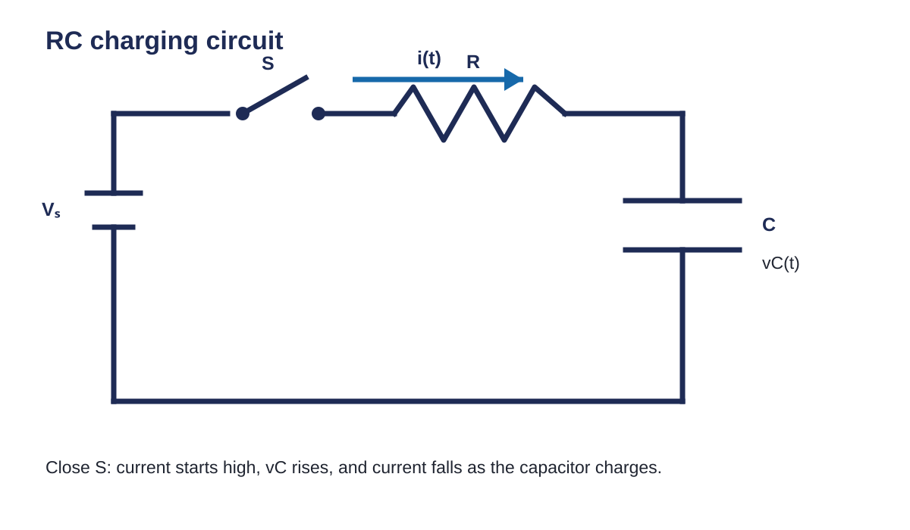
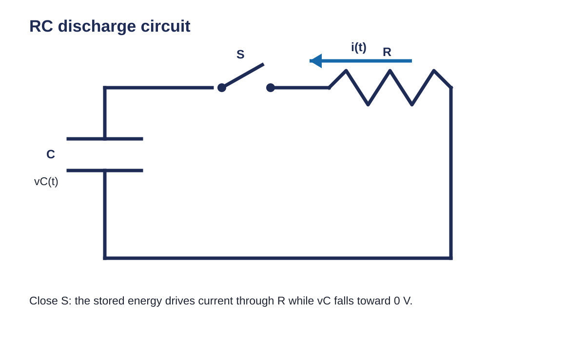
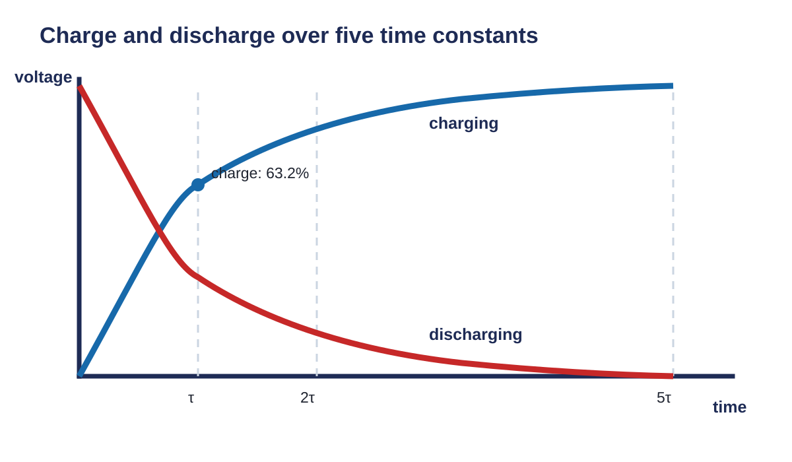

This lesson uses a resistor to control how quickly a capacitor charges or discharges.

::: {.callout-important title="Open the lesson materials"}

- **[Teaching slides](https://docs.google.com/presentation/d/130ilpoHB15CGT1_IQQuquD8zWLzIYprLojiKbAYDfk4/edit){target="_blank"}**
- **[Make a copy of the five-question sheet](https://docs.google.com/document/d/15-JnCH81bBWqF-rU5wDr9bnD6r-0hZarVn9fz1YW6Fs/copy){target="_blank"}**
- **[Open the notebook in JupyterLite](https://jupyter.org/try-jupyter/lab/index.html?fromURL=https%3A%2F%2Fandrewandrade.ca%2Ftech-edu-resources%2Fassets%2Ftej-computational%2Fnotebooks%2F11-rc-charge-discharge.ipynb){target="_blank"}**
- [Download the notebook](../../../assets/tej-computational/notebooks/11-rc-charge-discharge.ipynb)
- **[Open the TEJ Tinkercad classroom](https://www.tinkercad.com/classrooms/9Km3yctGOwi/home){target="_blank"}**

:::

## Charging

<figure class="ter-circuit-figure" id="fig-rc-charge" data-diagram-source="../../../assets/electronics/schematics/rc-charge.svg">

<figcaption><a class="ter-figure-label" href="#fig-rc-charge">Figure 1.</a> When the switch closes, current flows through the resistor and charge builds on the capacitor.</figcaption>
</figure>

At the instant the switch closes for an ideal uncharged capacitor:

$$
v_C(0)=0\,\mathrm{V},\qquad i(0)=\frac{V_S}{R}
$$

The current is largest at the start. As the capacitor voltage rises, the resistor voltage and current fall.

After a long time:

$$
v_C(\infty)=V_S,\qquad i(\infty)=0\,\mathrm{A}
$$

The charged capacitor behaves like an open circuit for steady DC in this ideal model.

## Discharging

<figure class="ter-circuit-figure" id="fig-rc-discharge" data-diagram-source="../../../assets/electronics/schematics/rc-discharge.svg">

<figcaption><a class="ter-figure-label" href="#fig-rc-discharge">Figure 2.</a> The source is removed. Stored energy leaves the capacitor through the resistor.</figcaption>
</figure>

The capacitor voltage cannot jump instantly in the ideal model. It falls from its starting value toward $0\,\mathrm{V}$.

## Read the graph

<figure class="ter-circuit-figure" id="fig-rc-curves" data-diagram-source="../../../assets/electronics/schematics/rc-curves.svg">

<figcaption><a class="ter-figure-label" href="#fig-rc-curves">Figure 3.</a> At one time constant, charging is about 63.2% complete and discharging has about 36.8% remaining. At five time constants, use the practical final value.</figcaption>
</figure>

For charging toward a source voltage $V_S$:

$$
v_C(\tau)\approx0.632V_S,\qquad v_C(5\tau)\approx0.993V_S
$$

For discharging from $V_0$:

$$
v_C(\tau)\approx0.368V_0,\qquad v_C(5\tau)\approx0.0067V_0
$$

## Worked example using GUESS

A capacitor charges toward $12.0\,\mathrm{V}$. Estimate its voltage after one time constant and after five time constants.

**Given**

$$V_S=12.0\,\mathrm{V},\qquad t=\tau\text{ and }5\tau$$

**Unknown**

$$v_C(\tau),\qquad v_C(5\tau)$$

**Equations**

$$v_C(\tau)\approx0.632V_S,qquad v_C(5\tau)\approx0.993V_S$$

**Substitute and solve**

$$
v_C(\tau)=0.632(12.0\,\mathrm{V})=7.58\,\mathrm{V}
$$

$$
v_C(5\tau)=0.993(12.0\,\mathrm{V})=11.9\,\mathrm{V}
$$

**Statement**

The capacitor is about $7.58\,\mathrm{V}$ after one time constant and $11.9\,\mathrm{V}$ after five time constants.

## Tinkercad check

1. Calculate the expected starting, one-time-constant, and five-time-constant values first.
2. Build the source, switch, resistor, and capacitor in one loop.
3. Use red for positive, black for $0\,\mathrm{V}$, and another colour for the capacitor signal node.
4. Place the voltmeter across the capacitor.
5. Start the simulation, close the switch, and record the capacitor voltage.
6. Share the Tinkercad circuit link.

Use the [step-by-step Tinkercad circuit guide](../../circuits/tinkercad-circuits.qmd) if you need the controls and screenshots.

## Complete the work

1. Complete all five questions using GUESS.
2. Label $0$, $\tau$, and $5\tau$ on the graph.
3. Use the notebook to check the estimates.
4. Build one charging circuit in Tinkercad.
5. Submit the sheet, notebook, and Tinkercad link.

**Textbook support:** Grob, Chapter 22, sections 22-2 to 22-3, pp. 668-675. Practice support: Problems Manual, Chapter 22, pp. 309-316. Optional teacher-approved lab: Experiment 22-1. [[1, Ch. 22]](../../../references.qmd#ref-grob2016)

## Next lesson

Continue to [RC Time Constants and Design](rc-time-constant-design.qmd).

## Help improve this lesson

If a direction, diagram, simulation step, or code cell is unclear, identify the exact step. Explain what you tried and what happened.
