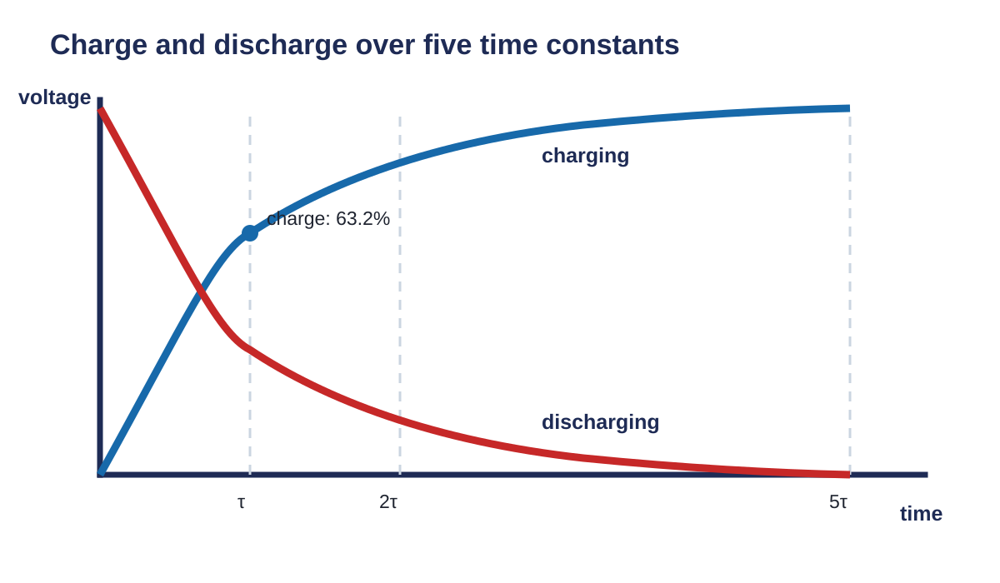

This lesson turns the charging curve into a design tool. Start with a target time, choose $R$ and $C$, then check the actual result.

::: {.callout-important title="Open the lesson materials"}

- **[Teaching slides](https://docs.google.com/presentation/d/1N42Y9o1foMHonzgeO2wooZMHOW8aZAgvGPKRuZ9l4rw/edit){target="_blank"}**
- **[Make a copy of the five-question sheet](https://docs.google.com/document/d/13fdwh-aNJ8iGO1RfPaQI_-9Zn1bmuFAuY5v6rNB48PQ/copy){target="_blank"}**
- **[Open the notebook in JupyterLite](https://jupyter.org/try-jupyter/lab/index.html?fromURL=https%3A%2F%2Fandrewandrade.ca%2Ftech-edu-resources%2Fassets%2Ftej-computational%2Fnotebooks%2F12-rc-time-constant-design.ipynb){target="_blank"}**
- [Download the notebook](../../../assets/tej-computational/notebooks/12-rc-time-constant-design.ipynb)
- **[Open the TEJ Tinkercad classroom](https://www.tinkercad.com/classrooms/9Km3yctGOwi/home){target="_blank"}**
- **[Download the Thursday printable worksheet](../../../assets/electronics/worksheets/rc-timing-thursday-worksheet.pdf)**

:::

## The time constant

For a simple resistor-capacitor circuit:

$$
\tau=RC
$$

where:

- $\tau$ is time in seconds;
- $R$ is resistance in ohms;
- $C$ is capacitance in farads.

Useful unit combinations are:

$$
\mathrm{k\Omega}\times\mathrm{\mu F}=\mathrm{ms},
\qquad
\mathrm{M\Omega}\times\mathrm{\mu F}=\mathrm{s}
$$

## Worked example using GUESS

A circuit uses $R=15\,\mathrm{k\Omega}$ and $C=47\,\mu\mathrm{F}$. Calculate the time constant and the practical charging time.

**Given**

$$R=15\,000\,\Omega,\qquad C=47\times10^{-6}\,\mathrm{F}$$

**Unknown**

$$\tau=?,\qquad 5\tau=?$$

**Equation**

$$\tau=RC$$

**Substitute and solve**

$$
\tau=(15\,000\,\Omega)(47\times10^{-6}\,\mathrm{F})=0.705\,\mathrm{s}
$$

$$
5\tau=5(0.705\,\mathrm{s})=3.525\,\mathrm{s}
$$

**Statement**

The time constant is $0.705\,\mathrm{s}$, and practical charging takes about $3.53\,\mathrm{s}$.

## Use the time scale on the graph

<figure class="ter-circuit-figure" id="fig-rc-design-curves" data-diagram-source="../../../assets/electronics/schematics/rc-curves.svg">

<figcaption><a class="ter-figure-label" href="#fig-rc-design-curves">Figure 1.</a> If $\tau=0.705\,\mathrm{s}$, then the marks are $0.705\,\mathrm{s}$, $1.41\,\mathrm{s}$, $2.12\,\mathrm{s}$, and $3.53\,\mathrm{s}$ at $1\tau$, $2\tau$, $3\tau$, and $5\tau$.</figcaption>
</figure>

## Solve for a part value

If the target time and capacitance are known:

$$
R=\frac{\tau}{C}
$$

If the target time and resistance are known:

$$
C=\frac{\tau}{R}
$$

The exact answer may not be a standard part value. Choose an available part and recalculate the actual time constant.

Example: a target of $2.00\,\mathrm{s}$ with $R=22.0\,\mathrm{k\Omega}$ requires:

$$
C=\frac{2.00\,\mathrm{s}}{22\,000\,\Omega}=90.9\,\mu\mathrm{F}
$$

A $100\,\mu\mathrm{F}$ part gives:

$$
\tau=(22.0\,\mathrm{k\Omega})(100\,\mu\mathrm{F})=2.20\,\mathrm{s}
$$

State both the ideal calculated value and the actual value from the selected part.

## Optional calculus bridge

You do not need calculus to complete this lesson. The full ideal equations are:

$$
v_C(t)=V_S\left(1-e^{-t/RC}\right)
$$

for charging, and:

$$
v_C(t)=V_0e^{-t/RC}
$$

for discharging.

Differentiation describes how fast voltage changes. Integration connects current over time to stored charge. Later, an op amp can build practical integrators and differentiators.

## Jupyter and Tinkercad check

1. Calculate $\tau$ and $5\tau$ by hand.
2. Run the notebook with the same $R$, $C$, and source voltage.
3. Double $R$ and predict the change before running the cell.
4. Reset $R$, double $C$, and compare.
5. Build one assigned circuit in Tinkercad.
6. Measure $v_C$ near one time constant and compare it with $0.632V_S$.

## Complete the work

1. Complete all five questions using GUESS.
2. Show the unit conversions.
3. Use the notebook to verify each numerical result.
4. Build Question 4 or 5 in Tinkercad.
5. Submit the sheet, notebook, and Tinkercad link.

**Textbook support:** Grob, Chapter 22, pp. 668-691. Practice support: Problems Manual, Chapter 22, pp. 309-316. Optional teacher-approved lab: Experiment 22-1. [[1, Ch. 22]](../../../references.qmd#ref-grob2016)

## Where this leads

Continue to [Diodes and LEDs](diodes-leds.qmd), then [Transistors](transistors.qmd), and then [Operational Amplifiers and the XL741](op-amps.qmd). Capacitors and resistors also lead to filters, integrators, differentiators, and calculus.

## Help improve this lesson

If a direction, calculation, simulation step, or code cell is unclear, identify the exact step. Explain what you tried and what happened.
