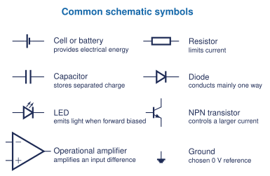
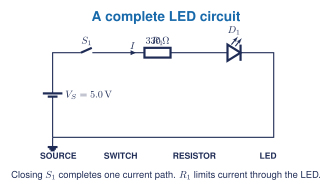

## Learning goals

- I can explain what a circuit and a schematic are.
- I can identify a source, conductor, control, protection device, and load.
- I can recognize common component symbols without confusing them with physical appearance.
- I can trace one complete path and identify connected nodes.

## What is a circuit?

A **circuit** is a set of connected electrical components that provides one or more paths for current. A useful circuit normally has:

- a **source** that supplies electrical energy;
- **conductors** that connect points;
- a **control** such as a switch;
- **protection** such as current limiting or a fuse;
- a **load** that converts electrical energy into light, motion, heat, sound, or another useful form.

A pile of components is not yet a circuit. Their connections determine what the system does.

## What is a schematic?

A **schematic** is a functional map of electrical connections. It does not try to look like the physical breadboard or product. It preserves the information needed to understand the circuit:

- which terminals are connected;
- which components are used;
- component names and values;
- polarity and current direction when relevant;
- the chosen 0 V reference.

<figure class="ter-circuit-figure" id="fig-component-symbols" data-diagram-source="../../../assets/electronics/schematics/component-symbols-foundation.tex">

<figcaption><a class="ter-figure-label" href="#fig-component-symbols">Figure 1.</a> A symbol represents electrical behaviour and terminals, not the component's physical size or colour.</figcaption>
</figure>

## Lines, nodes, and junctions

A line normally represents a conductor. Every uninterrupted set of connected lines is one **node**, so all points on that node have the same ideal voltage.

- A visible dot marks a junction when several lines connect.
- Crossing lines without a junction dot should be treated as not connected unless the drawing standard states otherwise.
- **Ground** is the chosen 0 V reference for voltage measurements. It is not automatically the Earth.
- A component interrupts a wire because current must pass through that component between two nodes.

## Read a first schematic

<figure class="ter-circuit-figure" id="fig-first-led-circuit" data-diagram-source="../../../assets/electronics/schematics/first-led-circuit.tex">

<figcaption><a class="ter-figure-label" href="#fig-first-led-circuit">Figure 2.</a> The resistor and LED are in one path. Closing the switch completes the circuit.</figcaption>
</figure>

Trace from the positive source terminal through $S_1$, $R_1$, and $D_1$, then back to the source through ground. The resistor is not optional decoration: it limits current to protect the LED.

## Reference designators

Schematics give each component a short identifier.

| Prefix | Component | Example |
|---|---|---|
| R | resistor | R1 |
| C | capacitor | C1 |
| D | diode or LED | D1 |
| Q | transistor | Q1 |
| U | integrated circuit or functional block | U1 |
| S or SW | switch | S1 |
| V or BT | voltage source or battery | V1 or BT1 |

The number distinguishes components of the same type. It does not normally give the component value.

## Five-question starter

1. Identify the source, control, current limiter, and load in Figure 2.
2. Explain why a schematic does not need to match the physical placement of parts.
3. Redraw Figure 2 with the switch open and state whether a complete path exists.
4. Mark the distinct nodes in Figure 2 and identify the node chosen as 0 V.
5. A student removes $R_1$ and replaces it with a wire. Explain why this is unsafe for the LED even though the path still looks complete.

## Start-now activity

Before handling components, rebuild Figure 2 in a teacher-approved circuit simulator. Predict the current direction and the effect of opening the switch before starting the simulation. Record calculated, simulated, and measured evidence in separate columns.

## Textbook and visual support

Grob provides the main circuit vocabulary and progression from quantities to components and connections. [[1, Ch. 1]](../../../references.qmd#ref-grob2016) *Open Circuits* is a classroom visual reference for comparing the outside of a component with its internal construction. [[2]](../../../references.qmd#ref-opencircuits2023) Public diagrams on this page are original and do not reproduce the book's cutaway images.
