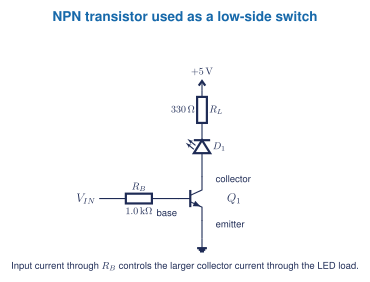

## Learning goals

- I can name the base, collector, and emitter of a bipolar junction transistor.
- I can distinguish NPN and PNP symbols and roles.
- I can explain how a small input can control a larger load current.
- I can verify a real pinout instead of guessing from package shape.

## What is a transistor?

A transistor is a semiconductor device used for switching or amplification. The bipolar junction transistors in the XL741 kit have three terminals:

- **base (B):** control terminal;
- **collector (C):** part of the controlled-current path;
- **emitter (E):** the other end of that path.

An NPN and PNP transistor operate with opposite polarities and current directions. They are not interchangeable.

## A first switching circuit

<figure class="ter-circuit-figure" id="fig-transistor-led-switch" data-diagram-source="../../../assets/electronics/schematics/transistor-led-switch.tex">

<figcaption><a class="ter-figure-label" href="#fig-transistor-led-switch">Figure 1.</a> The input controls base current through $R_B$; the transistor controls the load path.</figcaption>
</figure>

For a beginner switching model:

- **off:** base drive is absent, so collector current is approximately zero;
- **on:** sufficient base drive allows load current, subject to the load, source, transistor ratings, and saturation voltage.

This model is useful but incomplete. Transistor gain varies, and a switch design must provide adequate drive without exceeding base, collector, voltage, power, or temperature limits.

## Package shape is not a pinout

Two transistors in similar packages may arrange base, collector, and emitter differently. Verify the exact manufacturer datasheet and the board marking. Installing a transistor backwards is a common kit fault.

The XL741 v2.0 uses thirteen 2N3904 NPN transistors and seven 2N3906 PNP transistors. The quantity itself is a useful lesson: an op-amp symbol can represent a system built from many individual devices.

## Five-question starter

1. Name the three BJT terminals and state the role of each.
2. Explain why NPN and PNP transistors are not interchangeable.
3. Trace the load-current path in Figure 1 when Q1 is on.
4. Explain why both $R_B$ and the LED load resistor are required.
5. A transistor matches the package drawing but the circuit fails. Write a diagnostic sequence that checks part number, pinout, orientation, supply polarity, base drive, and current limiting without immediately replacing the part.

## Jupyter and lab pathway

Start with an ideal two-state model in Jupyter or a circuit simulator. Sweep the input condition and predict load current from the source, LED model, and load resistor. Clearly label this as a model: it does not prove the selected transistor has adequate drive, safe power dissipation, or the expected pinout.

Physical testing uses a protected low-voltage supply and current limiting. The XL741 build comes later, after students can identify diode and transistor orientation and inspect solder joints.

**Textbook support:** Grob transistor and switching chapters, used with the matching Problems and Experiments Manual sections. [[1, Chs. 28-30]](../../../references.qmd#ref-grob2016) *Open Circuits* provides classroom visual context for semiconductor construction. [[2]](../../../references.qmd#ref-opencircuits2023)
