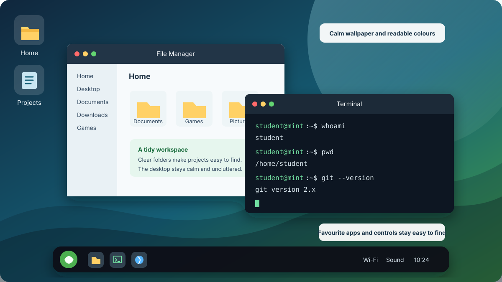

The main goal of this lesson is simple: **have fun with Linux and make the computer useful.** The website is your lesson and reference. Each Google Doc below is a separate submission artifact.

::: {.callout-important title="Choose the correct assignment"}
- **Assignment 1:** [Make Linux Mint Xfce Your Own](https://docs.google.com/document/d/1i5idpi--acAt6GjY-TNwthrjG0jv0k5VPrbG5SjVLDg/copy)
- **Assignment 2:** [Terminal Quest: WSL and Mac Basics](https://docs.google.com/document/d/1giXUn6HgP5CX-ZNAVb-GwBa3V_FW_70EDRTdzYyb5_0/copy)
- **Assignment 3:** [Bashcrawl Terminal Adventure](https://docs.google.com/document/d/1CzNZyCFPe63nMXYZ_V9yqRs2sFNfgmykL25-HtGgFnM/copy)

Complete and submit each assignment separately. Do not combine their evidence or submit a separate history text file.
:::

## Learning goals

By the end of this page:

- I will be able to create and test safe user accounts on an assigned classroom computer.
- I will be able to personalize Linux Mint with the graphical user interface (GUI).
- I will be able to open the correct terminal on Windows, Linux, or Mac and use beginner commands.
- I will be able to create a folder and file, inspect processes, and review command history safely.
- I will be able to download and explore Bashcrawl with Git.

## Before you begin

You may need:

- an assigned classroom computer with Linux Mint installed;
- the `min` classroom account and the classroom account password supplied directly by your teacher;
- the account names or aliases supplied for students who share the computer;
- classroom Wi-Fi credentials supplied directly by your teacher; and
- the [Linux Start Here class slides](https://docs.google.com/presentation/d/1V9VzFkTGhEyKs5TszsuZV96xya5k-zvfEx8qGKjgbzM/edit).

::: {.callout-warning title="Use only an approved computer and account"}
Do not change accounts or files on another computer. Do not use guest Wi-Fi, scan the school network, or try to connect to another person's computer. Never put passwords, Wi-Fi credentials, student numbers, access tokens, recovery information, or other private information in a Google Doc, screenshot, or command history.
:::

## Extension work: create and test classroom accounts

This account activity supports the shared Linux computers, but it is **not required evidence for Assignments 1, 2, or 3** unless your teacher assigns it separately.

Sign in as `min`. Open **Menu > System > Users and Groups**, then select **Unlock**. Use the classroom account password supplied directly by your teacher when Linux asks for administrator approval.

Create these three accounts only when your teacher has assigned the computer and approved the account names:

| Account | Username | Account type | Password |
|:--|:--|:--|:--|
| Your account | Create a unique, school-appropriate username with no spaces | **Administrator** | Create a private password you can remember |
| Other student 1 | Use the name or alias supplied by your teacher | **Standard** | Use the temporary password supplied directly by your teacher |
| Other student 2 | Use the name or alias supplied by your teacher | **Standard** | Use the temporary password supplied directly by your teacher |

Your username should not contain your student number, email address, or full legal name. Record usernames only if your teacher asks. **Never record a password.** Keep the `min` account as the classroom recovery account.

To test the accounts, sign out and sign in to each approved account. Confirm that each account opens normally and has a separate home folder. Sign back in to your own account before continuing. If an account does not work or an unexpected administrator warning appears, stop and ask your teacher for help.

## Assignment 1: Make Linux Mint Xfce Your Own

::: {.callout-tip title="LEVEL 4+: MAKE THE INSTRUCTIONS BETTER"}
If anything here is unclear, incomplete, or could be explained better, improve it in your own copy. Use Suggesting mode if it is available. Otherwise, add a clearly labelled “Suggested improvement” with your revised wording. Include one sentence explaining why your version is clearer or more useful. Do not remove required work. Mr. A will review your change and may update the course website and future assignment documents if he agrees it helps. Improving a real instruction accurately is one way to demonstrate Level 4+ thinking.
:::

### Part 2: make Linux feel like your computer

::: {.callout-important title="Open the assignment and know what to submit"}
[Make a copy of **Make Linux Mint Xfce Your Own**](https://docs.google.com/document/d/1i5idpi--acAt6GjY-TNwthrjG0jv0k5VPrbG5SjVLDg/copy).

Submit **ONE completed Google Doc** in Google Classroom. It must contain a BEFORE screenshot, an AFTER screenshot, and all five short reflection answers. Do not attach the screenshots as separate files.
:::

### 1. Save your BEFORE screenshot

Do this before changing any settings. Sign in to your own Linux account and show the full desktop with its wallpaper and bottom panel visible. Press **Print Screen (PrtSc)**. If nothing happens, try **Fn + PrtSc** or search the application menu for **Screenshot**. Save the picture in your Pictures folder and insert it into the assignment Google Doc.

::: {.callout-note title="What a clear BEFORE screenshot looks like"}
{fig-alt="A typical Linux Mint Xfce desktop with a green wallpaper, desktop icons, and the complete bottom panel visible"}

Show the whole desktop, not a cropped corner. Keep the wallpaper and full panel visible. This reference image is not a student submission. [Image source: Linuxiac](https://linuxiac.com/linux-mint-22-wilma/).
:::

### 2. Get inspiration from Xfce makeovers

Watch the parts that interest you. Use the built-in settings in the next section. You do **not** need to copy either design, download a theme, run terminal commands, or install Compiz.

::: {.grid}
::: {.g-col-12 .g-col-lg-6}


**[Customize Your Linux Mint XFCE: A Simple Guide](https://www.youtube.com/watch?v=-s1KOzdj5ow)** by Specter-3924 shows a complete Linux Mint Xfce desktop makeover.
:::

::: {.g-col-12 .g-col-lg-6}


**[Making XFCE Look Better](https://www.youtube.com/watch?v=B3WN0KGyMGw)** by NH Soft: start at **3:33** for wallpaper, **7:32** for themes, and **12:49** for the panel. Skip downloads, terminal commands, and the later Compiz effects.
:::
:::

#### Three realistic built-in-only design ideas

Pick one direction or mix ideas. Theme names can vary slightly between classroom computers.

| Design direction | Wallpaper | Theme or icons | Panel |
|:--|:--|:--|:--|
| **Calm study desktop** | Choose a quiet nature or abstract built-in image | Try a light Mint-Y style and a simple built-in icon set | Keep it at the bottom and set a comfortable row size around 38 to 42 pixels |
| **Dark coding desktop** | Choose a darker built-in image with little visual clutter | Try a built-in dark Mint-Y style and readable icons | Move it to the top or keep it at the bottom, then make it slightly taller |
| **Easy-to-see desktop** | Choose an uncluttered image that does not hide labels | Choose the clearest high-contrast built-in style available | Increase the row size to about 46 to 52 pixels and keep the menu, network, sound, and clock easy to find |

{fig-alt="A customized Xfce-style desktop with a blue and green wallpaper, a tidy file manager, a readable dark terminal, and a bottom panel containing favourite applications and system controls"}

This course example shows one possible finished direction. Your design should reflect your own choices and remain readable.

### 3. Make the three required changes

Use the settings already included with Linux Mint. Do not download themes, scripts, packages, or desktop effects without teacher permission.

#### Change A: wallpaper

{fig-alt="Xfce Desktop Settings showing the Background tab, folder selector, style control, colour controls, and wallpaper thumbnails"}

1. Right-click an empty part of the desktop.
2. Select **Desktop Settings**, then **Background**.
3. Choose a different built-in picture. Close the window to see the result.

Example: choose a simple image whose light and dark areas still let you read desktop icon labels. [Screenshot source: It's FOSS](https://itsfoss.com/customize-xfce/).

#### Change B: theme or icons

{fig-alt="Xfce Appearance window showing built-in themes in the Style tab"}

1. Open **Menu > Settings > Appearance**. If you cannot find it, type `Appearance` into the menu search box.
2. Open the **Style** tab and try a different built-in style. This changes application windows, menus, buttons, and colours.
3. You may also open the **Icons** tab and choose a different built-in icon set. Keep labels and controls readable.

Example: compare one light and one dark Mint-Y variant, then keep the one that gives better contrast with your wallpaper. [Screenshot source: Xfce Project](https://xfce.org/about/tour418).

#### Change C: panel

{fig-alt="Xfce Panel Preferences on the Display tab with controls for mode, output, position, length, and row size"}

1. Right-click the bottom panel, which is the bar with the menu and clock.
2. Choose **Panel > Panel Preferences**. You can also search for `Panel` in the menu.
3. Change the **Row size** first. A small change, such as 36 pixels to 42 pixels, is easy to see and easy to reverse.
4. If you want another change, move the panel to the top or adjust its appearance. Close Panel Preferences when finished.

Do **not** delete the panel or remove the application menu, network, sound, or clock controls. [Screenshot source: It's FOSS](https://itsfoss.com/newsletter/foss-weekly-25-02/).

If a setting looks wrong, return to the same settings window and change it back. If you cannot restore the panel or essential controls, stop and ask for help.

### 4. Save your AFTER screenshot

Make sure the updated wallpaper and panel are visible. You may leave File Manager open so the theme is also visible. Take another screenshot and insert it into the same Google Doc.

### 5. Answer all five reflection questions

In your assignment Google Doc, answer:

1. What wallpaper did you choose, and where did you change it?
2. What theme or icon change did you make, and which setting did you use?
3. What did you change about the panel, and how did you do it?
4. Which change made the desktop look better or easier to use, and why?
5. Did anything go wrong, and how did you fix it? Write “Nothing went wrong” if appropriate.

::: {.callout-note title="Optional customization"}
After completing the required work, you may change fonts or pointer size, add a favourite application shortcut, arrange desktop icons, or investigate another built-in appearance setting. Do not install a theme or desktop effect without permission.
:::

## Extension work: network and software exploration

These activities build useful Linux skills, but they are **not required evidence for Assignments 1, 2, or 3** unless your teacher assigns them separately.

### Check the network with the GUI

1. Select the network icon in the panel.
2. Connect using credentials supplied directly by your teacher. Do **not** use guest Wi-Fi.
3. Open the connection information or network settings.
4. Identify whether the connection uses Wi-Fi or Ethernet. Keep local addresses in private classroom work only.
5. Open the browser and visit the [TEJ Notes website](https://andrewandrade.ca/tech-edu-resources/tej3-4/).

If a warning appears, credentials are rejected, or a result differs significantly from these instructions, stop and ask for help. Do not change security settings or scan the network.

### Install approved software

Open **Software Manager** from the application menu. Search for Git and install it only if it is missing and your teacher has approved the installation. You may also choose one school-appropriate game or useful application, read its description and system requirements, and ask for approval before installing it.

::: {.callout-important title="Install from trusted sources"}
Use Software Manager, an operating system's official documentation, or the official Bashcrawl GitLab repository. Do not paste installation commands from advertisements, comments, forums, or unknown sites. If installation requires administrator access and you do not have permission, stop and ask your teacher.
:::

## Assignment 2: Terminal Quest: WSL and Mac Basics

::: {.callout-tip title="LEVEL 4+: MAKE THE INSTRUCTIONS BETTER"}
If anything here is unclear, incomplete, or could be explained better, improve it in your own copy. Use Suggesting mode if it is available. Otherwise, add a clearly labelled “Suggested improvement” with your revised wording. Include one sentence explaining why your version is clearer or more useful. Do not remove required work. Mr. A will review your change and may update the course website and future assignment documents if he agrees it helps. Improving a real instruction accurately is one way to demonstrate Level 4+ thinking.
:::

### Part 5: meet the terminal

::: {.callout-important title="Open the assignment and know what to submit"}
[Make a copy of **Terminal Quest: WSL and Mac Basics**](https://docs.google.com/document/d/1giXUn6HgP5CX-ZNAVb-GwBa3V_FW_70EDRTdzYyb5_0/copy).

Submit **ONE completed Google Doc** in Google Classroom. Paste the complete, reviewed command history into that document. Do not submit a separate history text file.
:::

### 1. Open the correct terminal

#### Windows with WSL

Open **Start** and search for **WSL**, **Ubuntu**, or the name of the installed Linux distribution. Open the matching app. Run the Linux assignment commands there, not in PowerShell.

If WSL is not installed, ask the computer owner or teacher for permission. Installation requires administrator access and may require a restart. With permission, open **PowerShell as Administrator** and run:

**INPUT**

```powershell
wsl --install
```

Restart if Windows asks. If installation is blocked, a security warning appears, or you are unsure which distribution opened, stop and ask for help. Follow the official [Microsoft WSL installation guide](https://learn.microsoft.com/windows/wsl/install) when needed.

#### Linux Mint or Ubuntu

Press **Ctrl + Alt + T**, or search the application menu for **Terminal**. WSL is not needed on a Linux computer.

#### Mac

Press **Command + Space**, search for **Terminal**, and press **Return**. You can also open **Applications > Utilities > Terminal**.

### 2. Identify the account and current folder

Run one command at a time. Read the result and enter the requested answer in your Google Doc.

**INPUT**

```bash
whoami
```

**INPUT**

```bash
hostname
```

**INPUT**

```bash
pwd
```

**INPUT**

```bash
ls
```

**INPUT**

```bash
ls -a
```

**EXAMPLE OUTPUT**

```text
Desktop  Documents  Downloads  Music  Pictures
```

Your username, computer name, path, files, and hidden items will differ. A shell prompt may end with `$` or `%`; do not type that prompt symbol as part of a command.

### 3. Investigate the operating system

**INPUT**

```bash
uname -s
```

**INPUT**

```bash
uname -m
```

**INPUT**

```bash
df -h .
```

**INPUT**

```bash
uptime
```

Record the system name, machine or CPU type, available space, and uptime in your Google Doc. On a Mac, the system name may be `Darwin`. In WSL, the system name is normally `Linux` because Linux is running inside Windows.

### 4. Create the `terminal-quest` folder and `hello.txt`

Run each command separately:

**INPUT**

```bash
cd ~
```

**INPUT**

```bash
mkdir -p terminal-quest
```

**INPUT**

```bash
cd terminal-quest
```

**INPUT**

```bash
pwd
```

**INPUT**

```bash
echo Hello from my computer > hello.txt
```

**INPUT**

```bash
ls
```

**INPUT**

```bash
cat hello.txt
```

**EXAMPLE OUTPUT**

```text
Hello from my computer
```

Return to your home folder and confirm your location:

**INPUT**

```bash
cd ~
```

**INPUT**

```bash
pwd
```

### 5. View running processes

On WSL, Linux Mint, or Ubuntu, try:

**INPUT**

```bash
htop
```

If `htop` is not installed, use `top`, or ask permission before installing software. On Ubuntu-based systems, the approved installation commands are:

**INPUT**

```bash
sudo apt update
```

**INPUT**

```bash
sudo apt install htop -y
```

On a Mac, use `htop` only if it is already installed. Otherwise run:

**INPUT**

```bash
top
```

Press `q` to leave `htop` or `top`. Observe one CPU and one memory detail. Never end an unfamiliar process. If installation is blocked or asks for access you do not have, use `top` and ask for help.

### 6. Review and copy the complete command history

History contains commands, not their output. Review it before copying. Remove or redact passwords, tokens, personal names, private paths, Wi-Fi credentials, and other private information. If you see a password or token, do not paste it. Stop and ask for help, and change any exposed credential.

#### Windows WSL, Linux Mint, or Ubuntu using Bash

Review the history:

**INPUT**

```bash
history
```

On **Windows WSL**, copy the complete history to the Windows clipboard:

**INPUT**

```bash
history | clip.exe
```

On **Linux Mint or Ubuntu**, first check the desktop session:

**INPUT**

```bash
echo $XDG_SESSION_TYPE
```

If the result is `x11`, ask permission to install `xclip` if needed, then copy:

**INPUT**

```bash
sudo apt install xclip -y
```

**INPUT**

```bash
history | xclip -selection clipboard
```

If the result is `wayland`, ask permission to install `wl-clipboard` if needed, then copy:

**INPUT**

```bash
sudo apt install wl-clipboard -y
```

**INPUT**

```bash
history | wl-copy
```

#### Mac using the default zsh shell

Review the complete history:

**INPUT**

```bash
history 1
```

Copy it to the Mac clipboard:

**INPUT**

```bash
history 1 | pbcopy
```

If the Mac uses Bash instead of zsh, use `history` and `history | pbcopy`.

Paste the complete, reviewed history into the labelled box in your Terminal Quest Google Doc. Confirm that it includes the activities you tried. Review the pasted text again before submitting. **Submit only that completed Google Doc.**

## Assignment 3: Bashcrawl Terminal Adventure

::: {.callout-tip title="LEVEL 4+: MAKE THE INSTRUCTIONS BETTER"}
If anything here is unclear, incomplete, or could be explained better, improve it in your own copy. Use Suggesting mode if it is available. Otherwise, add a clearly labelled “Suggested improvement” with your revised wording. Include one sentence explaining why your version is clearer or more useful. Do not remove required work. Mr. A will review your change and may update the course website and future assignment documents if he agrees it helps. Improving a real instruction accurately is one way to demonstrate Level 4+ thinking.
:::

### Part 6: clone and play Bashcrawl

::: {.callout-important title="Open the assignment and know what to submit"}
[Make a copy of **Bashcrawl Terminal Adventure**](https://docs.google.com/document/d/1CzNZyCFPe63nMXYZ_V9yqRs2sFNfgmykL25-HtGgFnM/copy).

Submit **ONE completed Google Doc** with all four reflection answers and at least one readable terminal screenshot. No history file is required.
:::

[Bashcrawl](https://gitlab.com/slackermedia/bashcrawl) is a terminal adventure. Folders are rooms and files contain clues. There is **no required final room and no time limit**. Explore for as long as you can, return another day if you want, and record the furthest room you reached.

### 1. Open Terminal and check Git

- **Windows:** Open WSL, Ubuntu, or the installed Linux distribution from Start.
- **Linux Mint or Ubuntu:** Press **Ctrl + Alt + T**, or open Terminal from the application menu.
- **Mac:** Press **Command + Space**, search for **Terminal**, and press **Return**.

#### Use a phone or tablet

You can also play Bashcrawl on a phone or tablet if you have access to one.

- **Android:** Install [Termux from F-Droid](https://f-droid.org/packages/com.termux/). Open Termux, then run these commands one at a time:

**INPUT**

```bash
pkg update
```

**INPUT**

```bash
pkg install git
```

- **iPhone or iPad:** Install [iSH Shell](https://apps.apple.com/app/ish-shell/id1436902243). Open iSH, then run these commands one at a time:

**INPUT**

```bash
apk update
```

**INPUT**

```bash
apk add bash git
```

**INPUT**

```bash
bash
```

After setup, continue with the same Bashcrawl commands below. A computer is more comfortable, but Android and iPhone both work. A Bluetooth keyboard makes the experience much better. 📱💻

**INPUT**

```bash
git --version
```

**EXAMPLE OUTPUT**

```text
git version 2.43.0
```

Your version may differ. If Git is missing on WSL, Ubuntu, or Linux Mint, ask permission before running `sudo apt update` and `sudo apt install git -y`. On a Mac, follow the Apple Command Line Tools prompt only with the computer owner's permission. Stop and ask for help if installation is blocked.

### 2. Download and start Bashcrawl

Run one command at a time:

**INPUT**

```bash
cd ~
```

**INPUT**

```bash
mkdir -p Games
```

**INPUT**

```bash
cd Games
```

**INPUT**

```bash
git clone https://gitlab.com/slackermedia/bashcrawl.git
```

If Bashcrawl is already downloaded in `~/Games`, skip the clone command.

**INPUT**

```bash
cd bashcrawl/entrance
```

**INPUT**

```bash
cat scroll
```

`git clone` downloads a working copy of the repository into a new folder. It does not need administrator access. Never add `sudo` to that command.

### 3. Explore the dungeon

Useful commands include:

**INPUT**

```bash
pwd
```

**INPUT**

```bash
ls
```

**INPUT**

```bash
ls -a
```

**INPUT**

```bash
cat filename
```

**INPUT**

```bash
cd directory
```

**INPUT**

```bash
cd ..
```

Replace `filename` and `directory` with names you actually see. Read every `scroll` file you find. If a command does not work, read the message, try `ls` or `ls -a`, reread the clue, or go back one room. Do not use `sudo` inside the game.

### 4. Record and submit your progress

In the Bashcrawl Google Doc:

1. Record the furthest room or path you reached. Run `pwd` in that room if you need the path.
2. Answer what clue, object, or surprise you discovered.
3. Name one command you learned or used and explain what it does.
4. Explain what you tried when you got stuck and whether it worked.
5. Insert at least one readable screenshot showing the terminal at your furthest room or an interesting clue.

Submit **ONE completed Google Doc** in Google Classroom. There is no required final room, no time limit, and no history file for this assignment.

## Helpful resources

- Review the [Linux Start Here class slides](https://docs.google.com/presentation/d/1V9VzFkTGhEyKs5TszsuZV96xya5k-zvfEx8qGKjgbzM/edit) for the installation, account, terminal, and Bashcrawl sequence.
- Read the [official Bashcrawl instructions](https://gitlab.com/slackermedia/bashcrawl/-/raw/master/README.md) if you need help starting the game.
- Review the [Bashcrawl project on GitLab](https://gitlab.com/slackermedia/bashcrawl) to see where the game came from.
- Read the [Git documentation for `git clone`](https://git-scm.com/docs/git-clone) when you want to understand the download command in more detail.
- Use the [Ubuntu command-line tutorial](https://documentation.ubuntu.com/desktop/en/latest/tutorial/the-linux-command-line-for-beginners/) for another beginner-friendly introduction to the terminal.
- Read the [GNU Bash explanation of command history](https://www.gnu.org/software/bash/manual/html_node/Bash-History-Facilities.html) to learn what Bash saves.
- Explore the school-appropriate [Learn Linux TV YouTube channel](https://www.youtube.com/@LearnLinuxTV) for beginner Linux and terminal demonstrations.
- Try [Linux Journey](https://labex.io/linuxjourney) for short lessons about commands, permissions, processes, and networking.
- Try [GameShell](https://github.com/phyver/GameShell) or [OverTheWire Bandit](https://overthewire.org/wargames/bandit/) only with teacher approval.

## Review

You can now separate three different kinds of evidence: visual customization belongs in **Make Linux Mint Xfce Your Own**, complete reviewed command history belongs inside **Terminal Quest**, and Bashcrawl progress belongs in **Bashcrawl Terminal Adventure**. Each assignment is submitted as one Google Doc.
