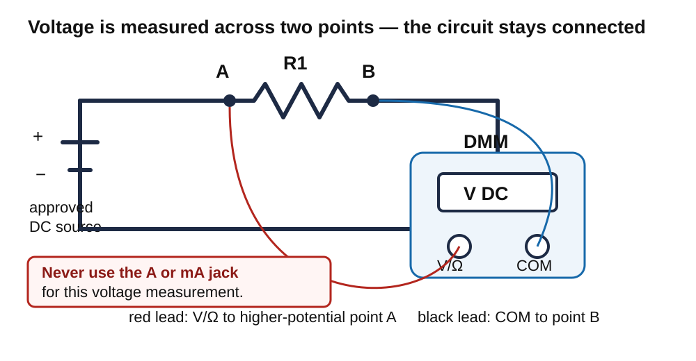
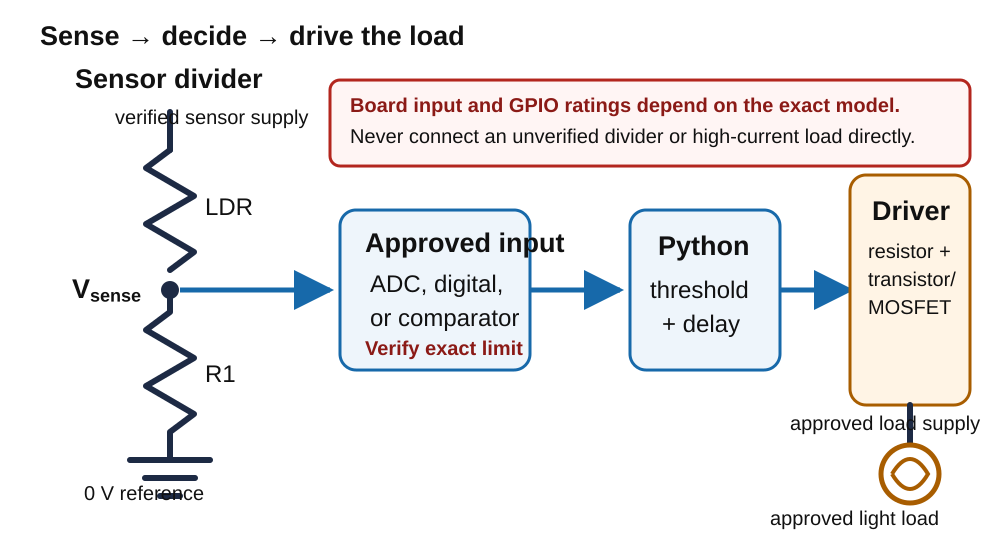
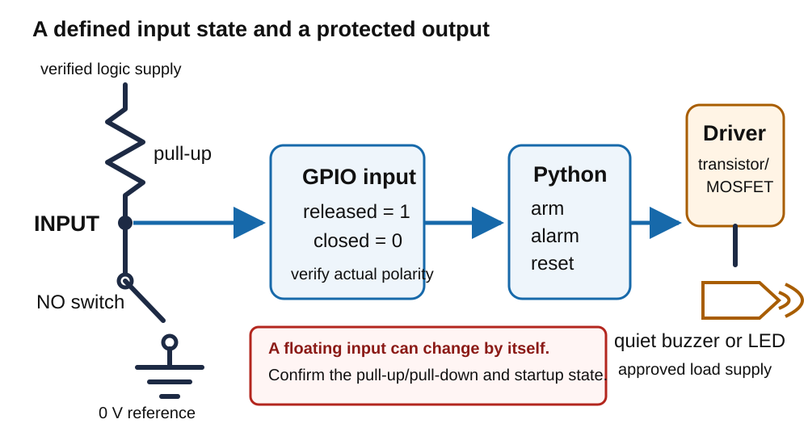
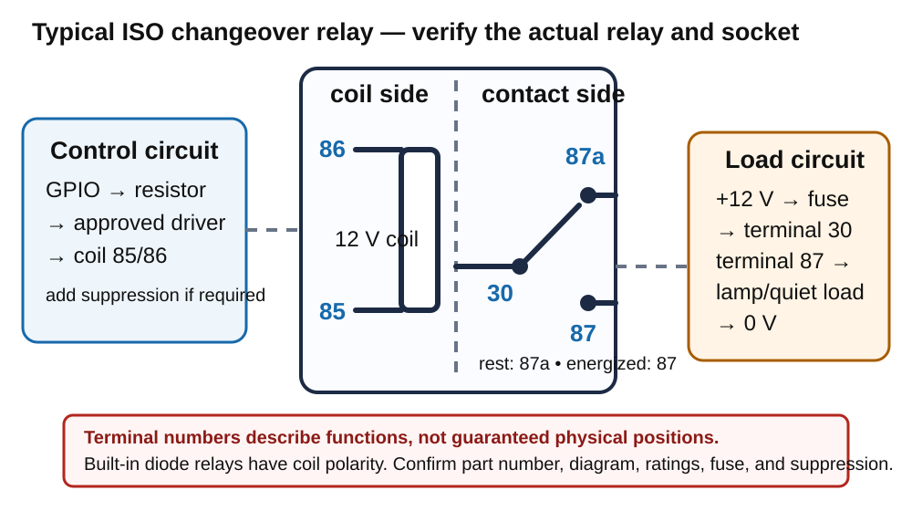
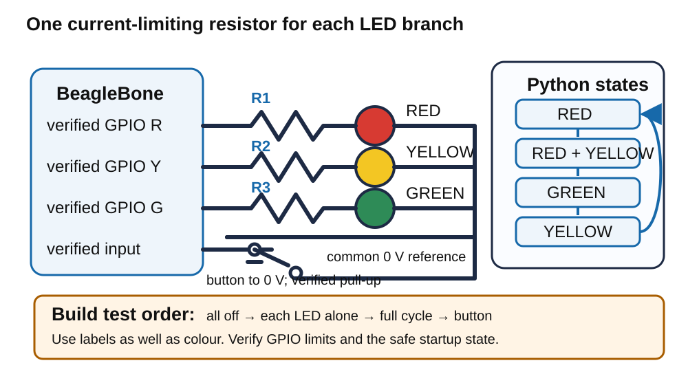

These are **reference patterns**, not permission to energize a circuit. Use the exact board manual and component datasheets for pin numbers, voltage limits, polarity, current, power, and relay terminal layout. The teacher must approve the final schematic and complete a power-off inspection.

# 1. Measure DC voltage across two named points

{width=100%}

**Use this pattern:**

1. Put the black lead in **COM** and the red lead in **V/ohm**.
2. Select **DC voltage** and a safe range.
3. Name both test points before touching the circuit.
4. Connect the probes **across** the component or two nodes. Do not break the circuit.
5. Record the sign, value, unit, range, and circuit state.

For beginner current evidence, calculate current from a measured resistor voltage when practical: $I=V_R/R$. Use the class clamp meter for a suitable conductor/load demonstration. Do not move the red lead into an A or mA jack unless the teacher has approved that specific procedure.

**Source basis:** Fluke’s DC-voltage procedure specifies black in COM, red in V/ohm, and warns that using a current input for voltage measurement can short the circuit. See [Fluke: How to Measure DC Voltage](https://www.fluke.com/en-ph/learn/blog/digital-multimeters/how-to-measure-dc-voltage-with-a-digital-multimeter).



# 2. Automatic night light

{width=100%}

**Student checks:**

- Predict whether $V_{sense}$ rises or falls in darkness for the chosen LDR position.
- Measure the divider supply and $V_{sense}$ in bright and dark conditions.
- Verify the board’s exact ADC or digital-input limit before connecting the divider.
- Keep the light load within GPIO capability or use an approved transistor/MOSFET driver.
- Record the threshold, hysteresis or delay used to stop flicker near the switching point.

**Source basis:** SparkFun’s photocell tutorial uses an LDR and fixed resistor as a voltage divider so a changing resistance becomes a changing voltage. See [SparkFun Photocell Hookup Guide](https://learn.sparkfun.com/tutorials/photocell-hookup-guide/all). Board limits still come from the exact BeagleBoard documentation and datasheet.



# 3. Alarm with switch input and protected output

{width=100%}

**Student checks:**

- Confirm whether the input is active-low or active-high.
- Confirm the pull resistor is enabled or installed; never leave an input floating.
- Test normal, alarm, reset, startup, and shutdown states in Python.
- Use an LED or quiet buzzer as the default output.
- If the output is inductive, add the exact suppression required by its datasheet.

**Source basis:** BeagleBoard’s GPIO tutorial demonstrates a switch to ground with a pull-up so the input has a defined released state. Its output examples use a series resistor with an LED. See [BeagleBoard: Using GPIO](https://docs.beagleboard.org/boards/beagley/ai/demos/using-gpio.html) and [BeagleBone Cookbook: Displays and Other Outputs](https://docs.beagleboard.org/books/beaglebone-cookbook/03displays/displays.html).



# 4. Automotive relay trainer

{width=100%}

**Student checks:**

- Verify the markings and datasheet for the **actual relay and socket**. Do not infer terminal positions from the case shape.
- Treat **85/86** as the coil circuit and **30/87/87a** as a separate contact circuit only after verification.
- Fuse the load circuit near its source and keep it teacher controlled.
- Use an approved transistor/MOSFET or relay interface; a GPIO does not power the coil.
- Check whether the relay contains a diode or resistor. A built-in diode makes coil polarity important.
- Use a lamp or quiet buzzer for student work. A horn remains a shared teacher demonstration.

**Source basis:** TE Connectivity’s Micro ISO relay datasheet identifies ISO pin assignment, coil variants, Form A/Form C contacts, and current ratings. See [TE Connectivity: Micro ISO Automotive Relays](https://www.te.com/content/dam/te-com/documents/automotive/global/ENG_DS_V23074-X0000-A001_0615.pdf). Exact ratings and suppression differ by part number.



# 5. BeagleBone mini traffic light

{width=100%}

**Student checks:**

- Give every LED its own current-limiting resistor.
- Verify the GPIO pins, safe voltage, and allowed current for the exact board.
- Set all outputs to a safe state before starting the timed sequence.
- Test one output at a time before running the complete state machine.
- Record the expected and observed state, time, and output values.
- Add the pedestrian input only after the basic cycle is repeatable.

**Source basis:** The BeagleBone Cookbook demonstrates an external LED with a series resistor and notes the limited GPIO drive current; the GPIO tutorial demonstrates defined button inputs and output control. See the two BeagleBoard references on the previous page.



# 6. Capacitor timing with a horn-safe boundary

{width=100%}

**What the capacitor demonstrates:**

- The control voltage changes over time instead of jumping immediately.
- The time constant is $\tau=RC$.
- During charging, the capacitor reaches about 63% of its final voltage after one time constant and is near its final value after about five time constants.
- A comparator or program threshold converts the changing voltage into an event.
- The driver, relay contacts, fuse, and external supply provide the energy for the load. The capacitor is a timing element, not a horn power source.

Use a lamp or quiet buzzer for repeated student tests. If a horn is demonstrated, the teacher controls energizing, distance, duration, and the quiet equivalent.

**Source basis:** Texas Instruments gives $\tau=RC$, the capacitor charge equation, the 63.2% value at one time constant, and the approximately 99.3% value at five time constants. See [TI Analog Engineer’s Pocket Reference](https://www.ti.com/seclit/eb/slyw038c/slyw038c.pdf). Relay suppression and polarity must follow the exact relay/driver datasheets.

# Reference and reuse note

The six SVG figures in `assessment/diagrams/` are original classroom drawings created for this package. They summarize the cited sources without copying their artwork. Existing course schematics in `site/assets/electronics/schematics/` remain useful for deeper KVL, KCL, RC, component-symbol, and transistor-switch practice.
